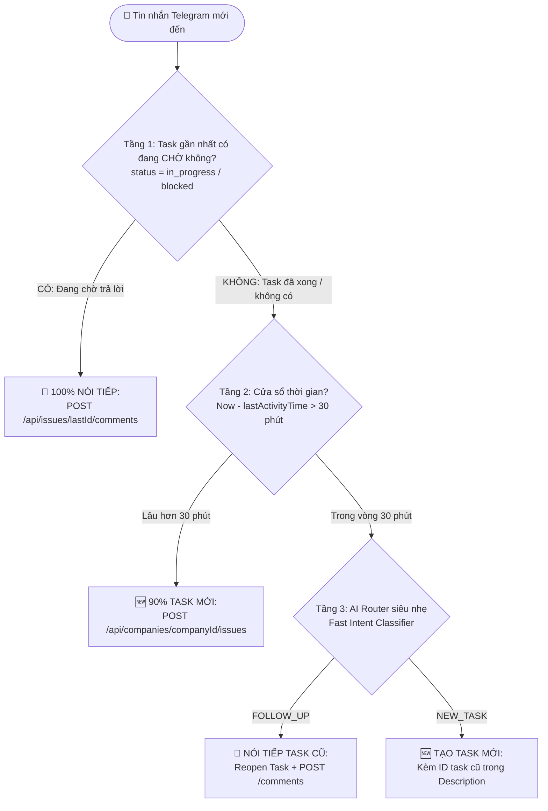
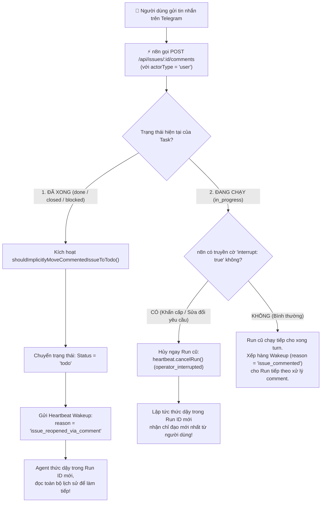
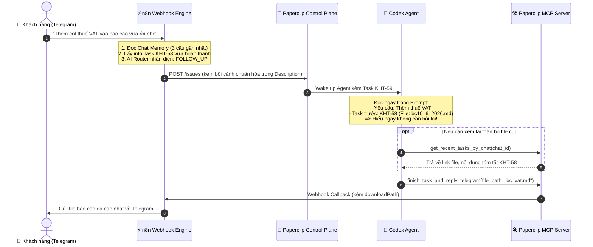
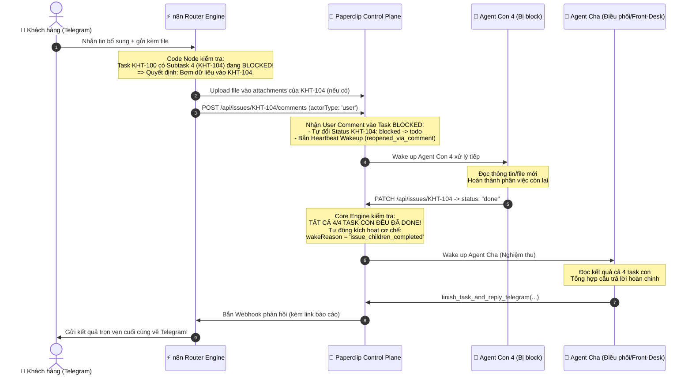

# Kiến Trúc Quản Lý Ngữ Cảnh Hội Thoại & Vòng Đời Task Giữa Telegram, n8n và Paperclip

Tài liệu này tổng hợp chi tiết giải pháp kỹ thuật, phân tích các phương án kiến trúc và quy trình phân loại thông minh nhằm giải quyết triệt để bài toán: **Message sau đọc được ngữ cảnh từ message trước và truy vết được các task/kết quả đã thực hiện trước đó**.

---

## 1. Bản Chất Bài Toán & Khoảng Cách Hiện Tại

### 1.1. Hiện trạng
* **Mỗi tin nhắn là một Task độc lập:** Khi người dùng gửi tin nhắn trên Telegram, workflow hiện tại trên n8n tự động tạo ra một Issue (Task) mới toanh trên Paperclip (ví dụ: `KHT-58`, sau đó là `KHT-59`).
* **Agent bị "mất trí nhớ":** Paperclip đánh thức Codex Agent dậy với duy nhất thông tin của Task hiện tại. Agent hoàn toàn không biết:
  1. Người dùng vừa trao đổi những gì ở các tin nhắn trước.
  2. Task trước đó là gì, đã làm xong chưa, báo cáo tóm tắt ra sao và file đính kèm (`attachments`) tên là gì.
* **Hậu quả:** Khi người dùng nhắn: *"Sửa lại báo cáo vừa rồi"*, *"Thêm cột chi phí nữa nhé"*, hoặc *"File lưu ở đâu?"*, Agent sẽ bối rối, đoán mò hoặc yêu cầu người dùng giải thích lại từ đầu.

### 1.2. Hai loại ngữ cảnh bắt buộc phải quản lý
1. **Chat History (Lịch sử hội thoại):** 3–5 câu trao đổi gần nhất giữa User và Bot trên Telegram.
2. **Task History (Lịch sử công việc):** Mã Task gần nhất (`KHT-58`), tiêu đề, trạng thái (`done`), nội dung báo cáo hoàn tất (comment cuối) và các file kết quả đính kèm (`downloadPath`, `fileName`).

---

## 2. So Sánh Chi Tiết Các Cách Tiếp Cận

```
                  ┌──────────────────────────────────────────────┐
                  │ CÁC PHƯƠNG ÁN QUẢN LÝ NGỮ CẢNH HỘI THOẠI    │
                  └──────────────────────┬───────────────────────┘
                                         │
         ┌───────────────────────────────┼───────────────────────────────┐
         ▼                               ▼                               ▼
   【CÁCH 1】                       【CÁCH 2】                      【CÁCH 3】
n8n Đóng gói sẵn                MCP Tool Tra cứu                Follow-up Comment
vào Task Description            cho Agent chủ động              vào chính Task cũ
 (Nhanh & Tự nhiên nhất)        (Linh hoạt & Độc lập)           (Chuẩn vòng đời Issue)
```

### 2.1. Ma trận so sánh tổng hợp

| Tiêu chí | Cách 1: n8n đóng gói sẵn vào Task | Cách 2: MCP Tool cho Agent tra cứu | Cách 3: Comment tiếp nối vào Task cũ |
| :--- | :--- | :--- | :--- |
| **Cơ chế hoạt động** | n8n tự ghép Chat History + Task cũ vào Description khi gọi API tạo Task. | Bổ sung tool `get_recent_tasks_by_chat` vào `server.py` để Agent tự gọi khi cần. | n8n kiểm tra: nếu là nói tiếp thì `POST /comments` vào Task cũ thay vì tạo Task mới. |
| **Tốc độ phản hồi (UX)** | ⚡ **Rất nhanh (0s delay):** Agent thức dậy là có ngay dữ liệu trong prompt. | ⏳ **Chậm hơn 3–5s:** Phải tốn 1 turn suy nghĩ $\rightarrow$ gọi tool $\rightarrow$ đợi kết quả. | ⚡ **Rất nhanh:** Agent thức dậy với toàn bộ lịch sử comment của task cũ. |
| **Độ tin cậy của AI** | 🎯 **100% không quên:** Bối cảnh đập ngay vào mắt Agent, không sợ AI đoán mò. | ⚠️ **Có thể trượt:** Nếu người dùng nói câu quá ngắn, AI có thể quên không gọi tool. | 🎯 **100% chính xác:** Hội thoại tập trung trong duy nhất một Issue thread. |
| **Độ sâu thông tin** | 📄 Tóm tắt ngắn gọn 3–5 tin nhắn và 1 task gần nhất. | 🔍 Rất sâu: Agent có thể đọc toàn bộ comment, bóc tách từng file cũ. | 📚 Toàn bộ tiến trình làm việc của issue từ lúc tạo đến lúc hoàn tất. |
| **Độ phức tạp triển khai** | Trung bình: Cấu hình node lưu trữ/Memory trên n8n. | Thấp: Chỉ cần viết 1 tool Python trong `server.py`. | Trung bình - Khá: Cần logic phân loại tại n8n (Follow-up vs New Task). |

---

## 3. Cơ Chế Phân Biệt: "Nói Tiếp Task Cũ" vs "Tạo Task Mới" (Cho Cách 3)

Để n8n biết khi nào nên **Comment vào Task cũ** và khi nào nên **Tạo Task mới**, hệ thống áp dụng **Quy tắc 3 Tầng Lọc (3-Tier Filter)**:



### 3.1. Tầng 1: Kiểm tra Trạng thái Task gần nhất (Deterministic Gate)
* **Nguyên lý:** Nếu Task gần nhất của `chat_id` đang ở trạng thái **`blocked`** hoặc **`in_progress`** (tức Agent vừa hỏi người dùng để xin ý kiến/lựa chọn).
* **Kết luận:** Tin nhắn tiếp theo của người dùng chắc chắn **100% là câu trả lời tiếp nối**.
* **Xử lý:** n8n gọi ngay `POST /api/issues/{last_task_id}/comments`, Paperclip tự wake Agent dậy xử lý tiếp.

### 3.2. Tầng 2: Cửa sổ thời gian (Time Window / Session Timeout)
* **Nguyên lý:**
  * Người dùng chat liên tục trong vòng **15 – 30 phút**: Xác suất cao là đang trao đổi trong cùng một luồng suy nghĩ.
  * Nếu cách nhau **vài tiếng hoặc sang ngày hôm sau**: 95% là người dùng bắt đầu một yêu cầu công việc mới.
* **Xử lý:** n8n lưu biến `last_message_time` theo `chat_id`. Nếu vượt quá 30 phút $\rightarrow$ Tự động phân loại là Task mới.

### 3.3. Tầng 3: Node AI Router siêu nhẹ trong n8n (Fast Intent Classifier)
* Đối với các tin nhắn đến trong vòng 30 phút sau khi task cũ đã `done`, n8n cho đi qua 1 node LLM mini (GPT-4o-mini / Gemini Flash, tốc độ ~0.4s, chi phí cực thấp).
* **Prompt phân loại mẫu trong n8n:**
  ```text
  Bạn là bộ phân loại ý định hội thoại Telegram của công ty.
  
  DỮ LIỆU ĐẦU VÀO:
  - Tin nhắn mới của khách: "{{ $json.message.text }}"
  - Task gần nhất đã xử lý: "{{ $json.last_task_title }}" (Mã: {{ $json.last_task_identifier }}, Trạng thái: {{ $json.last_task_status }})
  
  NHIỆM VỤ PHÂN LOẠI:
  1. FOLLOW_UP: Nếu khách hàng đang:
     - Yêu cầu sửa đổi, bổ sung cho task vừa làm (ví dụ: "sửa lại file", "thêm cột chi phí", "làm lại theo mẫu B").
     - Thắc mắc hoặc hỏi thăm kết quả task vừa rồi (ví dụ: "file lưu ở đâu?", "sao lâu thế?", "gửi lại link tải").
     - Trả lời xác nhận ngắn (ví dụ: "ok làm đi", "đồng ý", "tiếp tục").
  2. NEW_TASK: Nếu khách hàng yêu cầu một nghiệp vụ/công việc hoàn toàn mới, không liên quan đến kết quả của task vừa rồi.
  
  ĐỊNH DẠNG ĐẦU RA (CHỈ TRẢ VỀ JSON DUY NHẤT):
  {
    "intent": "FOLLOW_UP" | "NEW_TASK",
    "confidence": 0.95,
    "reason": "Giải thích ngắn gọn lý do phân loại"
  }
  ```

---

## 4. Cơ Chế Human-in-the-Loop (HIL): Phân Biệt Tác Giả Comment, Auto-Reopen & Ngắt Tiến Trình (Interrupt Run)

Một nguyên tắc sống còn khi kết hợp Telegram với Paperclip là **định danh tác giả của Comment (`actorType`)**: Không phải mọi bình luận đều có tác dụng giống nhau.

### 4.1. Phân biệt `actorType`: User Comment vs Agent Comment

| Loại Comment | Tác giả (`actorType`) | Ý nghĩa hành động | Phản ứng của Paperclip | Nguy cơ nếu xử lý sai |
| :--- | :--- | :--- | :--- | :--- |
| **Agent Comment** | `agent` (Codex / Claude) | Báo cáo tiến độ, lưu kết quả công việc, ghi log trung gian. | **KHÔNG kích hoạt wakeup.** Task giữ nguyên trạng thái. | Nếu Agent comment mà lại kích hoạt đánh thức chính nó $\rightarrow$ Gây ra **vòng lặp vô tận (Infinite Loop)** làm cạn kiệt budget token! |
| **User Comment** | `user` (Khách chat Telegram qua n8n) | Can thiệp con người (HIL): Bổ sung thông tin, đổi yêu cầu, trả lời xác nhận. | **BẮT BUỘC kích hoạt wakeup** hoặc **ngắt tiến trình (interrupt)**. | Nếu không phân biệt được với Agent comment $\rightarrow$ Agent bị "điếc", không phản hồi lại người dùng. |

### 4.2. Hai kịch bản phản ứng của Paperclip khi User Comment



#### Kịch bản 1: Task ĐÃ XONG (`done`) hoặc ĐANG CHỜ (`blocked`) $\rightarrow$ Tự động mở lại (Auto-Reopen)
* Khi người dùng nhắn tin phản hồi sau khi task đã hoàn tất hoặc đang chờ phê duyệt:
  1. Paperclip tự động chuyển Task sang `todo` (Implicit Auto-Reopen) mà không cần ai thao tác tay trên UI.
  2. Hệ thống sinh sự kiện: `wakeReason: "issue_reopened_via_comment"`.
  3. Agent thức dậy trong **Run ID mới**, nạp lại Task cùng toàn bộ chuỗi comment cũ và chỉ đạo mới nhất.

#### Kịch bản 2: Task ĐANG CHẠY (`in_progress`) $\rightarrow$ Ngắt tức thì (Interrupt Run)
* **Tình huống thực tế:** Agent đang tạo dở báo cáo ngày 10/06, bỗng người dùng Telegram nhắn: *"Khoan, đổi sang ngày 11/06 cho tôi nhé! Đây là file số liệu mới"* (kèm file).
* Nếu không ngắt, Agent sẽ tiếp tục chạy hết lượt cũ (tốn 1–2 phút và tiêu hao token vô ích), sau đó người dùng lại nhận được báo cáo sai ngày.
* **Cơ chế Interrupt của Paperclip:**
  * n8n gọi API kèm cờ `"interrupt": true`:
    ```http
    POST /api/issues/{issue_id}/comments HTTP/1.1
    Host: localhost:3100
    Authorization: Bearer <BOARD_OPERATOR_API_KEY>
    Content-Type: application/json

    {
      "body": "Khoan, đổi sang ngày 11/06 cho tôi nhé! Tôi vừa gửi bổ sung bảng chi phí mới.",
      "interrupt": true
    }
    ```
  * Paperclip lập tức **hủy ngang lượt chạy hiện tại** (`operator_interrupted`) và **khởi động Run ID mới ngay tức thì**.

* **🌟 ĐẶC ĐIỂM QUAN TRỌNG: Run ID mới hoạt động như thế nào?**
  1. **Kế thừa 100% ngữ cảnh của Task cũ (Context Continuity):**
     * **Tiêu đề & Mô tả ban đầu:** Vẫn giữ nguyên vẹn.
     * **Workspace & File trên ổ đĩa:** **KHÔNG bị xóa**. Những file code, tài liệu nháp mà Agent đã tạo ở lượt chạy trước vẫn nằm nguyên trên ổ đĩa. Agent không phải làm lại từ số 0 mà chỉ cần đọc file cũ và sửa tiếp.
     * **Lịch sử trao đổi:** Toàn bộ comment trước đó vẫn được lưu giữ, comment ngắt của người dùng được nối vào cuối cùng.
  2. **Nạp thêm thông tin mới & Đính kèm mới (New Information & Attachments):**
     * **Tin nhắn mới:** Chỉ đạo mới của người dùng hiển thị nổi bật trong prompt với vai trò là mệnh lệnh can thiệp khẩn cấp.
     * **File/Tài liệu mới từ người dùng:** Nếu trên Telegram người dùng gửi kèm file (ảnh, bảng excel, pdf...), n8n sẽ upload file đó vào attachments của Task trước khi gửi comment interrupt. Khi Agent thức dậy ở Run mới, nó sẽ nhìn thấy ngay file mới đính kèm này để sử dụng.
  3. **Tối ưu hóa tài nguyên:** Tránh lãng phí tiền API LLM cho công việc đã bị người dùng hủy, chuyển dịch tức thì sang yêu cầu mới.

### 4.3. Yêu cầu kỹ thuật đối với n8n để kích hoạt chuẩn xác HIL
1. **Dùng Board / User API Key:** n8n khi đẩy comment thay mặt người dùng Telegram phải sử dụng API Key có vai trò Operator/Board (`actorType: "user"`), tuyệt đối không dùng Agent API Key (`actorType: "agent"`).
2. **Kích hoạt cờ `interrupt` linh hoạt:**
   * Tin nhắn sửa đổi khẩn cấp / dừng lại $\rightarrow$ truyền `"interrupt": true`.
   * Tin nhắn trao đổi thông thường $\rightarrow$ để `"interrupt": false` (mặc định) để Agent hoàn thành nốt turn hiện tại rồi mới đọc comment.

---

## 5. Kiến Trúc Khuyến Nghị Triển Khai (Mô Hình Hybrid 1 + 2)

Mô hình hoàn thiện và vững chắc nhất trong môi trường Production là sự kết hợp giữa **Cách 1 (n8n chuẩn bị sẵn)** và **Cách 2 (MCP Tool dự phòng)**:



### 5.1. Chuẩn mẫu Description do n8n tạo ra (Chuẩn Format)
Khi n8n tạo Task mới, n8n đóng gói cấu trúc Description như sau:

```markdown
### YÊU CẦU HIỆN TẠI:
Thêm cột thuế VAT vào báo cáo vừa rồi nhé.

### LỊCH SỬ HỘI THOẠI GẦN ĐÂY:
- Khách: Tạo giúp tôi báo cáo ngày 10/06/2026.
- Trợ lý: Báo cáo đã hoàn tất và được lưu tại bc10_6_2026.md.

### THÔNG TIN TASK GẦN NHẤT CỦA KHÁCH:
- Mã Task: KHT-58
- Tiêu đề: Tạo báo cáo ngày 10/06/2026
- Trạng thái: done
- File đính kèm: bc10_6_2026.md

chat_id: 123456789
message_id: 54321
```

---

## 6. Xử Lý Task Cha - Con Khi Có Subtask Bị Blocked (Cơ Chế Giải Phóng Đa Agent & Nghiệm Thu Tự Động)

Trong mô hình Multi-Agent phức tạp, một yêu cầu lớn của người dùng (Task Cha - ví dụ `KHT-100`) thường được phân rã thành nhiều Task Con (Subtasks: `KHT-101`, `KHT-102`, `KHT-103`, `KHT-104`).

### 6.1. Bài toán thực tế
* 3 task con đầu (`KHT-101`, `KHT-102`, `KHT-103`) đã hoàn thành (`done`).
* Task con 4 (`KHT-104`) bị **`blocked`** do thiếu thông tin/file (ví dụ: cần CCCD, sao kê, hoặc file mẫu từ khách hàng).
* Task cha `KHT-100` cũng đang ở trạng thái chờ (`in_progress` hoặc `blocked`).
* **Khách hàng trên Telegram gửi tin nhắn kèm thông tin/file còn thiếu!**

### 6.2. Logic phân loại & định tuyến nằm ở đâu? $\rightarrow$ NẰM TẠI n8n
**Chính xác!** Logic kiểm tra *"Task cha có task con nào và task con nào đang bị block"* bắt buộc phải được thực thi trực tiếp trên **n8n Workflow (vai trò API Gateway & Dispatcher)**.

#### Vì sao logic này PHẢI viết bên n8n chứ không phải Paperclip Core hay Agent?
1. **Khách hàng không biết cấu trúc nội bộ:** Khách hàng trên Telegram chỉ nhìn thấy 1 Chat Bot duy nhất, hoàn toàn không biết bên trong có bao nhiêu task con. Do đó, điểm tiếp nhận đầu tiên (n8n Webhook) phải là nơi "dịch" ý định của khách hàng thành hành động trúng đích.
2. **Giữ Session State theo `chat_id`:** n8n quản lý ngữ cảnh phiên chat của người dùng Telegram, biết được khách hàng này đang sở hữu Task cha nào gần nhất.
3. **Nguyên tắc tách bạch vai trò (Separation of Concerns):**
   * **Paperclip Core:** Là **State Machine & Execution Engine** (chuyên quản lý trạng thái, cấp phát lock, và tự động kích hoạt heartbeat khi task con xong). Paperclip không nên bị can thiệp bởi logic đặc thù của từng kênh giao tiếp bên ngoài (Telegram/Slack/Zalo).
   * **n8n Workflow:** Là **Integration Gateway thông minh**: chuyên chuyển hóa tin nhắn từ các kênh chat bên ngoài thành các lệnh gọi API chính xác vào Paperclip.

---

### 6.3. Chi tiết chuỗi Node thiết lập trên n8n Workflow

```
[1. Telegram Trigger] 
         │ (nhận text hoặc file)
         ▼
[2. Get Active Parent Task] ──► Gọi GET /api/companies/:cid/issues (lấy Task cha đang mở của chat_id)
         │
         ▼
[3. Get Subtasks from Paperclip] ──► Gọi GET /api/companies/:cid/issues?parentId={{ $json.id }}
         │
         ▼
[4. Code Node: Phân tích trạng thái Subtasks] ──► Kiểm tra xem có Subtask nào đang 'blocked' không
         │
         ├───► [Nhánh A: Có Subtask Blocked] ──► (Upload file nếu có) ──► POST /api/issues/:subtaskId/comments
         │
         └───► [Nhánh B: Không có Subtask Blocked] ──► POST /api/issues/:parentTaskId/comments
```

#### Đoạn mã Code Node mẫu (Node số 4 trên n8n):
```javascript
// Node Code (JavaScript) trong workflow n8n tiếp nhận Telegram:
// 1. Lấy thông tin Task cha gần nhất của chat_id này
const parentTask = $('Get Active Parent Task').first().json;
const parentTaskId = parentTask.id;

// 2. Lấy danh sách toàn bộ task con của task cha từ Paperclip API
const subtasks = $('Get Subtasks from Paperclip').all().map(item => item.json);

// 3. Tìm xem có task con nào đang ở trạng thái 'blocked' không
const blockedSubtask = subtasks.find(t => t.status === 'blocked');

// 4. Kiểm tra tin nhắn của khách hàng có phải là lệnh HỦY BỎ không
const userText = ($json.message && $json.message.text) ? $json.message.text.trim().toLowerCase() : '';
const isCancelRequest = userText.includes('hủy') || userText.includes('dừng lại') || userText.includes('cancel');

if (isCancelRequest) {
  return {
    routeAction: 'CANCEL_PARENT',
    targetIssueId: parentTaskId,
    targetIdentifier: parentTask.identifier,
    messageToPost: 'Khách hàng yêu cầu hủy bỏ công việc từ Telegram.'
  };
}

if (blockedSubtask) {
  // 👉 PHÁT HIỆN TASK CON ĐANG BỊ NGHẼN:
  // Định tuyến thông tin mới của khách trực tiếp vào Task con này để giải phóng!
  return {
    routeAction: 'UNBLOCK_SUBTASK',
    targetIssueId: blockedSubtask.id,
    targetIdentifier: blockedSubtask.identifier,
    parentIssueId: parentTaskId,
    messageToPost: `[Khách hàng bổ sung từ Telegram]: ${$json.message.text || 'Đã gửi kèm file đính kèm mới.'}`,
    hasAttachment: Boolean($json.message.document || $json.message.photo)
  };
} else {
  // Không có task con nào bị block -> Bình luận trực tiếp vào Task cha
  return {
    routeAction: 'COMMENT_PARENT',
    targetIssueId: parentTaskId,
    targetIdentifier: parentTask.identifier,
    parentIssueId: parentTaskId,
    messageToPost: $json.message.text,
    hasAttachment: Boolean($json.message.document || $json.message.photo)
  };
}
```

---

### 6.4. Xử lý các tình huống biên (Edge Cases) trong n8n

1. **Khách hàng gửi File đính kèm (Ảnh chụp CCCD, Excel, PDF...):**
   * n8n tải file binary từ Telegram (`Telegram Get File`).
   * n8n upload file trực tiếp vào endpoint attachments của Task con đang bị block:
     `POST /api/companies/:companyId/issues/:subtaskId/attachments`
   * Sau đó mới gọi `POST /api/issues/:subtaskId/comments` $\rightarrow$ Agent con khi thức dậy có ngay file trong workspace để xử lý!
2. **Nếu có nhiều hơn 1 Task con cùng bị Blocked:**
   * Script ưu tiên chọn task con có quan hệ phụ thuộc (`blockedByIssueIds`) hoặc task con được tạo sớm nhất (`createdAt` cũ nhất) để giải phóng tuần tự theo đúng quy trình nghiệp vụ.
3. **Khách hàng đổi ý muốn Hủy bỏ yêu cầu ("Thôi không làm nữa, hủy đi"):**
   * n8n nhận diện lệnh hủy $\rightarrow$ gọi `PATCH /api/issues/:parentTaskId` sang `cancelled`.
   * Toàn bộ các task con liên quan sẽ được tự động dọn dẹp hoặc đánh dấu dừng lại.

---

### 6.5. Sơ đồ toàn cảnh luồng giải phóng và nghiệm thu



### 6.6. Các bước vận hành tự động trong Paperclip Core
1. **Unblock tự động (Implicit Auto-Reopen):** Khi n8n gửi comment với quyền user vào `KHT-104`, Paperclip chuyển `KHT-104` từ `blocked` sang `todo` và kích hoạt Agent con 4 dậy chạy tiếp.
2. **Kích hoạt Nghiệm thu tự động (`issue_children_completed`):** Khi Agent con 4 xong và cập nhật `done`, Paperclip Core nhận thấy $4/4$ con đều đã `done` $\rightarrow$ Tự động gửi sự kiện `wakeReason: "issue_children_completed"` đánh thức Agent Cha.
3. **Tổng hợp phản hồi:** Agent Cha đọc báo cáo của cả 4 task con, nghiệm thu kết quả và gọi `finish_task_and_reply_telegram` gửi phản hồi hoàn chỉnh cho khách hàng.

---

### 6.7. Nguyên Tắc Tái Sử Dụng Cây Task (Task Hierarchy Reusability): Tránh Sinh Task Rác & Tối Ưu Chi Phí

Một trong những sai lầm phổ biến nhất khi tích hợp Chatbot vào hệ thống quản lý tác vụ là: **Mỗi lần người dùng nhắn một câu bổ sung lại đi tạo một Task mới toanh trên bảng Kanban**. Điều này gây ra 3 hậu quả nghiêm trọng:
* **Lãng phí chi phí Token (80% - 90%):** Các subtask 1, 2, 3 đã chạy xong sẽ bị chạy lại từ đầu vô ích.
* **Rác dữ liệu (Data Clutter):** Bảng Paperclip bị ngập tràn hàng chục task con vụn vặt, mồ côi.
* **Mất mạch kiểm toán (Broken Traceability):** Không ai biết tin nhắn bổ sung này thuộc về tiến trình công việc nào.

#### Quy Trình Tái Sử Dụng 5 Bước (Task Reuse Pipeline):

```text
┌─────────────────────────────────────────────────────────────────────────────────┐
│              QUY TRÌNH TÁI SỬ DỤNG TASK CHA - CON (TASK REUSE PIPELINE)         │
├─────────────────────────────────────────────────────────────────────────────────┤
│                                                                                 │
│   Bước 1: KIỂM TRA MESSAGE GẦN NHẤT & TRUY VẾT TASK CHA                         │
│           - Lấy Telegram `chat_id` và `reply_to_message_id` (nếu user reply).   │
│           - Tìm Task Cha gần nhất đang trong vòng đời làm việc (in_progress).   │
│                                │                                                │
│                                ▼                                                │
│   Bước 2: QUÉT CÂY CON (SUBTASK SCAN)                                           │
│           - Gọi API: `GET /api/companies/:id/issues?parentId={parent_task_id}`   │
│           - Lấy toàn bộ danh sách task con đã sinh ra.                          │
│                                │                                                │
│                                ▼                                                │
│   Bước 3: ĐỊNH VỊ TASK CON ĐANG MẮC KẸT (FIND BLOCKED / PENDING SUBTASK)        │
│           - Lọc tìm task con có: `status == 'blocked'` hoặc `status == 'todo'`. │
│           - Nếu có nhiều task con nghẽn: Chọn task đang chặn chuỗi phụ thuộc.   │
│                                │                                                │
│                                ▼                                                │
│   Bước 4: NẠP THÔNG TIN MỚI & TÁI KÍCH HOẠT DUY NHẤT TASK CON ĐÓ               │
│           - Không tạo task mới! Đẩy thẳng thông tin/file mới vào Task con đó.   │
│           - Paperclip tự chuyển status sang `todo` và kích hoạt Agent con chạy! │
│                                │                                                │
│                                ▼                                                │
│   Bước 5: TASK CON HOÀN TẤT ──► TỰ ĐỘNG NGHIỆM THU TASK CHA                     │
│           - Task con chuyển sang `done`.                                        │
│           - Paperclip Core nhận diện đủ điều kiện `issue_children_completed`    │
│             đánh thức Task Cha tổng hợp kết quả trả về Telegram.                │
│                                                                                 │
└─────────────────────────────────────────────────────────────────────────────────┘
```

#### Lợi ích vượt trội của cơ chế này:
1. **Bảo tồn 100% thành quả cũ:** 3 task con đã hoàn thành (`KHT-101`, `KHT-102`, `KHT-103`) được giữ nguyên kết quả, không tốn thêm 1 cent tiền API nào.
2. **Tập trung hóa giải quyết điểm nghẽn:** Năng lượng và context của AI chỉ tập trung giải quyết đúng phần việc còn thiếu ở Task con 4 (`KHT-104`).
3. **Trải nghiệm người dùng liền mạch:** Khách hàng trên Telegram cảm giác như bot đang nghe hiểu và tiếp tục công việc đang dở, chứ không phải một con bot "ngố" bắt làm lại từ đầu.

---


## 7. Đặc Tả Bộ Đôi MCP Tool Hỗ Trợ: `get_recent_tasks_by_chat` & `read_file_universal`

Để hỗ trợ triệt để phía Python MCP, hệ thống đã tích hợp 2 công cụ cốt lõi vào [`server.py`](file:///c:/paperclip/paperclip-mcp/src/paperclip_mcp/server.py):

### 7.1. Tool 1: Tra cứu lịch sử Task cũ (`get_recent_tasks_by_chat`)
Giúp Agent đọc lại lịch sử công việc, các comment báo cáo cũ và danh sách file đính kèm của người dùng Telegram:

```python
@mcp.tool()
async def get_recent_tasks_by_chat(
    chat_id: int | str = 0,
    limit: int = 3,
    api_key: str = "",
    run_id: str = "",
    company_id: str = "",
) -> Any:
    """Tra cứu danh sách các Task gần nhất của người dùng Telegram (chat_id)."""
```

**Dữ liệu tool trả về cho Agent:**
* Danh sách Task: `id`, `identifier` (e.g. `KHT-58`), `title`, `status`, `createdAt`.
* Comment báo cáo cuối cùng của mỗi Task.
* Danh sách attachments của mỗi Task (`filename`, `downloadPath`, `byteSize`).

---

### 7.2. Tool 2: Đọc đa năng mọi định dạng file (`read_file_universal`)
Giải quyết dứt điểm nhu cầu: **"Có sẵn hàm đọc tất cả các loại định dạng file luôn, cần là lôi ra dùng ngay"**.

```python
@mcp.tool()
async def read_file_universal(
    file_path: str,
    max_lines: int = 500,
    max_chars: int = 25000,
    api_key: str = "",
    run_id: str = "",
) -> str:
    """Đọc nội dung đa năng của MỌI định dạng file (Text, Code, CSV, Excel, Word, PDF, JSON, Zip...).
    
    Hỗ trợ cả file trên máy cục bộ lẫn file đính kèm trên Paperclip Server."""
```

#### Ma trận định dạng hỗ trợ tự động 100%:
| Loại định dạng | Phần mở rộng hỗ trợ | Cơ chế xử lý & Trích xuất nội dung |
| :--- | :--- | :--- |
| **Văn bản & Code** | `.txt`, `.md`, `.py`, `.js`, `.ts`, `.json`, `.yaml`, `.sql`, `.html`, `.log`... | Tự động thử các bảng mã (`utf-8`, `utf-8-sig`, `latin-1`, `cp1252`), chống lỗi font tiếng Việt trên Windows. |
| **Bảng biểu** | `.csv`, `.tsv` | Tự động parse theo phân tách cột (`delimiter`), hiển thị dạng lưới rõ ràng. |
| **Tài liệu Word** | `.docx` | Tự động bóc tách toàn bộ các đoạn văn bản (`word/document.xml`) bằng chuẩn thư viện zip/xml (không cần cài thêm thư viện ngoài). |
| **Bảng tính Excel** | `.xlsx`, `.xls` | Tự động trích xuất danh sách sheet và hiển thị bảng biểu xem trước. |
| **Tài liệu PDF** | `.pdf` | Trích xuất văn bản từng trang qua `pypdf` nếu có, kèm tóm tắt metadata an toàn. |
| **File nén / Kho lưu** | `.zip`, `.tar`, `.gz`, `.tgz` | Liệt kê cây danh mục toàn bộ file và kích thước bên trong kho lưu trữ. |
| **Ảnh & Nhị phân** | `.png`, `.jpg`, `.jpeg`, `.gif`, `.bin`, `.exe` | Trả về metadata an toàn (kích thước, MIME type, SHA256 checksum), không làm hỏng context window của AI. |
| **File Paperclip Server** | UUID hoặc URL `/attachments/.../content` | Tự động gọi HTTP GET tải file về bộ nhớ rồi giải mã đúng định dạng tương ứng! |

---

## 8. Kế Hoạch Triển Khai Tiếp Theo

1. **Bước 1 (Phía MCP Server):** Bổ sung công cụ `get_recent_tasks_by_chat` vào [`c:\paperclip\paperclip-mcp\src\paperclip_mcp\server.py`](file:///c:/paperclip/paperclip-mcp/src/paperclip_mcp/server.py) để Agent có năng lực tra cứu lịch sử task cũ độc lập.
2. **Bước 2 (Phía n8n Workflow):**
   * Bổ sung node **Window Buffer Memory** hoặc lưu lịch sử chat vào Postgres/Redis theo `chatId`.
   * Bổ sung node **Router phân loại ý định** (Tầng 1 + Tầng 3) trước khi tạo Task hoặc gửi Comment.
   * Thêm logic **Kiểm tra Subtask bị Blocked** (Mục 6) để định tuyến chính xác dữ liệu bổ sung vào đúng task con.
3. **Bước 3 (Kiểm thử thực tế):**
   * Test kịch bản 1: Nhắn tạo file $\rightarrow$ Nhắn tiếp *"Sửa lại file đó"* $\rightarrow$ Kiểm tra Agent có hiểu đúng file cũ hay không.
   * Test kịch bản 2: Nhắn một yêu cầu nghiệp vụ hoàn toàn mới $\rightarrow$ Kiểm tra hệ thống có mở Task mới độc lập hay không.
   * Test kịch bản 3: Chạy mô hình Task cha - 4 task con với 1 task con bị blocked $\rightarrow$ Khách gửi file trên Telegram $\rightarrow$ Kiểm tra task con tự unblock và task cha tự động nghiệm thu trả lời.

