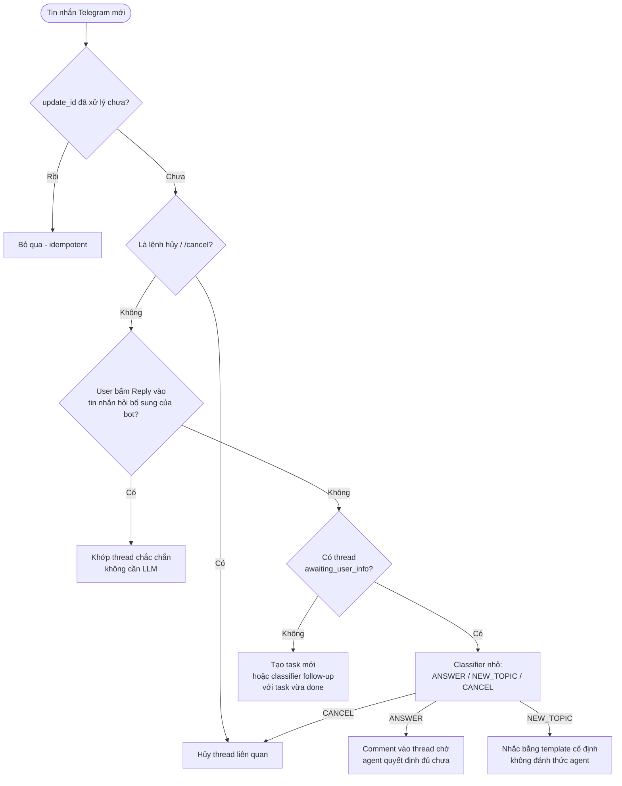

# Phân Tích: Quản Lý State Hội Thoại Telegram Khi Task Chờ Duyệt (HIL) Và Khi Cần User Bổ Sung Thông Tin

> Tài liệu này là **bản phân tích**, chưa phải thiết kế chốt và chưa có thay đổi code nào đi kèm.
> Liên quan: [kien_truc_quan_ly_ngu_canh_hoi_thoai_va_task_telegram_n8n_paperclip.md](./kien_truc_quan_ly_ngu_canh_hoi_thoai_va_task_telegram_n8n_paperclip.md) (đặc biệt mục 3.1 Tầng 1 và mục 6).

---

## 1. Yêu Cầu Nghiệp Vụ Đang Muốn Làm

Luồng: Telegram (user thật) ⇄ n8n (gateway) ⇄ Paperclip (agent xử lý logic phía sau). Agent có thể chạy **nhiều task đồng thời**.

Có hai tình huống:

1. **Task bị treo chờ cấp trên phê duyệt (Human-in-the-loop của nhiều người).**
   - Bot nhắn user: "task này đang chờ cấp trên phê duyệt, vui lòng đợi".
   - Sau đó user **được phép** hỏi tiếp các câu hỏi khác.
2. **Câu hỏi của user thiếu ngữ cảnh.**
   - Hệ thống nhắn user yêu cầu bổ sung thông tin còn thiếu.
   - Các message sau của user được phân tích: có phải thông tin bổ sung cho yêu cầu kia không?
   - Nếu không: nhắc nhở tiếp. Đến khi bổ sung đủ mới thôi.
   - **Không cho** hỏi chủ đề mới trong lúc đó.

---

## 2. Kết Luận Ngắn

- Hướng đi **đúng**, giải quyết được cả hai tình huống.
- Nhưng thiết kế hiện có đang **gộp hai kiểu "chờ" khác bản chất làm một**, và tài liệu kiến trúc hiện tại xử lý chúng theo hướng ngược với ý muốn.
- Bốn điểm cần chỉnh:
  1. Tách hai kiểu chờ, không dựa vào status `blocked` của Paperclip để định tuyến.
  2. Bỏ mô hình "task gần nhất", thay bằng tập thread theo `chat_id`.
  3. Khóa cứng ở tình huống bổ sung thông tin cần có lối thoát.
  4. Xử lý race condition vì có nhiều execution n8n chạy đồng thời.

---

## 3. Hai Kiểu "Chờ" Khác Nhau

| | **Kiểu A: chờ người khác duyệt** | **Kiểu B: chờ user bổ sung** |
|---|---|---|
| Ai đang được chờ | Cấp trên / bên thứ ba | Chính user |
| Tin nhắn mới của user | Là chủ đề mới (được phép) | Phải là câu trả lời, nếu không thì nhắc |
| Chat có bị khóa không | Không | Có (theo ý bạn) |
| Status Paperclip | `blocked` | `blocked` |

Cả hai đều là `blocked` trên Paperclip, nên **chỉ nhìn status thì không phân biệt được**.

### 3.1. Mâu thuẫn với tài liệu hiện có

[Tầng 1 trong tài liệu kiến trúc](./kien_truc_quan_ly_ngu_canh_hoi_thoai_va_task_telegram_n8n_paperclip.md) quy định:

> Nếu Task gần nhất của `chat_id` ở trạng thái `blocked` hoặc `in_progress` → tin nhắn tiếp theo chắc chắn 100% là câu trả lời tiếp nối.

- Với **kiểu B**: đúng.
- Với **kiểu A**: **sai**. Câu hỏi mới của user sẽ bị comment nhầm vào task đang chờ duyệt, agent bị đánh thức vô ích, user không được trả lời đúng.

→ Cần một **state hội thoại do n8n giữ** (ví dụ `awaiting_approval` và `awaiting_user_info`), không suy từ status Paperclip.

---

## 4. Đa Task Đồng Thời Làm Hỏng Mô Hình "Task Gần Nhất"

Workflow n8n hiện tại có node "Kiểm tra status của task gần nhất của message" rồi IF "Task cũ hay mới?". Khi một chat có nhiều task chạy song song thì "gần nhất" không còn đúng nghĩa.

Cần đổi thành **tập các thread theo `chat_id`**, mỗi thread có state riêng.

Quy tắc **"tại một thời điểm chỉ một thread được ở trạng thái `awaiting_user_info`"** của bạn rất có lợi: nó làm việc định tuyến không còn mơ hồ. Nếu đang có thread như vậy, tin nhắn tiếp theo chỉ cần trả lời câu hỏi "có phải câu trả lời của thread đó không".

### 4.1. Thứ tự định tuyến đề xuất (rẻ → đắt)

---

## 5. Khóa Cứng Ở Kiểu B: Rủi Ro Và Cách Giảm

Khóa cứng "không cho hỏi chủ đề mới đến khi bổ sung đủ" có ba nguy cơ:

| Nguy cơ | Mô tả |
|---|---|
| User bị kẹt | Bot hiểu sai yêu cầu ban đầu, user không thể thoát ra |
| Classifier nhầm | Câu trả lời cụt ("ngày 11", "ok") bị coi là chủ đề mới → bị nhắc mãi |
| User bỏ đi rồi quay lại | Sau vài giờ chat vẫn bị khóa |

Đề xuất giữ ý tưởng nhưng thêm lối thoát:

- **Giới hạn số lần nhắc** (ví dụ 2 lần), sau đó hỏi: "Bạn muốn hủy yêu cầu cũ để hỏi vấn đề mới không?".
- **TTL** (ví dụ 30–60 phút): hết hạn thì tự chuyển thread sang `cancelled` hoặc `parked`.
- **Lệnh hủy rõ ràng** (`/cancel`, "hủy").
- **Khóa chỉ áp cho thread đang hỏi bổ sung.** Các task khác đang chạy hoặc chờ duyệt vẫn chạy và vẫn trả kết quả bình thường.

---

## 6. Ai Quyết Định "Đã Đủ Thông Tin"

| Thành phần | Trách nhiệm |
|---|---|
| **n8n** | Chỉ quyết định tin nhắn **có thuộc thread đang chờ hay không** (định tuyến) |
| **Agent trên Paperclip** | Quyết định **thông tin đã đủ chưa**. Nếu chưa thì tiếp tục hỏi |

- Đúng với nguyên tắc tách vai trò trong tài liệu kiến trúc (mục 6.2): Paperclip lo logic nghiệp vụ, n8n là gateway định tuyến.
- Tránh sao chép logic "thiếu gì" sang n8n.

Hệ quả thiết kế:

- Khi hỏi bổ sung, agent nên trả về **danh sách trường còn thiếu có cấu trúc** (không chỉ một câu văn). n8n lưu danh sách đó.
- Classifier nhận: câu hỏi của bot + danh sách trường thiếu + tin nhắn mới → kết luận tin nhắn có đang trả lời các trường đó không.
- Khi user đi lạc đề, câu nhắc là **template cố định của n8n**, không đánh thức agent → tiết kiệm token.
- Trả lời từng phần: gom dần vào thread cho tới khi agent xác nhận đủ.

---

## 7. Kiểu A: Những Chi Tiết Dễ Bị Bỏ Sót

| Vấn đề | Cách xử lý gợi ý |
|---|---|
| Kết quả trả về bất đồng bộ, user đang nói chuyện khác | Tin nhắn kết quả phải nêu rõ thuộc yêu cầu nào ("Yêu cầu KHT-58 đã được duyệt…") |
| User hỏi tiến độ ("task kia sao rồi?") | n8n tra Paperclip và trả lời trực tiếp, không cần gọi agent |
| Bị từ chối hoặc quá hạn duyệt | Thông báo cho user và cập nhật state, tránh task treo vĩnh viễn |
| User gửi lại yêu cầu vì sốt ruột | Chống trùng, tránh sinh task trùng |
| User bổ sung thêm cho task đang chờ duyệt | Classifier cũng phải xét thread kiểu A, không chỉ kiểu B |

---

## 8. Race Condition Khi Chạy Đồng Thời (Rủi Ro Lớn Nhất)

Hai nguồn gây lỗi:

1. User gửi 2–3 tin liên tiếp hoặc nhiều file → n8n chạy **song song nhiều execution**. Cả hai cùng đọc "chưa có thread chờ" rồi cùng tạo task hoặc cùng comment.
2. Telegram có thể gửi lại cùng một update khi webhook phản hồi chậm.

Cần ở tầng dữ liệu (chưa cần code ngay):

- **Idempotency** theo `update_id` của Telegram.
- **Cập nhật state nguyên tử** (`UPDATE ... WHERE state = X`, hoặc khóa theo `chat_id`) trước khi hành động, để chỉ một execution thắng.

Quan sát từ ảnh workflow hiện tại (ảnh nhỏ, cần xác nhận lại):

- Sau bước `Select rows from table1` có nhiều nhánh nối tiếp, là chuỗi **đọc rồi ghi không có khóa**, dễ gặp lỗi trên.
- Node `Save new user message` đang đứng rời, chưa nối vào luồng.

---

## 9. Phác Thảo Mô Hình State (Chỉ Để Thảo Luận, Chưa Chốt)

Một bảng trạng thái theo thread, ví dụ các trường:

| Trường | Ý nghĩa |
|---|---|
| `chat_id` | Chat Telegram |
| `task_id` | Issue trên Paperclip |
| `state` | `running` / `awaiting_approval` / `awaiting_user_info` / `done` / `cancelled` / `parked` |
| `missing_fields` | Danh sách trường còn thiếu (chỉ dùng khi `awaiting_user_info`) |
| `asked_message_id` | Message Telegram của bot đã hỏi, để khớp `reply_to_message_id` |
| `reminder_count` | Số lần đã nhắc |
| `last_activity_at` | Phục vụ TTL |

Các chuyển trạng thái chính:

| Từ | Sang | Khi nào |
|---|---|---|
| `running` | `awaiting_approval` | Agent/hệ thống đẩy task vào chờ duyệt |
| `running` | `awaiting_user_info` | Agent báo thiếu thông tin, trả danh sách trường thiếu |
| `awaiting_user_info` | `running` | User trả lời, agent xác nhận đủ |
| `awaiting_user_info` | `cancelled` / `parked` | Hết TTL, quá số lần nhắc, hoặc user hủy |
| `awaiting_approval` | `running` / `cancelled` | Được duyệt / bị từ chối hoặc quá hạn |
| `running` | `done` | Agent hoàn tất |

Chưa kiểm tra trong repo xem agent đã có tool nào để báo "cần user bổ sung" kèm danh sách trường thiếu hay chưa. Tài liệu hiện có chỉ nhắc `finish_task_and_reply_telegram`. Cần xác minh trước khi chốt thiết kế.

---

## 10. Tóm Tắt Đánh Giá

| Điểm | Đánh giá |
|---|---|
| Ý tưởng chung | Đúng, giải quyết được cả hai tình huống |
| Dùng status Paperclip để định tuyến | Chưa đủ, cần state hội thoại riêng ở n8n |
| Mô hình "task gần nhất" | Không còn đúng khi nhiều task song song |
| Tầng 1 trong tài liệu kiến trúc | Mâu thuẫn với kiểu A, cần sửa |
| Khóa cứng ở kiểu B | Nên thêm giới hạn nhắc, TTL, lệnh hủy |
| Quyết định "đủ thông tin" | Giao cho agent, n8n chỉ định tuyến |
| Chạy đồng thời | Cần idempotency và cập nhật state nguyên tử |

---

## 11. Câu Hỏi Cần Chốt Trước Khi Triển Khai

1. State hội thoại lưu ở đâu? (Mở rộng `table1` hiện có trong Postgres hay bảng mới.)
2. Agent báo "thiếu thông tin" và "chờ duyệt" cho n8n bằng cơ chế nào? (Tool MCP mới, webhook callback, hay đọc từ comment/status.)
3. Khóa cứng ở kiểu B giữ nguyên hay dùng khóa mềm (cho hỏi chủ đề mới, đưa thread cũ vào `parked`)?
4. Giá trị cụ thể của số lần nhắc tối đa và TTL.
5. Có cho phép user bổ sung thêm thông tin vào task đang `awaiting_approval` không?
