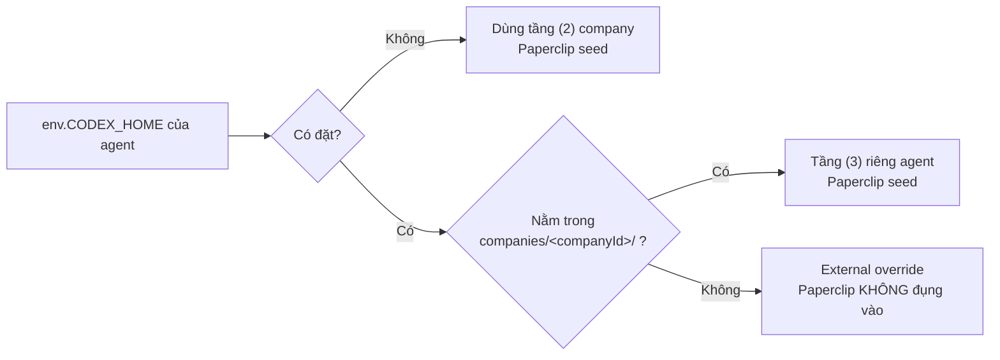
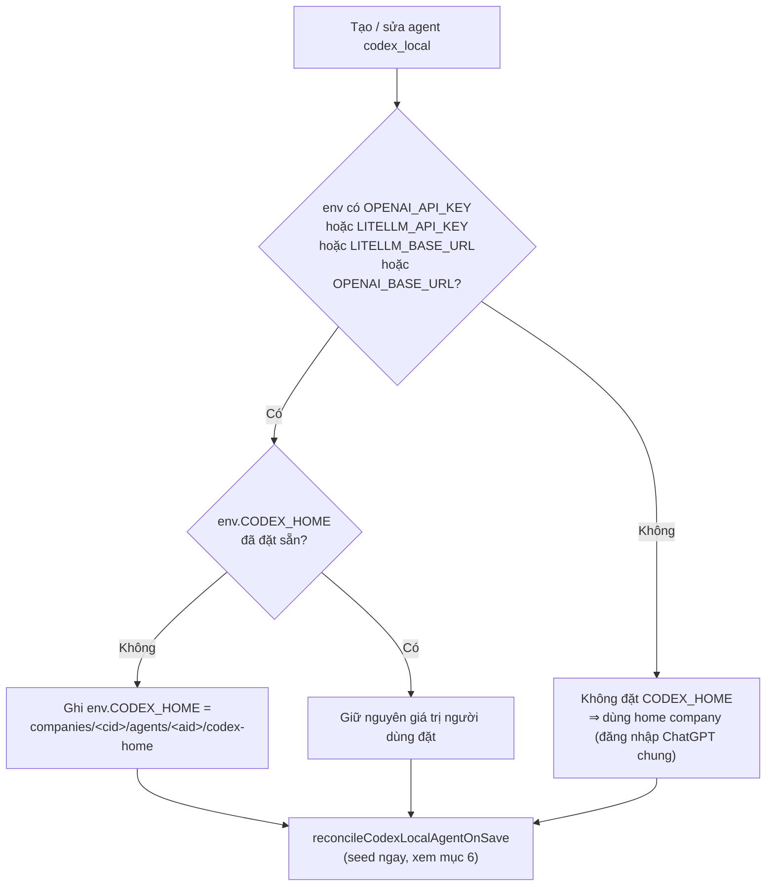
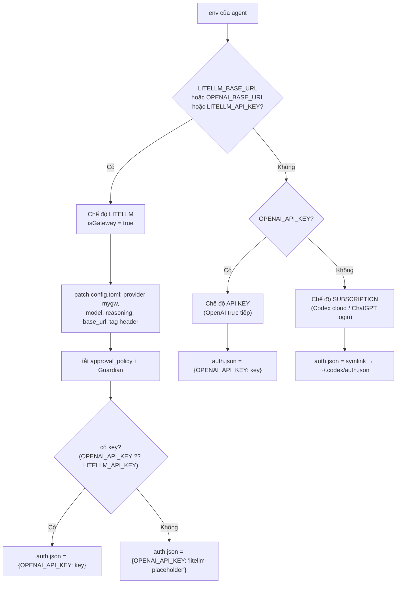
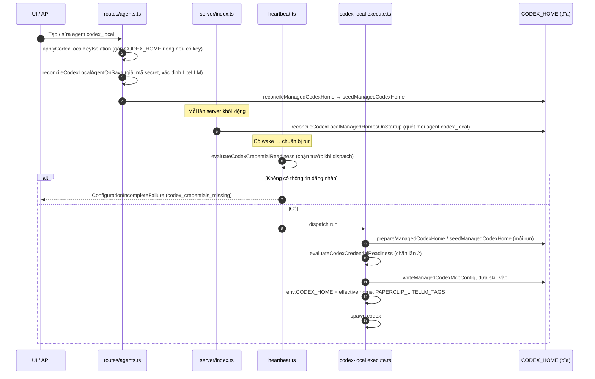
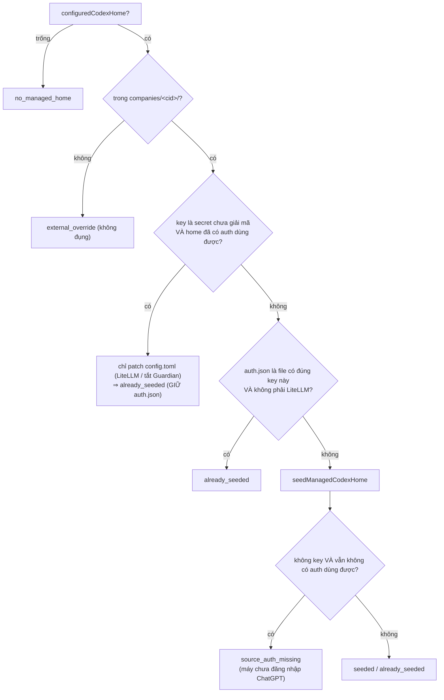

# Phần 1. Cấu hình Codex 3 tầng và cách chọn chế độ xác thực (LiteLLM, API key, Codex cloud)

- Ngày: 29/10/2026
- Nhánh: `test_adapter`. Các link code trỏ tới commit [`f6c9d6bfc`](https://github.com/trung2710/ppclip/tree/f6c9d6bfc1225895047151d99f8d4002dacee482), nên số dòng không bị lệch khi code thay đổi sau này.
- Commit chính của phần này:
  - [`bbaf367c4`](https://github.com/trung2710/ppclip/commit/bbaf367c4): các hàm sửa `config.toml` cho LiteLLM;
  - [`852ccdac9`](https://github.com/trung2710/ppclip/commit/852ccdac9): chuẩn bị `CODEX_HOME` cho agent dùng LiteLLM;
  - [`3ea8f0477`](https://github.com/trung2710/ppclip/commit/3ea8f0477): tính cost và token qua LiteLLM. Commit này chỉ được nhắc tới ở đây; chi tiết nằm ở Phần 3.
- Phạm vi: adapter `codex_local`, gồm cả 2 engine CLI (`codex exec`) và ACP (`codex-acp` chạy qua acpx).

---

## Tóm tắt phần này

**Đã thực hiện:** đọc code của cả 2 engine (CLI và ACP), phần server và phần heartbeat; đối chiếu với 2 tài liệu nguồn; kiểm tra thư mục thật trên máy. Chi tiết trình bày ở các mục bên dưới.

| Nội dung trong plan | Trạng thái | Xem ở mục |
|---|---|---|
| 3 tầng home: dùng chung, company, riêng agent | Xong | 2 |
| Khi nào agent dùng tầng nào | Xong | 3 |
| File nào symlink, file nào copy (`CODEX_SYNC_ALLOWLIST`) | Xong | 4 |
| Bảng quyết định LiteLLM / API key / subscription | Xong | 5 |
| Cách chuyển qua lại giữa các chế độ (dọn `auth.json` cũ) | Xong | 7 |
| Reconcile khi khởi động, khi lưu agent, trước mỗi run | Xong | 6 |
| Kiểm tra đường dẫn thật trên máy (`company-1`, `agent-1`) | Xong | 9 |

**Nguồn đã dùng:**
- Code: `codex-home.ts`, `codex-toml.ts`, `codex-args.ts`, `execute.ts` (CLI), `acpx-engine/execute.ts` (ACP), `server/src/routes/agents.ts`, `codex-auth-reconciliation.ts`, `heartbeat.ts`.
- Commit: `bbaf367c4`, `852ccdac9`.
- Tài liệu: [co_che_va_cau_hinh_codex_home_multi_level_paperclip.md](../instructions/co_che_va_cau_hinh_codex_home_multi_level_paperclip.md), [huong_dan_test_codex_agent_va_co_che_workspace_paperclip.md](../instructions/huong_dan_test_codex_agent_va_co_che_workspace_paperclip.md).

**Kết quả kiểm tra trên máy:**
- `company-1`: chỉ có home của company (`codex-home/`), **không có thư mục `agents/`**. Vậy agent `agent-1` (đường dẫn trong cấu hình làm việc của phiên này) **đang dùng home của company**, chưa có home riêng.
- Company `b0964fd7…`: có home company và 3 home riêng agent. Một agent trong đó dùng LiteLLM (`mygw`).
- Phát hiện 1 điểm đáng chú ý (R1) và 1 chỗ tài liệu cũ lệch với code (R7), xem mục 10.

**Kết luận chính:**
1. Chế độ xác thực chỉ phụ thuộc vào env của agent và được quyết định ở một hàm duy nhất, `resolveCodexGatewayConfig`: có URL hoặc key LiteLLM thì là **LiteLLM**; chỉ có `OPENAI_API_KEY` thì là **API key**; không có gì thì là **Codex cloud (subscription)**.
2. Đăng nhập ChatGPT được **symlink** (token xoay vòng, chỉ dùng 1 lần); key riêng của agent được **ghi thành file**. Agent có key hoặc dùng LiteLLM được cấp home riêng để không đè lên đăng nhập dùng chung.
3. Ở chế độ LiteLLM, Paperclip tự tắt approval và Guardian, và gắn tag `paperclip_run:<runId>` vào mọi request để trace.

---

## 0. Tóm tắt nhanh

1. Mỗi agent Codex chạy với một thư mục `CODEX_HOME`. Thư mục này chứa thông tin đăng nhập (`auth.json`), cấu hình (`config.toml`), session, skill… Paperclip có **3 tầng** `CODEX_HOME`:
   - **dùng chung** (`~/.codex` của máy);
   - **theo company**;
   - **riêng từng agent**.
2. **Tầng dùng chung không bao giờ được truyền thẳng cho agent.** Nó chỉ là nguồn để sao chép. Agent luôn chạy trên tầng company hoặc tầng agent. Ngoại lệ là khi người dùng tự trỏ `CODEX_HOME` ra ngoài; Paperclip khi đó không động vào thư mục đó.
3. **Agent có home riêng khi và chỉ khi** trong env của nó có ít nhất một biến: `OPENAI_API_KEY`, `LITELLM_API_KEY`, `LITELLM_BASE_URL` hoặc `OPENAI_BASE_URL`. Mục đích là để key riêng của agent không ghi đè lên đăng nhập ChatGPT mà các agent khác trong company đang dùng chung.
4. **Có 3 chế độ xác thực**, được quyết định hoàn toàn bởi env của agent:
   - **LiteLLM**: có `LITELLM_BASE_URL`, `OPENAI_BASE_URL` hoặc `LITELLM_API_KEY`;
   - **API key**: chỉ có `OPENAI_API_KEY`;
   - **Subscription (Codex cloud/ChatGPT)**: không có biến nào ở trên.
5. Ở chế độ LiteLLM, Paperclip tự làm 4 việc:
   - ghi provider `mygw` vào `config.toml`;
   - ghi `auth.json` dạng API key, hoặc placeholder nếu không có key;
   - **tắt approval và Guardian**;
   - gắn tag `paperclip_run:<runId>` vào mọi request gửi LiteLLM để trace.
6. Việc chuẩn bị home (seeding) chạy ở **3 thời điểm**: khi lưu agent, khi server khởi động, và trước **mỗi run**. Thêm vào đó có **2 lớp chặn** để không chạy agent khi thiếu thông tin đăng nhập: một lớp trước khi dispatch run, một lớp lúc execute.

---

## 1. `CODEX_HOME` là gì

Codex CLI đọc mọi thứ từ thư mục `$CODEX_HOME` (mặc định là `~/.codex`):

| File / thư mục | Vai trò |
|---|---|
| `auth.json` | Thông tin đăng nhập. Có 2 dạng: token của ChatGPT (`tokens.access_token`, `refresh_token`, `account_id`), hoặc `{ "OPENAI_API_KEY": "..." }` |
| `config.toml` | Model, provider, chính sách approval, MCP server… |
| `config.json`, `instructions.md` | Cấu hình và hướng dẫn phụ |
| `skills/` | Skill mà Paperclip đưa vào cho run |
| `sessions/`, `*.sqlite`, `cache/`… | Trạng thái do Codex tự sinh khi chạy |

Một lưu ý quan trọng ghi trong code: **Codex CLI từ bản 0.122 bỏ qua biến môi trường `OPENAI_API_KEY`** và chỉ đọc khóa từ `$CODEX_HOME/auth.json`. Vì vậy, muốn agent dùng API key thì Paperclip **phải ghi key vào file**, không thể chỉ đặt env. Xem [codex-home.ts:340-351](https://github.com/trung2710/ppclip/blob/f6c9d6bfc1225895047151d99f8d4002dacee482/packages/adapters/codex-local/src/server/codex-home.ts#L340-L351).

```ts
// codex-home.ts:346-351
export async function writeApiKeyAuthJson(home: string, apiKey: string): Promise<void> {
  await fs.mkdir(home, { recursive: true });
  const target = path.join(home, "auth.json");
  await fs.rm(target, { force: true });
  await fs.writeFile(target, JSON.stringify({ OPENAI_API_KEY: apiKey }), { mode: 0o600 });
}
```

---

## 2. Ba tầng `CODEX_HOME`

### 2.1. Sơ đồ thư mục

```text
C:\Users\<user>\.codex\                         ← (1) DÙNG CHUNG: đăng nhập ChatGPT của máy
│   auth.json   (token ChatGPT)
│   config.toml
│
C:\Users\<user>\.paperclip\instances\default\
└── companies\
    └── <companyId>\
        ├── codex-home\                         ← (2) THEO COMPANY: agent không có key dùng chung
        │     auth.json  ──symlink──► ~/.codex/auth.json
        │     config.toml (bản copy)
        │
        └── agents\
            └── <agentId>\
                └── codex-home\                 ← (3) RIÊNG AGENT: agent có key / dùng LiteLLM
                      auth.json   (file thật: API key hoặc LiteLLM key)
                      config.toml (bản copy + provider mygw)
```

### 2.2. Code xác định từng tầng

| Tầng | Đường dẫn | Hàm | Code |
|---|---|---|---|
| (1) Dùng chung | `$CODEX_HOME` của tiến trình server, nếu không có thì `~/.codex` | `resolveSharedCodexHomeDir` | [codex-home.ts:107-112](https://github.com/trung2710/ppclip/blob/f6c9d6bfc1225895047151d99f8d4002dacee482/packages/adapters/codex-local/src/server/codex-home.ts#L107-L112) |
| (2) Company | `<instance>/companies/<companyId>/codex-home` | `resolveManagedCodexHomeDir` | [codex-home.ts:118-130](https://github.com/trung2710/ppclip/blob/f6c9d6bfc1225895047151d99f8d4002dacee482/packages/adapters/codex-local/src/server/codex-home.ts#L118-L130) |
| (3) Agent | `<instance>/companies/<companyId>/agents/<agentId>/codex-home` | `codexLocalAgentHome` | [agents.ts:1272-1279](https://github.com/trung2710/ppclip/blob/f6c9d6bfc1225895047151d99f8d4002dacee482/server/src/routes/agents.ts#L1272-L1279) |

```ts
// codex-home.ts:107-130
export function resolveSharedCodexHomeDir(env = process.env): string {
  const fromEnv = nonEmpty(env.CODEX_HOME);
  return fromEnv ? path.resolve(fromEnv) : path.join(os.homedir(), ".codex");
}

export function resolveManagedCodexHomeDir(env, companyId?): string {
  const instanceRoot = resolvePaperclipInstanceRootForAdapter({ ... });
  return companyId
    ? path.resolve(instanceRoot, "companies", companyId, "codex-home")
    : path.resolve(instanceRoot, "codex-home");
}
```

### 2.3. Ranh giới thư mục "Paperclip quản lý"

Paperclip chỉ seed, tức sửa file, cho những home **nằm trong cây `companies/<companyId>/`**. Một đường dẫn ở ngoài cây này được coi là **external override** do người dùng tự quản, và Paperclip không bao giờ ghi vào đó.

```ts
// codex-home.ts:139-153
export function isManagedCodexHomePath(env, companyId, homePath): boolean {
  if (!companyId) return false;
  const companyRoot = path.resolve(instanceRoot, "companies", companyId);
  const resolved = path.resolve(homePath);
  return resolved === companyRoot || resolved.startsWith(companyRoot + path.sep);
}
```

Code: [codex-home.ts:132-153](https://github.com/trung2710/ppclip/blob/f6c9d6bfc1225895047151d99f8d4002dacee482/packages/adapters/codex-local/src/server/codex-home.ts#L132-L153).

Như vậy, xét theo cách Paperclip đối xử, `CODEX_HOME` có tới **4 trường hợp**: 3 tầng ở trên, cộng thêm "tự quản" (external).



---

## 3. Khi nào agent được cấp home riêng (isolation guard)

Mỗi lần **tạo** hoặc **sửa** agent `codex_local`, server chạy `applyCodexLocalKeyIsolation`. Code: [agents.ts:1287-1313](https://github.com/trung2710/ppclip/blob/f6c9d6bfc1225895047151d99f8d4002dacee482/server/src/routes/agents.ts#L1287-L1313).

```ts
// agents.ts:1293-1313
function applyCodexLocalKeyIsolation(companyId, agentId, adapterType, adapterConfig) {
  if (adapterType !== "codex_local") return adapterConfig;
  const existingEnv = asRecord(adapterConfig.env);
  if (!existingEnv) return adapterConfig;
  const hasKeyOrGateway =
    codexLocalEnvKeyConfigured(existingEnv.OPENAI_API_KEY) ||
    codexLocalEnvKeyConfigured(existingEnv.LITELLM_API_KEY) ||   // ← nhánh test_adapter thêm
    codexLocalEnvKeyConfigured(existingEnv.LITELLM_BASE_URL) ||  // ← nhánh test_adapter thêm
    codexLocalEnvKeyConfigured(existingEnv.OPENAI_BASE_URL);     // ← nhánh test_adapter thêm
  if (!hasKeyOrGateway) return adapterConfig;
  if (codexLocalEnvKeyConfigured(existingEnv.CODEX_HOME)) return adapterConfig; // người dùng tự đặt → tôn trọng
  return {
    ...adapterConfig,
    env: { ...existingEnv, CODEX_HOME: codexLocalAgentHome(companyId, agentId) },
  };
}
```

- Một biến được coi là "đã cấu hình" nếu có giá trị chuỗi, hoặc là một tham chiếu secret (`{ type: "secret_ref", secretId }`). Xem [agents.ts:1281-1285](https://github.com/trung2710/ppclip/blob/f6c9d6bfc1225895047151d99f8d4002dacee482/server/src/routes/agents.ts#L1281-L1285).
- Hàm được gọi ở cả 3 route tạo và sửa agent: [agents.ts:2474](https://github.com/trung2710/ppclip/blob/f6c9d6bfc1225895047151d99f8d4002dacee482/server/src/routes/agents.ts#L2474), [agents.ts:2670](https://github.com/trung2710/ppclip/blob/f6c9d6bfc1225895047151d99f8d4002dacee482/server/src/routes/agents.ts#L2670), [agents.ts:3124](https://github.com/trung2710/ppclip/blob/f6c9d6bfc1225895047151d99f8d4002dacee482/server/src/routes/agents.ts#L3124).
- **Thay đổi của nhánh:** bản gốc upstream chỉ tách home khi có `OPENAI_API_KEY`. Commit `852ccdac9` mở rộng thêm 3 biến của LiteLLM. Nếu không mở rộng, agent LiteLLM sẽ ghi `auth.json` của nó vào home **company**, đè lên symlink ChatGPT, và mọi agent khác trong company sẽ bị chuyển sang key LiteLLM.



---

## 4. Seeding: file nào được symlink, file nào copy, file nào ghi mới

Hàm trung tâm là `seedManagedCodexHome`. Code: [codex-home.ts:619-700](https://github.com/trung2710/ppclip/blob/f6c9d6bfc1225895047151d99f8d4002dacee482/packages/adapters/codex-local/src/server/codex-home.ts#L619-L700). Danh sách file được định nghĩa ở [codex-home.ts:21-22](https://github.com/trung2710/ppclip/blob/f6c9d6bfc1225895047151d99f8d4002dacee482/packages/adapters/codex-local/src/server/codex-home.ts#L21-L22):

```ts
const COPIED_SHARED_FILES = ["config.json", "config.toml", "instructions.md"] as const;
const SYMLINKED_SHARED_FILES = ["auth.json"] as const;
```

| File | Cách đưa vào home | Lý do | Code |
|---|---|---|---|
| `auth.json` (chế độ subscription) | **Symlink** về `~/.codex/auth.json` | Refresh token của ChatGPT **chỉ dùng được 1 lần** và được xoay vòng. Nếu copy, bản sao sẽ cũ và lần chạy sau lỗi `refresh_token_reused` (upstream #5028). Symlink giúp mọi home luôn đọc token mới nhất. | [codex-home.ts:209-238](https://github.com/trung2710/ppclip/blob/f6c9d6bfc1225895047151d99f8d4002dacee482/packages/adapters/codex-local/src/server/codex-home.ts#L209-L238) |
| `auth.json` (chế độ API / LiteLLM) | **Ghi file mới** `{OPENAI_API_KEY}`, ghi lại ở mỗi lần seed | Key là của riêng agent | [codex-home.ts:687-699](https://github.com/trung2710/ppclip/blob/f6c9d6bfc1225895047151d99f8d4002dacee482/packages/adapters/codex-local/src/server/codex-home.ts#L687-L699) |
| `config.toml`, `config.json`, `instructions.md` | **Copy 1 lần**: file đã có thì không copy lại | Để agent có cấu hình nền giống máy, sau đó Paperclip sửa thêm | [codex-home.ts:240-245](https://github.com/trung2710/ppclip/blob/f6c9d6bfc1225895047151d99f8d4002dacee482/packages/adapters/codex-local/src/server/codex-home.ts#L240-L245) |
| `config.toml` (các khối Paperclip quản lý) | **Sửa tại chỗ** ở mỗi lần seed: provider LiteLLM, tắt approval, `env_vars` cho MCP | Đảm bảo luôn đúng với cấu hình hiện tại của agent | [codex-toml.ts:282-326](https://github.com/trung2710/ppclip/blob/f6c9d6bfc1225895047151d99f8d4002dacee482/packages/adapter-utils/src/codex-toml.ts#L282-L326) |
| `skills/` | Đưa vào trước mỗi run | Skill được chọn cho run | `execute.ts` (ngoài phạm vi phần này) |

`ensureSymlink` còn **tự sửa** trường hợp một bản Paperclip cũ đã copy `auth.json` thay vì symlink. Nó xóa file thật rồi tạo lại symlink. Riêng khi ở đó là thư mục thì nó để nguyên.

```ts
// codex-home.ts:217-231 (rút gọn)
if (!existing.isSymbolicLink()) {
  // A previous Paperclip version copied this file ... stale copy fails with refresh_token_reused (#5028)
  if (existing.isDirectory()) return;
  await fs.unlink(target);
  await createExpectedSymlink(target, source);
  return;
}
```

Khi run chạy trên máy remote hoặc sandbox, chỉ những mục trong allowlist mới được đóng gói gửi đi. Đó là `config.json`, `config.toml`, `instructions.md`, `auth.json` và `skills`. Các file `*.sqlite`, `sessions/`, `cache/` được giữ lại trên máy. Xem [codex-home.ts:26-40](https://github.com/trung2710/ppclip/blob/f6c9d6bfc1225895047151d99f8d4002dacee482/packages/adapters/codex-local/src/server/codex-home.ts#L26-L40).

---

## 5. Logic chọn chế độ: LiteLLM, API key hay Codex cloud

### 5.1. Hàm quyết định: `resolveCodexGatewayConfig`

Đây là **nơi duy nhất** đọc env của agent để quyết định chế độ. Cả CLI, ACP và server đều gọi hàm này. Code: [codex-toml.ts:460-485](https://github.com/trung2710/ppclip/blob/f6c9d6bfc1225895047151d99f8d4002dacee482/packages/adapter-utils/src/codex-toml.ts#L460-L485).

```ts
export function resolveCodexGatewayConfig(config: unknown): CodexGatewayConfig {
  const env = asRecord(asRecord(config).env);
  const liteLlmKey = nonEmptyString(env[LITELLM_API_KEY_ENV]);           // LITELLM_API_KEY
  const apiKey = nonEmptyString(env.OPENAI_API_KEY) ?? liteLlmKey;        // OPENAI_API_KEY ưu tiên
  const liteLlmBaseUrl =
    nonEmptyString(env.LITELLM_BASE_URL) ??
    nonEmptyString(env.OPENAI_BASE_URL) ??
    (liteLlmKey ? DEFAULT_LITELLM_BASE_URL : null);                      // http://localhost:4000/v1
  const isGateway = liteLlmBaseUrl !== null;
  return {
    apiKey, liteLlmBaseUrl,
    model: ..., reasoningEffort: ...,          // model / modelReasoningEffort / effort của agent
    isGateway,
    disableApprovalGuardian: isGateway,        // chỉ agent gateway mới tắt approval/Guardian
  };
}
```

Các hằng số liên quan ở [codex-toml.ts:19-29](https://github.com/trung2710/ppclip/blob/f6c9d6bfc1225895047151d99f8d4002dacee482/packages/adapter-utils/src/codex-toml.ts#L19-L29):
- `DEFAULT_LITELLM_BASE_URL = "http://localhost:4000/v1"`;
- `LITELLM_PROVIDER_ID = "mygw"`;
- `LITELLM_TAGS_HEADER = "x-litellm-tags"`.

### 5.2. Bảng quyết định

| `OPENAI_API_KEY` | `LITELLM_API_KEY` | `LITELLM_BASE_URL` / `OPENAI_BASE_URL` | ⇒ Chế độ | `auth.json` | `config.toml` | Approval/Guardian | Billing |
|---|---|---|---|---|---|---|---|
| – | – | – | **Subscription (Codex cloud/ChatGPT)** | symlink → `~/.codex/auth.json` | bản copy, giữ nguyên | mặc định của Codex | `subscription` / `chatgpt` |
| ✔ | – | – | **API key (OpenAI trực tiếp)** | file `{OPENAI_API_KEY: <key>}` | bản copy, giữ nguyên | mặc định của Codex | `api` / `openai` |
| – | ✔ | – | **LiteLLM** (base URL mặc định `localhost:4000/v1`) | file `{OPENAI_API_KEY: <LiteLLM key>}` | provider `mygw` | **tắt** | `api` / `litellm` |
| – | – | ✔ | **LiteLLM** (không có key) | file `{OPENAI_API_KEY: "litellm-placeholder"}` | provider `mygw` | **tắt** | `api` / `litellm` |
| ✔ | ✔ / – | ✔ | **LiteLLM**, `auth.json` lấy `OPENAI_API_KEY` | file `{OPENAI_API_KEY: <OpenAI key>}` | provider `mygw` | **tắt** | `api` / `litellm` |

Billing type và biller được tính ở [execute.ts:164-178](https://github.com/trung2710/ppclip/blob/f6c9d6bfc1225895047151d99f8d4002dacee482/packages/adapters/codex-local/src/server/execute.ts#L164-L178). Đây là thay đổi của nhánh: agent gateway được tính là `api`, để cost của nó **không bị bỏ qua** như khi bị tính là `subscription`.



### 5.3. Chế độ LiteLLM: `config.toml` sau khi được patch

`applyLiteLlmGatewayToml` ([codex-toml.ts:281-306](https://github.com/trung2710/ppclip/blob/f6c9d6bfc1225895047151d99f8d4002dacee482/packages/adapter-utils/src/codex-toml.ts#L281-L306)) sửa các khóa ở gốc file và **thay toàn bộ** bảng `[model_providers.mygw]`. Sau đó nó gọi `ensureCodexApprovalsDisabled` ([codex-toml.ts:264-273](https://github.com/trung2710/ppclip/blob/f6c9d6bfc1225895047151d99f8d4002dacee482/packages/adapter-utils/src/codex-toml.ts#L264-L273)).

```ts
const model = options.model?.trim() || "lfm-free";               // mặc định nếu agent không chọn model
const reasoningEffort = options.reasoningEffort?.trim() || "low";
setTomlRootKeys(cleaned, { model_provider: "mygw", model, model_reasoning_effort: reasoningEffort });
replaceTomlTable(withRoot, "model_providers.mygw", {
  name: "My gateway",
  base_url: baseUrl,
  env_key: "LITELLM_API_KEY",                                    // Codex đọc key từ biến môi trường này
  wire_api: "responses",
  env_http_headers: { "x-litellm-tags": "PAPERCLIP_LITELLM_TAGS" }, // header lấy giá trị từ env
});
```

Kết quả là `config.toml` có dạng như sau. Ví dụ này lấy từ agent `87c740d4…` trên máy, đã bỏ các phần không liên quan:

```toml
model_provider = "mygw"
model = "gemini/gemini-3.6-flash"
model_reasoning_effort = "low"
approval_policy = "never"
approvals_reviewer = "user"

[features]
guardian_approval = false
guardian = false

[model_providers.mygw]
name = "My gateway"
base_url = "http://localhost:4000/v1"
env_key = "LITELLM_API_KEY"
wire_api = "responses"
env_http_headers = { "x-litellm-tags" = "PAPERCLIP_LITELLM_TAGS" }
```

Vì sao chế độ LiteLLM bắt buộc phải tắt cả approval lẫn Guardian: comment ở [codex-toml.ts:258-263](https://github.com/trung2710/ppclip/blob/f6c9d6bfc1225895047151d99f8d4002dacee482/packages/adapter-utils/src/codex-toml.ts#L258-L263) giải thích rằng `approval_policy = "never"` chỉ tắt việc duyệt lệnh terminal. Lệnh gọi tool MCP còn phải qua Guardian, và Guardian gọi **một model khác** để duyệt, mà gateway thường không phục vụ model đó. Kết quả là mỗi lệnh tốn thêm một lượt LLM hoặc bị kẹt. Phần 4 sẽ phân tích kỹ chủ đề này.

**Tag để trace theo run.** Trước mỗi run, adapter đặt biến `PAPERCLIP_LITELLM_TAGS`, ví dụ `paperclip_run:<runId>,paperclip_agent:<agentId>,paperclip_company:<companyId>`. Codex tự chuyển biến này thành header `x-litellm-tags`. Xem [codex-toml.ts:35-45](https://github.com/trung2710/ppclip/blob/f6c9d6bfc1225895047151d99f8d4002dacee482/packages/adapter-utils/src/codex-toml.ts#L35-L45) và [execute.ts:736-739](https://github.com/trung2710/ppclip/blob/f6c9d6bfc1225895047151d99f8d4002dacee482/packages/adapters/codex-local/src/server/execute.ts#L736-L739). Phần 2 sẽ đi sâu vào phần này.

### 5.4. Chế độ API key

Chế độ API key chỉ ghi `auth.json`, không sửa provider, nên Codex gọi thẳng OpenAI. Approval và Guardian **giữ mặc định** (`disableApprovalGuardian = false`).

### 5.5. Chế độ Subscription (Codex cloud)

Chế độ subscription không có key. Home company hoặc home agent chỉ **symlink** `auth.json` về đăng nhập ChatGPT của máy, nên các agent ở chế độ này **dùng chung một tài khoản ChatGPT** và chung hạn mức của tài khoản đó.

---

## 6. Vòng đời: seeding chạy khi nào



| Thời điểm | Code | Ghi chú |
|---|---|---|
| **Khi lưu agent** | [agents.ts:1315-1367](https://github.com/trung2710/ppclip/blob/f6c9d6bfc1225895047151d99f8d4002dacee482/server/src/routes/agents.ts#L1315-L1367); gọi ở [2526](https://github.com/trung2710/ppclip/blob/f6c9d6bfc1225895047151d99f8d4002dacee482/server/src/routes/agents.ts#L2526), [2712](https://github.com/trung2710/ppclip/blob/f6c9d6bfc1225895047151d99f8d4002dacee482/server/src/routes/agents.ts#L2712), [3183](https://github.com/trung2710/ppclip/blob/f6c9d6bfc1225895047151d99f8d4002dacee482/server/src/routes/agents.ts#L3183) | **Nhánh thêm mới.** Có giải mã secret, nên seed được key thật. Một secret không giải mã được vẫn được tính là agent LiteLLM. Nếu lỗi thì chỉ ghi log warn, không chặn việc lưu. |
| **Khi server khởi động** | [codex-auth-reconciliation.ts:74-](https://github.com/trung2710/ppclip/blob/f6c9d6bfc1225895047151d99f8d4002dacee482/server/src/services/codex-auth-reconciliation.ts#L74), gọi ở [server/src/index.ts:811](https://github.com/trung2710/ppclip/blob/f6c9d6bfc1225895047151d99f8d4002dacee482/server/src/index.ts#L811) | Code upstream. **Không** giải mã secret và **không** truyền thông tin LiteLLM (xem rủi ro R1). |
| **Chặn trước khi dispatch** | [heartbeat.ts:956-993](https://github.com/trung2710/ppclip/blob/f6c9d6bfc1225895047151d99f8d4002dacee482/server/src/services/heartbeat.ts#L956-L993) | Biến lỗi thiếu đăng nhập thành lỗi "configuration incomplete" thay vì để run chạy rồi mới fail. |
| **Mỗi run (CLI)** | [execute.ts:530-582](https://github.com/trung2710/ppclip/blob/f6c9d6bfc1225895047151d99f8d4002dacee482/packages/adapters/codex-local/src/server/execute.ts#L530-L582) | Seed lại, sau đó kiểm tra lần 2 và báo lỗi nếu không có đăng nhập. |
| **Mỗi run (ACP)** | [acpx-engine/execute.ts:946-971](https://github.com/trung2710/ppclip/blob/f6c9d6bfc1225895047151d99f8d4002dacee482/packages/adapter-utils/src/acpx-engine/execute.ts#L946-L971) | Một bản seed riêng của engine ACP (xem mục 8). |

### 6.1. Đoạn chọn home trong `execute.ts` (CLI)

```ts
// execute.ts:530-558
const gateway = resolveCodexGatewayConfig(config);
const configuredHomeIsManaged =
  configuredCodexHome != null && isManagedCodexHomePath(process.env, agent.companyId, configuredCodexHome);
if (configuredCodexHome == null) {
  await prepareManagedCodexHome(process.env, onLog, agent.companyId, {   // tầng (2) company
    apiKey: gateway.apiKey, liteLlmBaseUrl: gateway.liteLlmBaseUrl,
    model: gateway.model, reasoningEffort: gateway.reasoningEffort,
    disableApprovalGuardian: gateway.disableApprovalGuardian,
  });
} else if (configuredHomeIsManaged) {
  await seedManagedCodexHome(configuredCodexHome, process.env, onLog, { ... }); // tầng (3) agent
}                                                                                 // external: bỏ qua
const effectiveCodexHome = configuredCodexHome ?? resolveManagedCodexHomeDir(process.env, agent.companyId);
```

Sau đó `env.CODEX_HOME` được đặt bằng `effectiveCodexHome` ([execute.ts:818](https://github.com/trung2710/ppclip/blob/f6c9d6bfc1225895047151d99f8d4002dacee482/packages/adapters/codex-local/src/server/execute.ts#L818)). Trường hợp run chạy remote thì dùng đường dẫn home trên sandbox.

### 6.2. Reconcile: khi nào bỏ qua, khi nào seed lại

Code: `reconcileManagedCodexHome`, [codex-home.ts:748-816](https://github.com/trung2710/ppclip/blob/f6c9d6bfc1225895047151d99f8d4002dacee482/packages/adapters/codex-local/src/server/codex-home.ts#L748-L816).



Một `auth.json` được coi là "dùng được" khi có `OPENAI_API_KEY` khác rỗng, hoặc có đủ `tokens.account_id` cộng một trong `id_token` / `access_token` / `refresh_token`. Xem [codex-home.ts:73-97](https://github.com/trung2710/ppclip/blob/f6c9d6bfc1225895047151d99f8d4002dacee482/packages/adapters/codex-local/src/server/codex-home.ts#L73-L97).

### 6.3. Hai lớp chặn khi thiếu đăng nhập

`evaluateCodexCredentialReadiness` ([codex-home.ts:840-888](https://github.com/trung2710/ppclip/blob/f6c9d6bfc1225895047151d99f8d4002dacee482/packages/adapters/codex-local/src/server/codex-home.ts#L840-L888)) là **cùng một hàm** được dùng ở cả `heartbeat.ts` (trước khi dispatch) và `execute.ts` (lúc chạy), nên hai lớp không thể lệch nhau:

- External override: luôn coi là sẵn sàng.
- Có API key: sẵn sàng.
- Chế độ subscription: sẵn sàng nếu home hiện tại **hoặc** `~/.codex` có `auth.json` dùng được.

---

## 7. Chuyển qua lại giữa các chế độ

Người dùng có thể đổi env của agent bất kỳ lúc nào. Code xử lý các chiều chuyển như sau:

```mermaid
stateDiagram-v2
  [*] --> Subscription
  Subscription --> APIKey: thêm OPENAI_API_KEY<br/>(isolation guard gán home riêng; auth.json = file key)
  Subscription --> LiteLLM: thêm LITELLM_* / OPENAI_BASE_URL<br/>(home riêng; patch mygw; auth.json = key/placeholder)
  APIKey --> LiteLLM: thêm LITELLM_BASE_URL<br/>(patch mygw; tắt Guardian)
  APIKey --> Subscription: xóa key<br/>(xóa auth.json file → tạo lại symlink)
  LiteLLM --> Subscription: xóa hết biến LiteLLM<br/>(xóa auth.json file → symlink)
```



- **Từ API/LiteLLM về Subscription:** [codex-home.ts:632-642](https://github.com/trung2710/ppclip/blob/f6c9d6bfc1225895047151d99f8d4002dacee482/packages/adapters/codex-local/src/server/codex-home.ts#L632-L642) xóa `auth.json` khi đó là file thật, để có thể tạo lại symlink. Nếu không xóa, Codex sẽ tiếp tục dùng key cũ dù cấu hình đã bỏ key.
- **Lưu ý:** khi bỏ LiteLLM, code **không** xóa bảng `[model_providers.mygw]` và khóa `model_provider = "mygw"` trong `config.toml`. Xem rủi ro R3.
- Khi đã có home riêng, xóa key **không** đưa agent về home company. `CODEX_HOME` đã được lưu trong cấu hình agent, nên agent vẫn dùng home riêng, chỉ là `auth.json` giờ symlink về ChatGPT.

---

## 8. Hai engine: CLI và ACP

`codex_local` chọn engine ở [execute.ts:455-470](https://github.com/trung2710/ppclip/blob/f6c9d6bfc1225895047151d99f8d4002dacee482/packages/adapters/codex-local/src/server/execute.ts#L455-L470). Khi engine ACP lỗi và người dùng không ép dùng ACP, adapter quay về CLI.

| Hạng mục | CLI (`codex exec`) | ACP (`codex-acp` qua acpx) |
|---|---|---|
| Hàm seed | `seedManagedCodexHome` ([codex-home.ts:619](https://github.com/trung2710/ppclip/blob/f6c9d6bfc1225895047151d99f8d4002dacee482/packages/adapters/codex-local/src/server/codex-home.ts#L619-L700)) | `prepareManagedCodexHome` **riêng** ([acpx-engine/execute.ts:649-726](https://github.com/trung2710/ppclip/blob/f6c9d6bfc1225895047151d99f8d4002dacee482/packages/adapter-utils/src/acpx-engine/execute.ts#L649-L726)) |
| Chọn chế độ | `resolveCodexGatewayConfig` | `resolveCodexGatewayConfig`, dùng chung |
| Tắt Guardian | `config.toml` cộng cờ `-c approval_policy="never"`… ([codex-args.ts:58-65](https://github.com/trung2710/ppclip/blob/f6c9d6bfc1225895047151d99f8d4002dacee482/packages/adapters/codex-local/src/server/codex-args.ts#L58-L65)) | `config.toml` cộng `CODEX_CONFIG` cộng `INITIAL_AGENT_MODE="read-only"` ([acpx-engine/execute.ts:1538-1572](https://github.com/trung2710/ppclip/blob/f6c9d6bfc1225895047151d99f8d4002dacee482/packages/adapter-utils/src/acpx-engine/execute.ts#L1538-L1572)), vì codex-acp ghi đè `config.toml` bằng "mode" của session ở mỗi lượt ([codex-toml.ts:412-431](https://github.com/trung2710/ppclip/blob/f6c9d6bfc1225895047151d99f8d4002dacee482/packages/adapter-utils/src/codex-toml.ts#L412-L431)) |
| Tag LiteLLM | đặt ở env của run ([execute.ts:737-739](https://github.com/trung2710/ppclip/blob/f6c9d6bfc1225895047151d99f8d4002dacee482/packages/adapters/codex-local/src/server/execute.ts#L737-L739)) | đặt ở env runtime, **không** đưa vào fingerprint, nhờ vậy không làm hỏng resume session (Phần 5) |

---

## 9. Đối chiếu với máy hiện tại

Tôi kiểm tra thư mục instance `default`, company `b0964fd7-…`, ngày 29/10/2026. Tôi chỉ xem loại file `auth.json` và các khóa trong `config.toml`, không đọc nội dung khóa bí mật.

| Home | `auth.json` | `config.toml` | Nhận xét |
|---|---|---|---|
| `companies/b0964fd7…/codex-home` (tầng 2) | symlink → `~/.codex/auth.json` | `model = "gpt-5.4-mini"` | Đúng chế độ subscription dùng chung |
| `agents/51a10a79…/codex-home` | symlink → `~/.codex/auth.json` | `model = "gpt-5.6-luna"`, approval `never`, `guardian_approval = false` | Home riêng nhưng đang dùng đăng nhập ChatGPT; có cấu hình tắt Guardian |
| `agents/b5f2f963…/codex-home` | symlink → `~/.codex/auth.json` | `model = "gpt-5.6-luna"` | Home riêng, chế độ subscription |
| `agents/87c740d4…/codex-home` | **symlink → `~/.codex/auth.json`** | `model_provider = "mygw"`, `gemini/gemini-3.6-flash`, `base_url = localhost:4000/v1` | Agent LiteLLM, **nhưng `auth.json` lại là symlink ChatGPT** thay vì file key như thiết kế. Xem R1. |

Ở company `81ed1694…` (dữ liệu tháng 7), các home agent có `auth.json` là **file thật**, tức chế độ API key, đúng như mô tả.

**Company `company-1`** (thư mục làm việc của phiên này):

| Hạng mục | Kết quả |
|---|---|
| `companies/company-1/codex-home/auth.json` | symlink → `~/.codex/auth.json` (chế độ subscription) |
| `companies/company-1/codex-home/config.toml` | `model = "gpt-5.6-luna"`, không có `model_provider`, không có bảng `mygw` |
| `companies/company-1/agents/` | **Không tồn tại** |

Kết luận: `agent-1` **không có home riêng**, nó dùng chung home của company và đăng nhập ChatGPT của máy. Điều này khớp với thiết kế: agent không có key và không dùng LiteLLM thì không bị cấp `CODEX_HOME` riêng (mục 3).

---

## 10. Rủi ro và điểm cần lưu ý

**R1. Reconcile lúc khởi động bỏ qua LiteLLM. Mức trung bình, cần kiểm chứng thêm.**

[codex-auth-reconciliation.ts:104-109](https://github.com/trung2710/ppclip/blob/f6c9d6bfc1225895047151d99f8d4002dacee482/server/src/services/codex-auth-reconciliation.ts#L104-L109) chỉ truyền `OPENAI_API_KEY` vào reconcile. Nó **không** truyền `LITELLM_API_KEY`, `LITELLM_BASE_URL` hay `disableApprovalGuardian`.

Với một agent chỉ có `LITELLM_API_KEY`, reconcile lúc khởi động coi agent đó là subscription. Nó xóa file `auth.json` (key LiteLLM) và thay bằng symlink ChatGPT. Trạng thái này đúng với agent `87c740d4…` ở mục 9.

Mức ảnh hưởng thực tế có lẽ nhỏ, vì 2 lý do:
- Provider `mygw` đọc key qua `env_key = "LITELLM_API_KEY"` từ biến môi trường, không đọc từ `auth.json`.
- Run tiếp theo seed lại và ghi lại file key.

Dù vậy, trạng thái này sai so với thiết kế, và có thể gây nhầm lẫn khi debug. Hướng sửa: tách phần đọc env thành một hàm dùng chung với `reconcileCodexLocalAgentOnSave`, trong đó đọc thêm các biến LiteLLM (không cần giải mã secret, chỉ cần nhận ra secret).

**R2. Chỉ có `OPENAI_BASE_URL` cũng bị coi là LiteLLM.**

Một agent chỉ trỏ `OPENAI_BASE_URL` sang endpoint tương thích OpenAI, như OpenRouter hay Azure, sẽ bị chuyển sang provider `mygw`. Khi đó approval và Guardian bị tắt. Nếu agent không chọn model, model mặc định là **`lfm-free`** ([codex-toml.ts:283](https://github.com/trung2710/ppclip/blob/f6c9d6bfc1225895047151d99f8d4002dacee482/packages/adapter-utils/src/codex-toml.ts#L283)). Nên ghi rõ quy ước này trong hướng dẫn cấu hình.

**R3. Bỏ LiteLLM không dọn `config.toml`.**

Khi agent quay về subscription hoặc API key, `model_provider = "mygw"` và bảng `[model_providers.mygw]` vẫn còn trong `config.toml` của home riêng. Codex sẽ tiếp tục gọi `localhost:4000`. Muốn quay về, phải xóa tay `config.toml` của home agent để lần seed sau copy lại từ `~/.codex`.

**R4. `config.toml` chỉ copy 1 lần.**

Sửa `~/.codex/config.toml` của máy sau khi home đã được tạo sẽ **không** lan sang các home company và agent ([codex-home.ts:240-245](https://github.com/trung2710/ppclip/blob/f6c9d6bfc1225895047151d99f8d4002dacee482/packages/adapters/codex-local/src/server/codex-home.ts#L240-L245)). Chỉ các khối do Paperclip quản lý mới được cập nhật ở mỗi run.

**R5. Logic seed bị nhân đôi giữa CLI và ACP.**

Hai hàm seed ([codex-home.ts:619](https://github.com/trung2710/ppclip/blob/f6c9d6bfc1225895047151d99f8d4002dacee482/packages/adapters/codex-local/src/server/codex-home.ts#L619-L700) và [acpx-engine/execute.ts:649](https://github.com/trung2710/ppclip/blob/f6c9d6bfc1225895047151d99f8d4002dacee482/packages/adapter-utils/src/acpx-engine/execute.ts#L649-L726)) gần giống nhau nhưng là 2 bản riêng. Sửa một bên mà quên bên kia thì hai engine sẽ hành xử khác nhau. Hàm quyết định chế độ thì đã dùng chung (`resolveCodexGatewayConfig`), nên phần này an toàn hơn.

**R6. Subscription dùng chung tài khoản ChatGPT.**

Mọi agent ở chế độ subscription đều dùng chung một đăng nhập và chung hạn mức. Một agent chạy nhiều sẽ làm các agent khác bị giới hạn tốc độ. Ngoài ra, nếu máy đăng xuất khỏi Codex, mọi agent subscription bị chặn ở bước kiểm tra trước khi dispatch.

**R7. Tài liệu `co_che_va_cau_hinh_codex_home_multi_level_paperclip.md` có đoạn đã lỗi thời.**

Mục 5 của tài liệu nói rằng agent có key riêng chạy bằng engine ACP sẽ **không có** `config.toml` và `auth.json` trong home, do toán tử `??` bỏ qua hàm seed. Code hiện tại đã sửa lỗi này: engine ACP dùng điều kiện `effectiveIsManaged` để seed cả khi `CODEX_HOME` đã được đặt sẵn ([acpx-engine/execute.ts:957-971](https://github.com/trung2710/ppclip/blob/f6c9d6bfc1225895047151d99f8d4002dacee482/packages/adapter-utils/src/acpx-engine/execute.ts#L957-L971)), và hàm seed ACP cũng ghi `auth.json` ra đĩa. Chính mục 8 của tài liệu đó cũng ghi lại bản sửa này. Ngoài ra, một vài tên hàm trong tài liệu đã đổi: `patchCodexTomlForLiteLlmGateway` nay nằm ở `adapter-utils/src/codex-toml.ts` (không còn ở `codex-home.ts`), và `ensureGuardianApprovalDisabled` nay là `ensureCodexApprovalsDisabled`. Khi trích dẫn, nên theo code ở báo cáo này chứ không theo mục 5 của tài liệu cũ.

Về lý do phải tắt Guardian, tài liệu ghi lại một lỗi thực tế: Guardian gọi ngầm model `gpt-5.6-luna`; qua LiteLLM gateway không có model này nên trả `HTTP 400 Invalid model name` và tool MCP bị `Status: Denied`.

---

## 11. Kết luận

1. **3 tầng home cộng 1 trường hợp tự quản:**
   - **Dùng chung** (`~/.codex`) chỉ là nguồn để sao chép.
   - **Company** là mặc định cho agent không có key.
   - **Riêng agent** được cấp tự động khi agent có key hoặc dùng LiteLLM.
   - **External**: người dùng tự trỏ `CODEX_HOME` ra ngoài thì Paperclip không đụng vào.
2. **Chế độ xác thực chỉ phụ thuộc vào env của agent** và được quyết định ở một hàm duy nhất, `resolveCodexGatewayConfig`. Thứ tự ưu tiên: có URL hoặc key LiteLLM thì là **LiteLLM**; chỉ có `OPENAI_API_KEY` thì là **API key**; không có gì thì là **Codex cloud (subscription)**.
3. **Đăng nhập ChatGPT được symlink, key được ghi thành file.** Lý do là refresh token chỉ dùng được 1 lần, còn key là của riêng agent. Đây là điểm mấu chốt để nhiều agent dùng chung một đăng nhập mà không làm hỏng token của nhau.
4. **Nhánh `test_adapter` đã bổ sung:**
   - cấp home riêng cho agent LiteLLM;
   - patch provider `mygw`;
   - tự tắt approval và Guardian;
   - gắn tag `paperclip_run` để trace;
   - seed ngay khi lưu agent;
   - tính cost của agent gateway là `api`/`litellm` thay vì bị bỏ qua.
5. **Nên xử lý tiếp:**
   - R1: reconcile lúc khởi động bỏ qua LiteLLM;
   - R3: dọn `config.toml` khi bỏ LiteLLM;
   - R2: ghi rõ quy ước `OPENAI_BASE_URL` trong tài liệu.

---

## Phụ lục A. Danh sách file đã trích dẫn

| File | Nội dung chính |
|---|---|
| [packages/adapters/codex-local/src/server/codex-home.ts](https://github.com/trung2710/ppclip/blob/f6c9d6bfc1225895047151d99f8d4002dacee482/packages/adapters/codex-local/src/server/codex-home.ts) | Tầng home, symlink/copy, seed, reconcile, kiểm tra đăng nhập |
| [packages/adapter-utils/src/codex-toml.ts](https://github.com/trung2710/ppclip/blob/f6c9d6bfc1225895047151d99f8d4002dacee482/packages/adapter-utils/src/codex-toml.ts) | Chọn chế độ, patch LiteLLM, tắt Guardian, tag, env cho MCP |
| [packages/adapters/codex-local/src/server/execute.ts](https://github.com/trung2710/ppclip/blob/f6c9d6bfc1225895047151d99f8d4002dacee482/packages/adapters/codex-local/src/server/execute.ts) | Seed và chọn home cho mỗi run (CLI), billing, `env.CODEX_HOME` |
| [packages/adapters/codex-local/src/server/codex-args.ts](https://github.com/trung2710/ppclip/blob/f6c9d6bfc1225895047151d99f8d4002dacee482/packages/adapters/codex-local/src/server/codex-args.ts) | Cờ `-c` tắt Guardian cho CLI |
| [packages/adapter-utils/src/acpx-engine/execute.ts](https://github.com/trung2710/ppclip/blob/f6c9d6bfc1225895047151d99f8d4002dacee482/packages/adapter-utils/src/acpx-engine/execute.ts) | Seed và chọn home cho engine ACP |
| [server/src/routes/agents.ts](https://github.com/trung2710/ppclip/blob/f6c9d6bfc1225895047151d99f8d4002dacee482/server/src/routes/agents.ts) | Cấp home riêng, seed khi lưu agent |
| [server/src/services/codex-auth-reconciliation.ts](https://github.com/trung2710/ppclip/blob/f6c9d6bfc1225895047151d99f8d4002dacee482/server/src/services/codex-auth-reconciliation.ts) | Reconcile lúc server khởi động |
| [server/src/services/heartbeat.ts](https://github.com/trung2710/ppclip/blob/f6c9d6bfc1225895047151d99f8d4002dacee482/server/src/services/heartbeat.ts#L956-L993) | Chặn trước khi dispatch khi thiếu đăng nhập |

Tài liệu liên quan có sẵn trong repo:
- [instructions/co_che_va_cau_hinh_codex_home_multi_level_paperclip.md](../instructions/co_che_va_cau_hinh_codex_home_multi_level_paperclip.md)
- [instructions/HUONG_DAN_QUAN_TRI_MODEL_LITELLM_PROXY.md](../instructions/HUONG_DAN_QUAN_TRI_MODEL_LITELLM_PROXY.md)
- [instructions/co_che_3_tang_cau_hinh_duyet_guardian_codex.md](../instructions/co_che_3_tang_cau_hinh_duyet_guardian_codex.md)

## Phụ lục B. Cách tự kiểm tra trên máy

```sh
# 1. Xem agent đang dùng home nào và auth.json là symlink hay file
ls -l "$HOME/.paperclip/instances/default/companies/<companyId>/codex-home/auth.json"
ls -l "$HOME/.paperclip/instances/default/companies/<companyId>/agents/<agentId>/codex-home/auth.json"

# 2. Xem chế độ provider của home
grep -E '^(model_provider|model|approval_policy)' ".../codex-home/config.toml"

# 3. Trong log của run, tìm các dòng do Paperclip in ra:
#   [paperclip] Using Paperclip-managed Codex home "..." (seeded from "...")
#   [paperclip] Configured LiteLLM provider in ".../config.toml" (base_url: ...)
#   [paperclip] Wrote API-key auth.json ... | Wrote placeholder auth.json ... for LiteLLM
```
