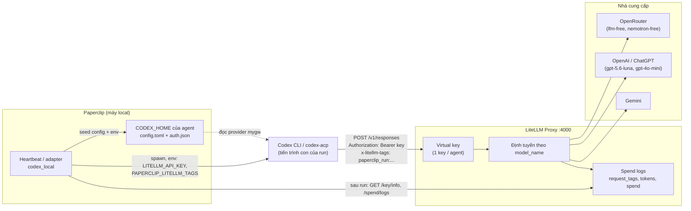
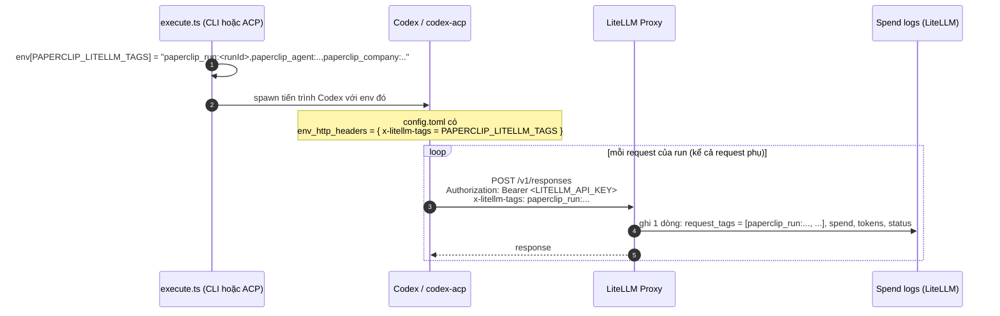
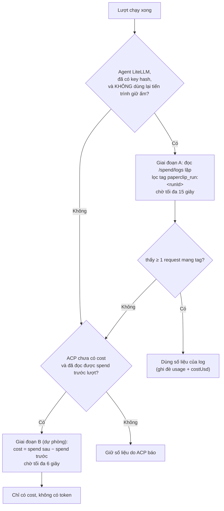

# Phần 2. Tích hợp LiteLLM và trace request theo run bằng tag

- Ngày: 29/10/2026
- Nhánh: `test_adapter`. Các link code trỏ tới commit [`f6c9d6bfc`](https://github.com/trung2710/ppclip/tree/f6c9d6bfc1225895047151d99f8d4002dacee482), nên số dòng không bị lệch khi code thay đổi sau này.
- Commit chính của phần này:
  - [`bbaf367c4`](https://github.com/trung2710/ppclip/commit/bbaf367c4) (20/10): `codex-toml.ts`, các hàm sửa `config.toml` cho LiteLLM và tag theo run;
  - [`35fdc3fbe`](https://github.com/trung2710/ppclip/commit/35fdc3fbe) (20/10): `litellm-spend.ts`, đọc lại usage của run từ log LiteLLM;
  - [`3ea8f0477`](https://github.com/trung2710/ppclip/commit/3ea8f0477) (20/10): nối hai phần trên vào luồng chạy run của engine ACP và CLI.
- Liên quan: Phần 1 (cách chọn chế độ LiteLLM và cách seed `CODEX_HOME`), Phần 3 (cost và budget, dùng số liệu mà phần này thu thập).

---

## Tóm tắt phần này

**Đã thực hiện:** đọc code của cả 2 engine, module `litellm-spend`, file cấu hình LiteLLM trên máy và 2 tài liệu nguồn; chạy các test liên quan; kiểm tra LiteLLM trên máy có đang chạy không.

| Nội dung trong plan | Trạng thái | Xem ở mục |
|---|---|---|
| Kiến trúc Codex → LiteLLM proxy → model | Xong | 1 |
| Đoạn provider được ghi vào `config.toml` | Xong | 2 |
| Key và URL đi tới LiteLLM bằng đường nào | Xong | 3 |
| Tag/metadata gắn vào request để trace theo run | Xong | 4 |
| Tag được gửi đi ở đâu, tra trên LiteLLM theo tag nào (mục "cần kiểm tra" trong plan) | Xong | 4.3, 6 |
| Dùng tag để lấy lại token và cost của run (chuyển sang Phần 3 để phân tích cost) | Xong ở mức cơ chế | 5 |
| Đối chiếu máy hiện tại | Xong | 7 |

**Nguồn đã dùng:**
- Code: `adapter-utils/src/codex-toml.ts`, `adapter-utils/src/litellm-spend.ts`, `adapter-utils/src/acpx-engine/execute.ts`, `adapter-utils/src/server-utils.ts`, `codex-local/src/server/execute.ts`.
- Commit: `bbaf367c4`, `35fdc3fbe`, `3ea8f0477`.
- Tài liệu: [HUONG_DAN_QUAN_TRI_MODEL_LITELLM_PROXY.md](../instructions/HUONG_DAN_QUAN_TRI_MODEL_LITELLM_PROXY.md), [thay_doi_litellm_guardian_cost_token_theo_run.md](../instructions/thay_doi_litellm_guardian_cost_token_theo_run.md).
- Cấu hình thật trên máy: `C:\Users\LAPTOP HP\litellm_config.yaml`, `custom_callbacks.py` (đã ẩn mọi key khi đọc).

**Kết quả kiểm tra:**
- LiteLLM trên máy **đang chạy**: `GET http://localhost:4000/health/liveliness` trả HTTP 200.
- **49 test pass** (22 của `litellm-spend`, 27 của `codex-toml`), cộng **3 test tích hợp ACPX** nhóm "LiteLLM gateway run usage". Tôi không chạy lại phép đo trên LiteLLM thật vì cần key của agent, nên các con số thật trong tài liệu nguồn chưa được tôi kiểm lại.
- Có 3 điểm đáng lưu ý: R1 (lane CLI chưa gom usage), R2 (chuỗi giống key thật nằm trong tài liệu đã push), R3 (LiteLLM đang lưu cả prompt vào spend logs). Xem mục 8.

**Kết luận chính:**
1. Agent LiteLLM nói chuyện với gateway qua provider `mygw` (`wire_api = "responses"`), do Paperclip tự ghi vào `config.toml` của home agent. Key lấy từ biến môi trường `LITELLM_API_KEY`.
2. Paperclip gắn **tag `paperclip_run:<runId>`** vào mọi request của run bằng cách đặt biến môi trường `PAPERCLIP_LITELLM_TAGS` và để Codex chuyển nó thành header `x-litellm-tags`. LiteLLM lưu thành `request_tags` mà không cần cấu hình thêm.
3. Nhờ tag, sau mỗi run Paperclip đọc `/spend/logs` và cộng lại **đúng các request của run đó**, kể cả khi nhiều run dùng chung một key. Cơ chế này chỉ hoạt động ở lane ACP; lane CLI mới chỉ gửi tag.

---

## 1. Kiến trúc: Codex → LiteLLM → model

Thay vì để agent gọi thẳng nhà cung cấp, mọi request đi qua **LiteLLM Proxy** (mặc định `http://localhost:4000/v1`). LiteLLM xác định agent nào gọi qua *virtual key*, tính cost và token, ghi log và có thể khóa key khi hết ngân sách. Xem [tài liệu quản trị, mục 1](../instructions/HUONG_DAN_QUAN_TRI_MODEL_LITELLM_PROXY.md).



Ba chi tiết cần nhớ:
- Một **run** không phải một request. Agent lặp nhiều lượt (lập kế hoạch, gọi tool, nạp kết quả), mỗi lượt là một request độc lập có token và cost riêng ([tài liệu, mục 3](../instructions/HUONG_DAN_QUAN_TRI_MODEL_LITELLM_PROXY.md)). Vì vậy cần một cách **gom các request về đúng run**: đó là vai trò của tag.
- Cùng một key có thể bị nhiều tiến trình dùng (nhiều run song song). Spend tích lũy của key vì thế không tách được theo run, trừ khi có tag.
- LiteLLM tự tính cost chính xác; vấn đề là Codex **vứt bỏ** trường `cost` khi đọc response, và `codex-acp` chỉ phát `{ used, size }` ([thay_doi…, mục 1](../instructions/thay_doi_litellm_guardian_cost_token_theo_run.md)). Nên Paperclip phải hỏi lại chính LiteLLM.

---

## 2. Đoạn provider ghi vào `config.toml`

Khi agent ở chế độ LiteLLM (Phần 1, mục 5), hàm `applyLiteLlmGatewayToml` sửa `config.toml` của home agent. Code: [codex-toml.ts:281-306](https://github.com/trung2710/ppclip/blob/f6c9d6bfc1225895047151d99f8d4002dacee482/packages/adapter-utils/src/codex-toml.ts#L281-L306).

```ts
// codex-toml.ts:282-306 (rút gọn)
const model = options.model?.trim() || "lfm-free";
const reasoningEffort = options.reasoningEffort?.trim() || "low";
const baseUrl = options.baseUrl?.trim() || DEFAULT_LITELLM_BASE_URL;   // http://localhost:4000/v1

const withRoot = setTomlRootKeys(cleaned, {
  model_provider: LITELLM_PROVIDER_ID,          // "mygw"
  model, model_reasoning_effort: reasoningEffort,
});
const withProvider = replaceTomlTable(withRoot, `model_providers.${LITELLM_PROVIDER_ID}`, {
  name: "My gateway",
  base_url: baseUrl,
  env_key: LITELLM_API_KEY_ENV,                 // "LITELLM_API_KEY"
  wire_api: "responses",
  env_http_headers: { [LITELLM_TAGS_HEADER]: LITELLM_TAGS_ENV },   // { "x-litellm-tags" = "PAPERCLIP_LITELLM_TAGS" }
});
return ensureCodexApprovalsDisabled(withProvider);
```

| Khóa | Ý nghĩa |
|---|---|
| `model_provider = "mygw"` | Bảo Codex dùng provider tự định nghĩa thay vì OpenAI mặc định. Tên `mygw` là hằng số `LITELLM_PROVIDER_ID` ([codex-toml.ts:20](https://github.com/trung2710/ppclip/blob/f6c9d6bfc1225895047151d99f8d4002dacee482/packages/adapter-utils/src/codex-toml.ts#L20)) |
| `model` | Tên model **trên LiteLLM** (`model_name` trong `litellm_config.yaml`), lấy từ cấu hình model của agent; nếu trống thì dùng `lfm-free` |
| `base_url` | Địa chỉ gateway; mặc định `http://localhost:4000/v1` |
| `env_key = "LITELLM_API_KEY"` | Codex đọc khóa gửi lên gateway từ **biến môi trường** này |
| `wire_api = "responses"` | Dùng API `/v1/responses` thay vì `/chat/completions` |
| `env_http_headers` | Với mỗi request, Codex đặt header `x-litellm-tags` bằng **giá trị hiện tại** của biến môi trường `PAPERCLIP_LITELLM_TAGS` (xem mục 4) |

Điểm thiết kế đáng chú ý:
- Bảng `[model_providers.mygw]` được **thay toàn bộ** ở mỗi lần seed, nên không bị lặp dòng và agent cũ tự được cập nhật. Các hàm sửa TOML làm việc theo từng bảng thay vì regex trên cả file, nên khóa `model` ở gốc không bao giờ bị nhầm với khóa cùng tên trong `[profiles.x]`. Xem phần đầu [codex-toml.ts:4-17](https://github.com/trung2710/ppclip/blob/f6c9d6bfc1225895047151d99f8d4002dacee482/packages/adapter-utils/src/codex-toml.ts#L4-L17).
- Hai engine (CLI và ACP) **dùng chung** module này, nên cấu hình sinh ra giống nhau.
- Hàm cuối cùng gọi `ensureCodexApprovalsDisabled` để tắt approval và Guardian. Lý do và hệ quả nằm ở Phần 4.

Mẫu `config.toml` thật của agent LiteLLM trên máy bạn (`agents/87c740d4…/codex-home/config.toml`), chỉ liệt kê các khóa liên quan:

```toml
model_provider = "mygw"
model = "gemini/gemini-3.6-flash"
approval_policy = "never"
approvals_reviewer = "user"

[features]
guardian_approval = false

[model_providers.mygw]
base_url = "http://localhost:4000/v1"
```

---

## 3. Key và URL đi tới LiteLLM bằng đường nào

Có hai nơi nhận key, và chúng phục vụ hai mục đích khác nhau:

| Nơi | Giá trị | Dùng để làm gì |
|---|---|---|
| Biến môi trường `LITELLM_API_KEY` của tiến trình Codex | Key của agent | Codex gửi nó làm `Authorization: Bearer` tới gateway (nhờ `env_key`) |
| `auth.json` trong home agent | `{"OPENAI_API_KEY": "<key>"}` hoặc `"litellm-placeholder"` | Codex CLI từ bản 0.122 chỉ đọc thông tin đăng nhập từ file này, nên cần có file để Codex chịu chạy (Phần 1, mục 1) |

- Biến môi trường của agent (kể cả `LITELLM_API_KEY`, `LITELLM_BASE_URL`) được chuyển nguyên vào tiến trình con: mọi khóa **không** bắt đầu bằng `PAPERCLIP_` đều được forward, kể cả giá trị lấy từ secret. Code: [server-utils.ts:2180-2192](https://github.com/trung2710/ppclip/blob/f6c9d6bfc1225895047151d99f8d4002dacee482/packages/adapter-utils/src/server-utils.ts#L2180-L2192). Khóa `PAPERCLIP_*` thì Paperclip giữ quyền quyết định, cấu hình của người dùng không ghi đè được.
- `resolveCodexGatewayConfig` quyết định `apiKey` là `OPENAI_API_KEY` nếu có, nếu không thì `LITELLM_API_KEY` ([codex-toml.ts:465](https://github.com/trung2710/ppclip/blob/f6c9d6bfc1225895047151d99f8d4002dacee482/packages/adapter-utils/src/codex-toml.ts#L465)). Khóa này là khóa mà Paperclip dùng khi **hỏi lại LiteLLM** sau run (mục 5), còn khóa Codex dùng để gọi model là `LITELLM_API_KEY`. Hai khóa thường trùng nhau; nếu khác nhau sẽ có rủi ro (R4, mục 8).

---

## 4. Tag: gắn "dấu vân tay" của run lên từng request

### 4.1. Tag gồm những gì

Hàm `buildPaperclipLiteLlmTags` tạo một chuỗi phân tách bằng dấu phẩy. Code: [codex-toml.ts:22-45](https://github.com/trung2710/ppclip/blob/f6c9d6bfc1225895047151d99f8d4002dacee482/packages/adapter-utils/src/codex-toml.ts#L22-L45).

```ts
export const LITELLM_TAGS_ENV = "PAPERCLIP_LITELLM_TAGS";
export const LITELLM_TAGS_HEADER = "x-litellm-tags";
export const PAPERCLIP_RUN_TAG_PREFIX = "paperclip_run:";

export function buildPaperclipLiteLlmTags(input) {
  const tags = [paperclipRunTag(input.runId)];                       // paperclip_run:<runId>
  if (input.agentId)   tags.push(`paperclip_agent:${input.agentId}`);
  if (input.companyId) tags.push(`paperclip_company:${input.companyId}`);
  return tags.map((tag) => tag.replace(/,/g, "_")).join(",");        // LiteLLM tách header theo dấu phẩy
}
```

Ví dụ giá trị thực tế:

```text
x-litellm-tags: paperclip_run:7f3a…,paperclip_agent:87c740d4-…,paperclip_company:b0964fd7-…
```

| Tag | Dùng để |
|---|---|
| `paperclip_run:<runId>` | Gom đúng các request của một run. Đây là tag mà code lọc theo |
| `paperclip_agent:<agentId>` | Xem tổng chi tiêu của một agent trên giao diện LiteLLM |
| `paperclip_company:<companyId>` | Xem tổng chi tiêu của một company |

Dấu phẩy bên trong một tag bị đổi thành `_`, vì LiteLLM tách header theo dấu phẩy.

### 4.2. Đường đi của tag (từ Paperclip tới log của LiteLLM)



Điểm mấu chốt: tag nằm ở **biến môi trường của tiến trình**, và Codex đọc biến này ở mỗi request. Vì Paperclip spawn một tiến trình Codex mới cho mỗi run, mỗi run tự nhiên có tag của riêng nó, kể cả request phụ như tạo tiêu đề hội thoại.

### 4.3. Tag được đặt ở đâu trong code

| Engine | Code | Điều kiện |
|---|---|---|
| CLI | [execute.ts:736-739](https://github.com/trung2710/ppclip/blob/f6c9d6bfc1225895047151d99f8d4002dacee482/packages/adapters/codex-local/src/server/execute.ts#L736-L739) | `gateway.isGateway` |
| ACP | [acpx-engine/execute.ts:1538-1549](https://github.com/trung2710/ppclip/blob/f6c9d6bfc1225895047151d99f8d4002dacee482/packages/adapter-utils/src/acpx-engine/execute.ts#L1538-L1549) | `resolveCodexGatewayConfig({ env }).isGateway` |

```ts
// acpx-engine/execute.ts:1539-1549
const isLiteLlm = resolveCodexGatewayConfig({ env }).isGateway;
// Forwarded by Codex as `x-litellm-tags` (env_http_headers in config.toml)
// so every gateway request of this run carries `paperclip_run:<runId>`.
// Set on the runtime env, not the adapter env, so it stays out of the
// session fingerprint and does not break session resume.
if (isLiteLlm) {
  env[LITELLM_TAGS_ENV] = buildPaperclipLiteLlmTags({ runId, agentId: agent.id, companyId: agent.companyId });
}
```

Comment trong code nêu một ràng buộc quan trọng: tag được đặt trên **env runtime**, không phải env cấu hình agent. Nếu đặt vào cấu hình agent thì `runId` đổi ở mỗi run sẽ làm fingerprint của session đổi theo, và agent mất phiên Codex cũ. Chi tiết fingerprint nằm ở Phần 5.

Agent **không** dùng LiteLLM thì không có tag, và không bị gọi gateway nào cả (có test kiểm tra).

### 4.4. Trace theo tag trên LiteLLM

LiteLLM tự đọc header `x-litellm-tags` và lưu vào `request_tags` của từng dòng spend log, **không cần cấu hình thêm** ([thay_doi…, mục 5](../instructions/thay_doi_litellm_guardian_cost_token_theo_run.md)). Có hai cách tra:

1. **Giao diện LiteLLM (Logs):** lọc theo tag `paperclip_run:<runId>` để thấy mọi request của run, hoặc `paperclip_agent:<agentId>` để xem cả agent.
2. **API:** `GET /spend/logs?api_key=<hash>&start_date=…&end_date=…&summarize=false`, rồi lọc `request_tags` chứa tag cần tìm. Lệnh PowerShell kèm các bước tự cộng lại có trong [thay_doi…, mục 6.2](../instructions/thay_doi_litellm_guardian_cost_token_theo_run.md); tôi **không chạy** lệnh này vì cần key của agent.

---

## 5. Từ tag tới token và cost của run

Phần này là cầu nối sang Phần 3. Module [litellm-spend.ts](https://github.com/trung2710/ppclip/blob/f6c9d6bfc1225895047151d99f8d4002dacee482/packages/adapter-utils/src/litellm-spend.ts) làm việc với các hàm sau:

| Hàm | Dòng | Việc làm |
|---|---|---|
| `getGatewayJson` | [51-69](https://github.com/trung2710/ppclip/blob/f6c9d6bfc1225895047151d99f8d4002dacee482/packages/adapter-utils/src/litellm-spend.ts#L51-L69) | `GET` một endpoint quản lý bằng chính key của agent; timeout 3 giây; mọi lỗi trả `null` |
| `readLiteLlmKeyInfo` | [79-89](https://github.com/trung2710/ppclip/blob/f6c9d6bfc1225895047151d99f8d4002dacee482/packages/adapter-utils/src/litellm-spend.ts#L79-L89) | `GET /key/info`: lấy spend tích lũy và **hash của key** (để lọc `/spend/logs`) |
| `summarizeTaggedSpendLogs` | [165-196](https://github.com/trung2710/ppclip/blob/f6c9d6bfc1225895047151d99f8d4002dacee482/packages/adapter-utils/src/litellm-spend.ts#L165-L196) | Hàm thuần: chỉ cộng các dòng có **đúng** tag của run |
| `collectLiteLlmRunUsage` | [206-247](https://github.com/trung2710/ppclip/blob/f6c9d6bfc1225895047151d99f8d4002dacee482/packages/adapter-utils/src/litellm-spend.ts#L206-L247) | Đọc lặp `/spend/logs` cho tới khi số liệu ổn định (tối đa 15 giây) |
| `measureLiteLlmRunCostUsd` | [100-127](https://github.com/trung2710/ppclip/blob/f6c9d6bfc1225895047151d99f8d4002dacee482/packages/adapter-utils/src/litellm-spend.ts#L100-L127) | Phương án dự phòng: spend của key sau run trừ spend trước run (tối đa 6 giây) |

Phép cộng cho một run:

```ts
// litellm-spend.ts:176-193 (rút gọn)
for (const raw of rows) {
  if (!tags.some((tag) => tag.trim() === runTag)) continue;     // khớp CHÍNH XÁC, không theo tiền tố
  usage.requestCount += 1;
  if (status === "failure") usage.failedRequestCount += 1;
  const cached = Math.min(prompt, cached_tokens ?? cache_read_input_tokens);
  usage.inputTokens       += prompt - cached;                   // input không tính phần cache
  usage.cachedInputTokens += cached;
  usage.outputTokens      += completion_tokens;
  usage.costUsd           += spend;
}
```

Cách cắm vào luồng chạy của ACP (`acpx-engine/execute.ts`):

| Bước | Code |
|---|---|
| Tạo client chỉ khi agent là Codex + gateway + có key + có URL | [2510-2517](https://github.com/trung2710/ppclip/blob/f6c9d6bfc1225895047151d99f8d4002dacee482/packages/adapter-utils/src/acpx-engine/execute.ts#L2510-L2517) |
| **Trước** lượt chạy: đọc `/key/info` lấy spend ban đầu và key hash | [3167-3173](https://github.com/trung2710/ppclip/blob/f6c9d6bfc1225895047151d99f8d4002dacee482/packages/adapter-utils/src/acpx-engine/execute.ts#L3167-L3173) |
| **Sau** lượt chạy: gom log theo tag (chỉ khi tiến trình được tạo mới cho run này) | [3212-3224](https://github.com/trung2710/ppclip/blob/f6c9d6bfc1225895047151d99f8d4002dacee482/packages/adapter-utils/src/acpx-engine/execute.ts#L3212-L3224) |
| Có ≥ 1 request mang tag: ghi đè `usage` và `costUsd` bằng số từ LiteLLM, in dòng log tóm tắt | [3225-3246](https://github.com/trung2710/ppclip/blob/f6c9d6bfc1225895047151d99f8d4002dacee482/packages/adapter-utils/src/acpx-engine/execute.ts#L3225-L3246) |
| Không có request nào mang tag: rơi về cách trừ spend của key | [3247-3254](https://github.com/trung2710/ppclip/blob/f6c9d6bfc1225895047151d99f8d4002dacee482/packages/adapter-utils/src/acpx-engine/execute.ts#L3247-L3254) |

Dòng log mà run in ra khi thành công:

```text
[paperclip] LiteLLM usage for paperclip_run:<runId>: N request(s) (M failed), input ..., cached ..., output ..., cost $....
```



Vì sao phải chờ: LiteLLM ghi request lỗi ngay nhưng ghi request thành công theo lô, nên đọc ngay lúc run xong có thể thiếu. Quan sát thực tế: có run từng báo "2 request, cả 2 đều lỗi, 0 token" trong khi thực tế còn nhiều request thành công chưa xuất hiện. Do đó code chỉ chốt khi đã có **ít nhất một request thành công** và số liệu đứng yên 2 lần đọc liên tiếp ([thay_doi…, mục 2.2 và 2.4](../instructions/thay_doi_litellm_guardian_cost_token_theo_run.md)). Cơ chế này là suy luận chưa kiểm chứng trên phiên bản LiteLLM của máy bạn (tài liệu nguồn cũng nói rõ).

Phần phân tích cost, cách cộng dồn vào ngân sách và độ chính xác sẽ trình bày ở Phần 3.

---

## 6. Trả lời hai câu hỏi trong plan

**Tag thực sự được gửi đi ở đâu?**
- Được tạo ở `execute.ts` của từng engine, đặt vào **biến môi trường của tiến trình Codex** (`PAPERCLIP_LITELLM_TAGS`).
- Biến này được Codex biến thành **header HTTP `x-litellm-tags`** trong mỗi request tới gateway, nhờ dòng `env_http_headers` của provider `mygw` trong `config.toml`.
- Nếu `config.toml` thiếu dòng này thì tag không được gửi. Dòng này được ghi lại ở mọi lần seed.

**Tra trên LiteLLM theo tag nào?**
- Theo `paperclip_run:<runId>` cho một run; `paperclip_agent:<agentId>` cho một agent; `paperclip_company:<companyId>` cho một company.
- Paperclip tự tra bằng `GET /spend/logs` và **chỉ** lọc theo `paperclip_run:<runId>`; hai tag còn lại chỉ để con người xem trên giao diện.

---

## 7. Đối chiếu với máy hiện tại

| Hạng mục | Kết quả |
|---|---|
| LiteLLM đang chạy? | **Có**, `health/liveliness` trả 200 |
| `litellm_config.yaml` | 6 model: `codex-model`, `codex-plus` (đều → `openai/gpt-5.6-luna`), `codex-turbo` (→ `gpt-4o-mini`), `luna` (→ `chatgpt/gpt-5.6-luna`), `lfm-free`, `nemotron-free` (→ OpenRouter, bản `:free`). `store_model_in_db: true` |
| Model của agent LiteLLM `87c740d4…` | `gemini/gemini-3.6-flash`, **không có trong danh sách 6 model của file yaml**; vì `store_model_in_db` bật nên model có thể đã được thêm qua giao diện hoặc database (tôi không kiểm tra database) |
| `custom_callbacks.inject_cost` | Vẫn được bật trong yaml. Đây là cách làm đời đầu (nhét `cost` vào response); **Paperclip không dùng** vì Codex bỏ trường này. Không gây hại, chỉ là cấu hình thừa |
| `store_prompts_in_spend_logs` | **`true`**, xem R3 |
| `config.toml` của agent LiteLLM | Có `model_provider = "mygw"`, `base_url = "http://localhost:4000/v1"`, approval `never`, `guardian_approval = false` |
| **Đối chiếu log run với sổ cost** (agent `DW VT`, 29/10) | Tôi so dòng `[paperclip] LiteLLM usage for …` trong log của 14 run với dòng `cost_events` cùng run: **12 run khớp tuyệt đối** cả 3 loại token và cost tới 6 chữ số thập phân (ví dụ run `f6362980`, 27/10: 11 request, 1 lỗi, 8,143328 cent). 2 run còn lại (13/10) lệch cost vì khi đó sổ ghi `subscription_included` nên cost bị đặt 0; lỗi này đã được sửa ở commit `3ea8f0477` ngày 20/10 (xem comment trong `resolveCodexBillingType`, [execute.ts:164-170](https://github.com/trung2710/ppclip/blob/f6c9d6bfc1225895047151d99f8d4002dacee482/packages/adapters/codex-local/src/server/execute.ts#L164-L170)). Vậy chuỗi tag → log LiteLLM → `cost_events` **hoạt động đúng trong thực tế** |
| **Một run bất thường** | Run `0dc97c51…` (27/10) **không có** dòng `LiteLLM usage for …` nhưng vẫn có cost event 13,385325 cent với chỉ 2.153 token input, 43.069 cached, 133 output. Tỷ lệ cost trên token cao khoảng 5 lần so với các run khác (run `f6362980` tốn 8,14 cent cho 65.964 input, 274.087 cached, 3.041 output). Tôi **chưa xác định được nguyên nhân**: giả thuyết là việc gom log theo tag không thấy request nào và cost đến từ phương án dự phòng (trừ spend của key, có thể lẫn request khác dùng cùng key). Ghi chú này là giả thuyết, chưa kiểm chứng |

---

## 8. Rủi ro và điểm cần lưu ý

**R1. Lane CLI chưa gom usage theo tag. Mức trung bình.**
Lane CLI (`engine: "cli"`) chỉ **gửi tag** ([execute.ts:736-739](https://github.com/trung2710/ppclip/blob/f6c9d6bfc1225895047151d99f8d4002dacee482/packages/adapters/codex-local/src/server/execute.ts#L736-L739)). Tôi tìm trong `codex-local/src/server/` không thấy chỗ nào gọi `collectLiteLlmRunUsage` hay `measureLiteLlmRunCostUsd`, khớp với bảng ở [thay_doi…, mục 4 và 7](../instructions/thay_doi_litellm_guardian_cost_token_theo_run.md). Hậu quả: agent LiteLLM chạy bằng CLI có token do Codex báo nhưng **không có cost** từ LiteLLM. Hướng sửa: tách phần cắm vào luồng chạy (mục 5) thành hàm dùng chung rồi gọi từ cả 2 engine. Hiện trên máy bạn mặc định chạy ACP nên chưa ảnh hưởng.

**R2. Chuỗi giống key thật đang nằm trong tài liệu đã push lên GitHub. Mức cao nếu repo public hoặc có người ngoài truy cập.**
Tôi tìm các chuỗi có dạng `sk-…` trong thư mục `instructions/` của nhánh `origin/test_adapter` và thấy **2 chuỗi có dạng virtual key của LiteLLM** (25 ký tự): một chuỗi bắt đầu bằng `sk-0hqC` (xuất hiện 2 lần) và một chuỗi bắt đầu bằng `sk-fMo_` (xuất hiện 4 lần, trong đó có lệnh `curl` ở [HUONG_DAN_QUAN_TRI_MODEL_LITELLM_PROXY.md:47](https://github.com/trung2710/ppclip/blob/f6c9d6bfc1225895047151d99f8d4002dacee482/instructions/HUONG_DAN_QUAN_TRI_MODEL_LITELLM_PROXY.md#L47)). Chuỗi `sk-fMo_` được thêm lần đầu trong commit [`1e5d60189`](https://github.com/trung2710/ppclip/commit/1e5d60189) (24/09). Các chuỗi còn lại (`sk-lite…`, `sk-cha-…`, `sk-con-…`, `sk-done…`) trông như giá trị ví dụ. Tôi không in đầy đủ chuỗi nào trong báo cáo này.
- Tôi **không xác minh được** hai chuỗi đó còn hiệu lực hay không, và cũng không xác minh được repo `trung2710/ppclip` là public hay private (máy không có `gh`).
- Khuyến nghị: nếu còn hiệu lực thì **thu hồi và tạo key mới** trong LiteLLM; thay bằng `<YOUR_KEY>` trong tài liệu. Xóa khỏi file không đủ, vì chuỗi vẫn nằm trong lịch sử git.

**R3. LiteLLM đang lưu cả prompt vào spend logs.**
`store_prompts_in_spend_logs: true` trong `litellm_config.yaml` làm log nặng hơn nhiều và lưu toàn bộ nội dung hội thoại của agent trong database của LiteLLM. Tài liệu nguồn khuyên **tắt** (chỉ bật khi thử nghiệm); tag và cost vẫn còn khi tắt ([thay_doi…, mục 5](../instructions/thay_doi_litellm_guardian_cost_token_theo_run.md)).

**R4. Hai khóa có thể lệch nhau.**
Codex gọi gateway bằng `LITELLM_API_KEY` (mục 3), còn Paperclip hỏi lại LiteLLM bằng `OPENAI_API_KEY` nếu có, nếu không thì `LITELLM_API_KEY`. Nếu một agent đặt cả hai với hai giá trị khác nhau, `/key/info` và `/spend/logs` sẽ trả dữ liệu của **key khác** với key đã gọi model, tag không khớp và số liệu về 0 hoặc rơi sang phương án dự phòng. Đây là suy luận từ code, **chưa chạy thử**. Cách tránh: dùng một khóa duy nhất cho agent LiteLLM.

**R5. Tiến trình giữ ấm (`warmHandleIdleMs > 0`) làm tag sai.**
Tiến trình được dùng lại sẽ mang tag của run cũ. Code phát hiện (`!cached?.runtime` ở [dòng 3215](https://github.com/trung2710/ppclip/blob/f6c9d6bfc1225895047151d99f8d4002dacee482/packages/adapter-utils/src/acpx-engine/execute.ts#L3215)) và rơi về cách trừ spend, nhưng trên giao diện LiteLLM các request đó vẫn mang tag run cũ. Nên giữ `warmHandleIdleMs = 0` (mặc định) cho agent LiteLLM.

**R6. Run có thể chậm thêm 3 đến 21 giây.**
Thời gian chờ nằm **bên trong** run: run chỉ kết thúc sau khi chờ xong, và run kế tiếp của cùng agent chỉ bắt đầu sau đó. Bình thường chậm thêm khoảng 3 giây. Khi mọi request của run đều lỗi (model sai, 429) hoặc không có request nào mang tag thì phải chờ đủ 15 giây, cộng thêm tối đa 6 giây của phương án dự phòng. Có thể chỉnh bằng `adapterConfig.litellmSpendSettleMs`. Giá trị 15 giây là ước lượng, chưa đo độ trễ thật.

**R7. Request phụ của Codex thất bại làm nhiễu log.**
Codex dùng tên model `gpt-5.6-luna` cho request tạo tiêu đề hội thoại. File yaml hiện có alias `luna` chứ chưa thấy alias `gpt-5.6-luna`, nên các request đó có thể thất bại (`Invalid model name`). Không tốn tiền nhưng thêm dòng lỗi vào log và làm tăng `failedRequestCount`. Có thể thêm alias, như đề xuất trong [thay_doi…, mục 5](../instructions/thay_doi_litellm_guardian_cost_token_theo_run.md).

**R8. Tài liệu cũ lệch với code.**
- Mục 5 và mục 8.5 của [HUONG_DAN_QUAN_TRI_MODEL_LITELLM_PROXY.md](../instructions/HUONG_DAN_QUAN_TRI_MODEL_LITELLM_PROXY.md) mô tả cách lấy cost qua `usage.cost` trong response. Cách này **không hoạt động** vì Codex bỏ trường `cost` ([thay_doi…, mục 8](../instructions/thay_doi_litellm_guardian_cost_token_theo_run.md) đã đính chính). Khi trích dẫn, nên theo cơ chế tag ở báo cáo này.
- `thay_doi_litellm_guardian_cost_token_theo_run.md` ghi "chưa commit" và số dòng cũ; code đã được commit ngày 20/10 và số dòng đã đổi. Báo cáo này dùng số dòng của commit `f6c9d6bfc`.

**R9. Sub-agent của Codex chưa được kiểm chứng.**
Sub-agent dùng cùng tiến trình và cùng cấu hình provider nên được kỳ vọng mang cùng tag, nhưng tài liệu nguồn ghi rõ là chưa kiểm chứng.

---

## 9. Kết luận

1. **Cấu hình một lần, dùng cho mọi request.** Paperclip ghi provider `mygw` vào `config.toml` của home agent. Từ đó Codex gửi mọi request tới LiteLLM, lấy khóa từ `LITELLM_API_KEY`.
2. **Tag là cầu nối giữa Paperclip và LiteLLM.** Một biến môi trường (`PAPERCLIP_LITELLM_TAGS`) cộng một dòng `env_http_headers` thành header `x-litellm-tags` trên **mọi** request của run. LiteLLM lưu vào `request_tags` mà không cần cấu hình. Tag được đặt ở env runtime để không làm hỏng việc nạp lại session.
3. **Có tag thì tách được số liệu theo run**, kể cả khi nhiều run dùng chung một key. Không có tag thì chỉ còn cách trừ spend của key, và cách này bị lẫn khi chạy song song.
4. **Lane ACP đã hoàn chỉnh, lane CLI mới làm nửa đường** (chỉ gửi tag, chưa gom usage).
5. **Nên xử lý tiếp:**
   - R2: thu hồi key nếu còn hiệu lực và xóa chuỗi khỏi tài liệu;
   - R3: tắt `store_prompts_in_spend_logs` khi không cần;
   - R1: gom usage cho lane CLI;
   - R4: dùng một khóa duy nhất cho agent LiteLLM.

---

## Phụ lục A. Danh sách file đã trích dẫn

| File | Nội dung chính |
|---|---|
| [packages/adapter-utils/src/codex-toml.ts](https://github.com/trung2710/ppclip/blob/f6c9d6bfc1225895047151d99f8d4002dacee482/packages/adapter-utils/src/codex-toml.ts) | Provider `mygw`, hằng số, tag, `resolveCodexGatewayConfig` |
| [packages/adapter-utils/src/litellm-spend.ts](https://github.com/trung2710/ppclip/blob/f6c9d6bfc1225895047151d99f8d4002dacee482/packages/adapter-utils/src/litellm-spend.ts) | Đọc `/key/info`, `/spend/logs`, cộng usage theo tag, phương án dự phòng |
| [packages/adapter-utils/src/acpx-engine/execute.ts](https://github.com/trung2710/ppclip/blob/f6c9d6bfc1225895047151d99f8d4002dacee482/packages/adapter-utils/src/acpx-engine/execute.ts) | Đặt tag, đo usage trước và sau lượt chạy (engine ACP) |
| [packages/adapters/codex-local/src/server/execute.ts](https://github.com/trung2710/ppclip/blob/f6c9d6bfc1225895047151d99f8d4002dacee482/packages/adapters/codex-local/src/server/execute.ts) | Đặt tag (engine CLI) |
| [packages/adapter-utils/src/server-utils.ts](https://github.com/trung2710/ppclip/blob/f6c9d6bfc1225895047151d99f8d4002dacee482/packages/adapter-utils/src/server-utils.ts#L2180-L2192) | Chuyển env của agent vào tiến trình con |
| [packages/adapter-utils/src/litellm-spend.test.ts](https://github.com/trung2710/ppclip/blob/f6c9d6bfc1225895047151d99f8d4002dacee482/packages/adapter-utils/src/litellm-spend.test.ts), [codex-toml.test.ts](https://github.com/trung2710/ppclip/blob/f6c9d6bfc1225895047151d99f8d4002dacee482/packages/adapter-utils/src/codex-toml.test.ts) | Test đơn vị |

## Phụ lục B. Cách tự kiểm tra trên máy

```sh
# 1. LiteLLM có chạy không
curl -s -o /dev/null -w "%{http_code}\n" http://localhost:4000/health/liveliness     # kỳ vọng 200

# 2. config.toml của agent LiteLLM có đủ provider và dòng gửi tag không
grep -n -E "model_provider|env_http_headers|base_url|env_key" \
  "$HOME/.paperclip/instances/default/companies/<companyId>/agents/<agentId>/codex-home/config.toml"

# 3. Chạy lại các test của phần này (từ thư mục gốc repo)
npx vitest run packages/adapter-utils/src/litellm-spend.test.ts packages/adapter-utils/src/codex-toml.test.ts
npx vitest run packages/adapter-utils/src/acpx-engine/execute.test.ts -t "LiteLLM gateway run usage"

# 4. Sau một run của agent LiteLLM (engine ACP), cuối log phải có dòng:
#    [paperclip] LiteLLM usage for paperclip_run:<runId>: N request(s) (M failed), input ..., cached ..., output ..., cost $...
#    Rồi so với tổng trên LiteLLM UI (Logs, lọc tag paperclip_run:<runId>) hoặc dùng lệnh PowerShell ở
#    instructions/thay_doi_litellm_guardian_cost_token_theo_run.md, mục 6.2.
```
