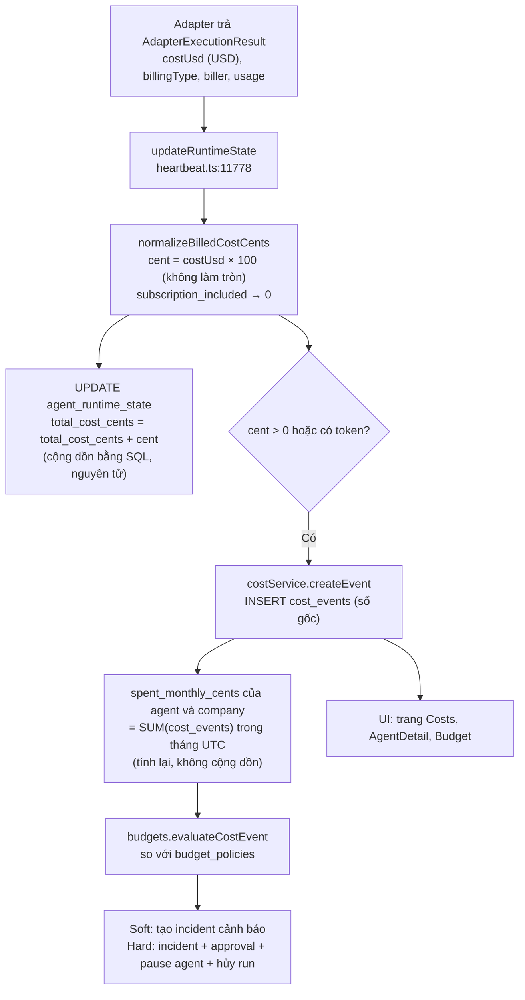
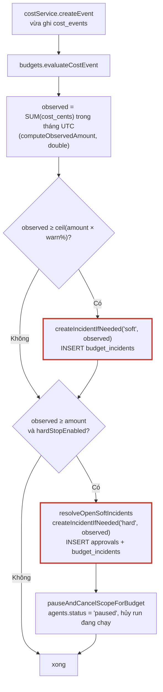

# Phần 3. Cost và budget: đơn vị tiền, ghi sổ, cộng dồn và hard-stop

- Ngày: 29/10/2026
- Nhánh: `test_adapter`. Các link code trỏ tới commit [`f6c9d6bfc`](https://github.com/trung2710/ppclip/tree/f6c9d6bfc1225895047151d99f8d4002dacee482), nên số dòng không bị lệch khi code thay đổi sau này.
- Commit chính của phần này:
  - [`deb455001`](https://github.com/trung2710/ppclip/commit/deb455001) (24/09): lấy cost từ response của LLM và bỏ làm tròn khi đổi sang cent;
  - [`78e56c780`](https://github.com/trung2710/ppclip/commit/78e56c780) (24/09): migration 0195, đổi 8 cột tiền sang `double precision`;
  - [`6b9293b28`](https://github.com/trung2710/ppclip/commit/6b9293b28) (24/09): hiển thị cost tới 6 chữ số thập phân trên giao diện;
  - [`b063835d0`](https://github.com/trung2710/ppclip/commit/b063835d0) (28/09): tài liệu migration;
  - [`35fdc3fbe`](https://github.com/trung2710/ppclip/commit/35fdc3fbe), [`3ea8f0477`](https://github.com/trung2710/ppclip/commit/3ea8f0477) (20/10): lấy token và cost của run từ log LiteLLM (đã trình bày ở Phần 2).
- Liên quan: Phần 2 (nguồn số liệu cost của agent LiteLLM).

---

## Tóm tắt phần này

**Đã thực hiện:** đọc toàn bộ đường đi của cost từ adapter tới màn hình (heartbeat, `costs.ts`, `budgets.ts`, schema, UI); đối chiếu với 3 tài liệu nguồn; **đọc trực tiếp (chỉ đọc) database thật** của bạn; chạy test sẵn có; viết và chạy một test tái hiện trên Postgres tạm.

| Nội dung trong plan | Trạng thái | Xem ở mục |
|---|---|---|
| Đổi cost sang `double precision` và lý do cần độ chính xác dưới 1 cent | Xong | 1, 3 |
| Cách tính cost và đường đi tới sổ cái | Xong | 2 |
| Hiển thị cost đủ số thập phân | Xong | 3.4, 9 |
| Cộng dồn cost (runtime state, cost_events, chi tiêu tháng) | Xong | 4 |
| Budget sau khi đổi kiểu dữ liệu (mục "cần kiểm tra" trong plan) | Xong, **phát hiện lỗi** | 5, 6 |
| Tổng `agentRuntimeState` có khớp tổng `cost_events` không, có tính trùng không | Xong | 4.2 |

**Nguồn đã dùng:**
- Code: `server/src/services/heartbeat.ts`, `costs.ts`, `budgets.ts`; `packages/db/src/schema/*`; migration `0195`; `codex-local/src/server/parse.ts`, `execute.ts`; `ui/src/lib/utils.ts`.
- Commit: `deb455001`, `78e56c780`, `6b9293b28`, `b063835d0`.
- Tài liệu: [CAU_HINH_BUDGET_PAPERCLIP.md](../instructions/CAU_HINH_BUDGET_PAPERCLIP.md), [migration_db_guide.md](../instructions/migration_db_guide.md), [thay_doi_litellm_guardian_cost_token_theo_run.md](../instructions/thay_doi_litellm_guardian_cost_token_theo_run.md).

**Kết quả kiểm tra (trên máy bạn, ngày 29/10):**
- Database thật: migration `0195` đã áp dụng (195 migration); 8 cột tiền đúng là `double precision`. Có 224 `cost_events` (19 sự kiện có phần lẻ), **không có sự kiện trùng**, và tổng `agent_runtime_state` **khớp hoàn toàn** tổng `cost_events` của cả 2 agent có chi phí.
- Test sẵn có: `costs-service`, `heartbeat-cost-accounting`, `budgets-service` **pass** (40 test); `parse.test.ts` **2 test fail**, do nhánh thêm trường `costUsd` mà chưa cập nhật test (mục 10).
- Test tái hiện (đã xóa file tạm, bản lưu ở [reports/repro/](repro/budget-fractional-cents.repro.test.ts.txt)): **xác nhận lỗi ngân sách** với số cent lẻ.

**Kết luận chính:**
1. Cost đi từ `costUsd` (USD) nhân 100 thành cent **không làm tròn nữa**, rồi ghi vào 3 nơi: `cost_events` (sổ gốc), `agent_runtime_state` (cộng dồn bằng SQL), và chi tiêu tháng của agent và company (tính lại từ tổng `cost_events`). Dữ liệu thật cho thấy 3 nơi này nhất quán.
2. **Lỗi cần sửa trước khi thử nghiệm budget:** migration 0195 chỉ đổi các cột *cost*, còn các cột *ngân sách* `budget_policies.amount` và `budget_incidents.amount_limit/amount_observed` vẫn là `integer`. Khi chi tiêu của agent vượt ngưỡng cảnh báo hoặc ngưỡng cứng mà con số có phần lẻ (gần như luôn xảy ra từ khi bỏ làm tròn), việc ghi incident **lỗi**, nên agent **không bị tự động pause** và run bị đánh dấu lỗi muộn (mục 6).
3. Agent `DW VT` của bạn đang ở **73,57 / 100 cent**, chỉ còn ~6,4 cent nữa là chạm ngưỡng cảnh báo 80%. Run kế tiếp của nó (các run gần nhất tốn 8 đến 13 cent) **rất có thể** kích hoạt lỗi này.

---

## 1. Vấn đề: cost của LLM nhỏ hơn 1 cent

Trước khi sửa, Paperclip làm tròn mọi khoản chi về **cent nguyên** (`Math.round(costUsd * 100)`) và các cột tiền là `integer`/`bigint`. Một lượt gọi model rẻ như `gemini-flash` thường chỉ tốn vài phần nghìn đô la. Dữ liệu thật trên máy bạn:

| Hạng mục | Giá trị |
|---|---|
| Cost nhỏ nhất khác 0 | 0,01234567 cent (khoảng $0,000123) |
| Số cost event có phần lẻ | 19 trên 224 |
| Ví dụ run của agent `DW VT` | 8,143328 cent; 13,385325 cent |

Một khoản $0,004 (0,4 cent) khi làm tròn thành **0 cent**, nên chi phí của cả một ngày chạy nhiều run nhỏ có thể về 0 và ngân sách không bao giờ chạm. Vì thế nhánh `test_adapter`:
1. bỏ làm tròn khi đổi sang cent;
2. đổi các cột tiền sang `double precision`;
3. cho giao diện hiển thị thêm chữ số thập phân.

---

## 2. Đường đi của cost: từ adapter tới màn hình



| Bước | Code |
|---|---|
| Đổi USD sang cent, không làm tròn | [heartbeat.ts:2684-2693](https://github.com/trung2710/ppclip/blob/f6c9d6bfc1225895047151d99f8d4002dacee482/server/src/services/heartbeat.ts#L2684-L2693) |
| Chuẩn hóa loại billing | [heartbeat.ts:2660-2678](https://github.com/trung2710/ppclip/blob/f6c9d6bfc1225895047151d99f8d4002dacee482/server/src/services/heartbeat.ts#L2660-L2678) |
| Cộng dồn `agent_runtime_state` | [heartbeat.ts:11803-11817](https://github.com/trung2710/ppclip/blob/f6c9d6bfc1225895047151d99f8d4002dacee482/server/src/services/heartbeat.ts#L11803-L11817) |
| Ghi `cost_events` | [heartbeat.ts:11819-11838](https://github.com/trung2710/ppclip/blob/f6c9d6bfc1225895047151d99f8d4002dacee482/server/src/services/heartbeat.ts#L11819-L11838) |
| Tính lại chi tiêu tháng và gọi đánh giá ngân sách | [costs.ts:55-103](https://github.com/trung2710/ppclip/blob/f6c9d6bfc1225895047151d99f8d4002dacee482/server/src/services/costs.ts#L55-L103) |

```ts
// heartbeat.ts:2684-2693  (bản cũ bị comment lại, bản mới bên dưới)
// function normalizeBilledCostCents(...) { ... return Math.max(0, Math.round(costUsd * 100)); }
function normalizeBilledCostCents(costUsd, billingType): number {
  if (billingType === "subscription_included") return 0;
  if (typeof costUsd !== "number" || !Number.isFinite(costUsd)) return 0;
  return Math.max(0, costUsd * 100);          // không làm tròn
}
```

```ts
// heartbeat.ts:11811-11814: cộng dồn bằng SQL, không đọc rồi ghi lại
totalCostCents: sql`${agentRuntimeState.totalCostCents} + ${additionalCostCents}`,
```

**Nguồn của `costUsd`:**
- Agent LiteLLM chạy engine ACP: lấy từ log LiteLLM theo tag của run (Phần 2).
- Agent dùng subscription ChatGPT: không có cost, `billingType` là `subscription_included`, nên ghi **0 cent** (có token nhưng cost bằng 0).
- Agent engine CLI và agent n8n: xem R3 ở mục 11.

**Loại billing quyết định cost có được tính vào ngân sách hay không.** Trên máy bạn:

| `billing_type` | `biller` | Số event | Tổng (cent) | Ý nghĩa |
|---|---|---|---|---|
| `subscription_included` | `chatgpt` | 185 | 0 | Agent dùng tài khoản ChatGPT, không tốn tiền theo token |
| `metered_api` | `litellm` | 13 | 73,566033 | Agent `DW VT` qua LiteLLM |
| `metered_api` | `openai` | 22 | 0,07407402 | Agent `Codex` khi từng dùng API key |
| `unknown` | `groq` | 4 | 0 | Không có giá |

Hệ quả cần nhớ: **ngân sách chỉ có tác dụng với agent trả tiền theo token** (`metered_api`). Agent subscription luôn có cost 0 nên không bao giờ chạm ngân sách; đó là thiết kế, không phải lỗi.

Cờ `cost_status` được đặt là `unpriced` khi có token nhưng `costUsd == null`, còn lại là `reported` ([heartbeat.ts:2695-2703](https://github.com/trung2710/ppclip/blob/f6c9d6bfc1225895047151d99f8d4002dacee482/server/src/services/heartbeat.ts#L2695-L2703)).

---

## 3. Những gì nhánh đã thay đổi

### 3.1. Bỏ làm tròn: [`deb455001`](https://github.com/trung2710/ppclip/commit/deb455001)

Ngoài hàm `normalizeBilledCostCents` ở trên, commit này còn cho adapter CLI đọc `cost` từ output của Codex:

```ts
// codex-local/src/server/parse.ts:80-84
if (usageObj.cost != null) {
  costUsd = (costUsd ?? 0) + asNumber(usageObj.cost, 0);
} else if (event.cost != null) {
  costUsd = (costUsd ?? 0) + asNumber(event.cost, 0);
}
```

và trả `costUsd: attempt.parsed.costUsd ?? null` thay vì `null` cố định ([execute.ts:1245](https://github.com/trung2710/ppclip/blob/f6c9d6bfc1225895047151d99f8d4002dacee482/packages/adapters/codex-local/src/server/execute.ts#L1245), [execute.ts:1369](https://github.com/trung2710/ppclip/blob/f6c9d6bfc1225895047151d99f8d4002dacee482/packages/adapters/codex-local/src/server/execute.ts#L1369)). Lưu ý: cách này giả định Codex xuất ra trường `cost`. Phần sau đã kiểm chứng rằng **Codex thật bỏ trường này** ([thay_doi…, mục 1 và 8](../instructions/thay_doi_litellm_guardian_cost_token_theo_run.md)), nên đường này chỉ có tác dụng nếu có một lớp trung gian chèn `cost` vào; xem R3.

### 3.2. Đổi kiểu cột: [`78e56c780`](https://github.com/trung2710/ppclip/commit/78e56c780), migration 0195

[0195_double_precision_costs.sql](https://github.com/trung2710/ppclip/blob/f6c9d6bfc1225895047151d99f8d4002dacee482/packages/db/src/migrations/0195_double_precision_costs.sql):

```sql
ALTER TABLE "cost_events"          ALTER COLUMN "cost_cents"           SET DATA TYPE double precision;
ALTER TABLE "agent_runtime_state"  ALTER COLUMN "total_cost_cents"     SET DATA TYPE double precision;
ALTER TABLE "agents"               ALTER COLUMN "budget_monthly_cents" SET DATA TYPE double precision;
ALTER TABLE "agents"               ALTER COLUMN "spent_monthly_cents"  SET DATA TYPE double precision;
ALTER TABLE "companies"            ALTER COLUMN "budget_monthly_cents" SET DATA TYPE double precision;
ALTER TABLE "companies"            ALTER COLUMN "spent_monthly_cents"  SET DATA TYPE double precision;
ALTER TABLE "status_card_updates"  ALTER COLUMN "cost_cents"           SET DATA TYPE double precision;
ALTER TABLE "finance_events"       ALTER COLUMN "amount_cents"         SET DATA TYPE double precision;
```

Đối chiếu với **kiểu thực tế trong database của bạn** (truy vấn `information_schema`, chỉ đọc):

| Bảng.cột | Kiểu thực tế | Do migration 0195? |
|---|---|---|
| `cost_events.cost_cents` | double precision | Có |
| `agent_runtime_state.total_cost_cents` | double precision | Có |
| `agents.budget_monthly_cents`, `spent_monthly_cents` | double precision | Có |
| `companies.budget_monthly_cents`, `spent_monthly_cents` | double precision | Có |
| `status_card_updates.cost_cents` | double precision | Có |
| `finance_events.amount_cents` | double precision | Có |
| **`budget_policies.amount`** | **integer** | **Không** |
| **`budget_incidents.amount_limit`** | **integer** | **Không** |
| **`budget_incidents.amount_observed`** | **integer** | **Không** |

Khai báo schema: [cost_events.ts:28](https://github.com/trung2710/ppclip/blob/f6c9d6bfc1225895047151d99f8d4002dacee482/packages/db/src/schema/cost_events.ts#L28), [agent_runtime_state.ts:18](https://github.com/trung2710/ppclip/blob/f6c9d6bfc1225895047151d99f8d4002dacee482/packages/db/src/schema/agent_runtime_state.ts#L18), [budget_policies.ts:13](https://github.com/trung2710/ppclip/blob/f6c9d6bfc1225895047151d99f8d4002dacee482/packages/db/src/schema/budget_policies.ts#L13), [budget_incidents.ts:20-21](https://github.com/trung2710/ppclip/blob/f6c9d6bfc1225895047151d99f8d4002dacee482/packages/db/src/schema/budget_incidents.ts#L20-L21). Ba dòng in đậm là nguồn gốc của lỗi ở mục 6.

### 3.3. Tài liệu migration: [`b063835d0`](https://github.com/trung2710/ppclip/commit/b063835d0)

[migration_db_guide.md](../instructions/migration_db_guide.md) mô tả cách tạo migration và cách mock test số thập phân. Commit này cũng đưa vào một bản báo cáo sự cố Postgres nhúng. Ghi chú: phần lớn dòng đổi trong `codex-local/execute.ts` của commit này chỉ là đổi kiểu xuống dòng (`git show -w` chỉ còn 3 dòng thay đổi thật).

### 3.4. Hiển thị: [`6b9293b28`](https://github.com/trung2710/ppclip/commit/6b9293b28)

```ts
// ui/src/lib/utils.ts:36-38
export function formatCents(cents: number): string {
  return `$${(cents / 100).toLocaleString("en-US", { minimumFractionDigits: 2, maximumFractionDigits: 6 })}`;
}
// ui/src/pages/AgentDetail.tsx:1640  →  `$${metrics.cost.toFixed(6)}`   (trước là toFixed(4))
```

Ví dụ: 73,566033 cent hiển thị `$0.73566`; 0,07407402 cent hiển thị `$0.000741`. Xem thêm mục 9.

---

## 4. Cộng dồn: ba "sổ" và việc chúng có khớp nhau không

| Sổ | Cách cập nhật | Phạm vi thời gian |
|---|---|---|
| `cost_events.cost_cents` | Mỗi run một dòng (INSERT) | Mọi lúc, là **sổ gốc** |
| `agent_runtime_state.total_cost_cents` | **Cộng dồn** bằng SQL `x = x + cent` | Toàn thời gian |
| `agents.spent_monthly_cents`, `companies.spent_monthly_cents` | **Tính lại** từ `SUM(cost_events)` mỗi khi có event mới ([costs.ts:30-50](https://github.com/trung2710/ppclip/blob/f6c9d6bfc1225895047151d99f8d4002dacee482/server/src/services/costs.ts#L30-L50), [79-98](https://github.com/trung2710/ppclip/blob/f6c9d6bfc1225895047151d99f8d4002dacee482/server/src/services/costs.ts#L79-L98)) | Tháng UTC hiện tại |

Thiết kế này có hai ưu điểm:
- Hai run kết thúc cùng lúc vẫn cộng đủ, vì cộng dồn là một câu SQL nguyên tử, không đọc rồi ghi.
- Chi tiêu tháng luôn đúng với sổ gốc vì được **tính lại** thay vì cộng dồn, nên không bị trôi dần.

### 4.2. Kết quả đối chiếu trên database thật

| Agent | `runtime_total` | Tổng `cost_events` (mọi lúc) | Tổng tháng này | `spent_monthly_cents` | Số event | Lệch |
|---|---|---|---|---|---|---|
| `DW VT` | 73,566033 | 73,566033 | 73,566033 | 73,566033 | 30 | **0** |
| `Codex` | 0,07407402 | 0,07407402 | 0 (event ở tháng trước) | 0 | 155 | **0** |

- Số `heartbeat_run_id` có nhiều hơn 1 cost event: **0**. Vậy không có trường hợp tính trùng trên dữ liệu thật.
- Hai nguồn tổng (cộng dồn và tính lại) cùng xuất phát từ một con số `additionalCostCents`, nên chỉ lệch khi một trong hai bước ghi thất bại giữa chừng. Điều này **có thể xảy ra** khi `evaluateCostEvent` ném lỗi (mục 6): lúc đó `cost_events` và `spent_monthly_cents` đã được ghi, nhưng các bước sau trong khối kết thúc run bị bỏ qua.
- Giá trị `73.56603299999999` của `spent_monthly_cents` là nhiễu dấu phẩy động bình thường của `double precision`, không phải lỗi.

---

## 5. Budget hoạt động thế nào

### 5.1. Chính sách và đơn vị

Mỗi `budget_policies` có: phạm vi (`company`, `agent`, `project`), cửa sổ (`calendar_month_utc`), `amount` tính bằng **cent nguyên**, `warnPercent` (mặc định 80), `hardStopEnabled`, `notifyEnabled`. Giao diện và API chỉ nhận số nguyên: `Math.floor(input.amount)` ([budgets.ts:520](https://github.com/trung2710/ppclip/blob/f6c9d6bfc1225895047151d99f8d4002dacee482/server/src/services/budgets.ts#L520)) và validator `z.number().int()` ([budget.ts:14](https://github.com/trung2710/ppclip/blob/f6c9d6bfc1225895047151d99f8d4002dacee482/packages/shared/src/validators/budget.ts#L14)).

Hai chính sách trên máy bạn (đều phạm vi `agent`, hard-stop bật):

| Agent | Hạn mức | Ngưỡng cảnh báo (80%) | Đã chi tháng này |
|---|---|---|---|
| `Codex` | 500 cent ($5,00 / tháng) | 400 cent | 0 |
| `DW VT` | 100 cent ($1,00 / tháng) | 80 cent | 73,566033 cent |

Chưa có incident nào (`budget_incidents` rỗng).

### 5.2. Quy trình đánh giá sau mỗi cost event



Code: [budgets.ts:649-716](https://github.com/trung2710/ppclip/blob/f6c9d6bfc1225895047151d99f8d4002dacee482/server/src/services/budgets.ts#L649-L716). Hai nút viền đỏ là hai chỗ ghi vào `budget_incidents.amount_observed` (kiểu `integer`), xem mục 6.

### 5.3. Hai lớp chặn, không chỉ một

1. **Sau mỗi run** (`evaluateCostEvent`): tạo incident, tạo phiếu duyệt, pause agent, hủy run đang chạy.
2. **Trước mỗi run** (`getInvocationBlock`, [budgets.ts:718-](https://github.com/trung2710/ppclip/blob/f6c9d6bfc1225895047151d99f8d4002dacee482/server/src/services/budgets.ts#L718) gọi từ [heartbeat.ts:10812-10819](https://github.com/trung2710/ppclip/blob/f6c9d6bfc1225895047151d99f8d4002dacee482/server/src/services/heartbeat.ts#L10812-L10819)): nếu `observed ≥ amount` thì run bị hủy khi nhận, **kể cả khi agent chưa bị pause**. Test sẵn có xác nhận hành vi này: *"blocks new work when an agent hard-stop remains exceeded even if the agent is not paused yet"*.

Nhờ lớp thứ hai, hệ thống **vẫn chặn run mới** khi vượt trần, dù lớp thứ nhất lỗi. Nhưng như mục 6 chỉ ra, khi lớp thứ nhất lỗi thì không có incident, không có phiếu duyệt để quản trị viên nâng hạn mức, và trạng thái agent trên giao diện không đổi.

### 5.4. Giới hạn theo ngày của heartbeat

Ngoài ngân sách tháng còn có `maxDailyRuns` và `maxDailyCostCents` trong cấu hình heartbeat của agent, kiểm tra tại [heartbeat.ts:10645-10664](https://github.com/trung2710/ppclip/blob/f6c9d6bfc1225895047151d99f8d4002dacee482/server/src/services/heartbeat.ts#L10645-L10664). Cách tính có vấn đề với số lẻ, xem R2 ở mục 11.

---

## 6. Lỗi phát hiện: số cent lẻ không ghi được vào các cột ngân sách `integer`

### 6.1. Cơ chế

Sau khi bỏ làm tròn, `computeObservedAmount` trả về **số thực**, ví dụ `80,5`:

```ts
// budgets.ts:158-165
total: sql<number>`coalesce(sum(${costEvents.costCents}), 0)::double precision`,
```

Số này được truyền thẳng vào `createIncidentIfNeeded` và ghi vào cột `amount_observed` kiểu `integer` ([budgets.ts:395-412](https://github.com/trung2710/ppclip/blob/f6c9d6bfc1225895047151d99f8d4002dacee482/server/src/services/budgets.ts#L395-L412)). Driver `postgres-js` gửi số dưới dạng text và để Postgres tự suy kiểu theo cột; Postgres **từ chối** chuỗi `"80.5"` cho cột `integer`.

Thí nghiệm riêng trên Postgres thật (PGlite), chỉ với 2 bảng mẫu:

| Câu lệnh | Kết quả |
|---|---|
| `integer` ← `'12'` | OK |
| `integer` ← `'12.5'` | **Lỗi**: `invalid input syntax for type integer: "12.5"` |
| `integer` ← `'0.0123'` | **Lỗi** (cùng thông báo) |
| `double precision` ← `'12.5'` | OK |

### 6.2. Tái hiện bằng code của dự án

Tôi viết một test tạm dùng đúng `budgetService` thật trên Postgres nhúng của bộ test (đã xóa file sau khi chạy; bản lưu tại [reports/repro/budget-fractional-cents.repro.test.ts.txt](repro/budget-fractional-cents.repro.test.ts.txt)). Hạn mức agent là 100 cent, cảnh báo 80%:

| Ca | Cost event | Kết quả `evaluateCostEvent` | Trạng thái agent | Incident |
|---|---|---|---|---|
| Soft, số nguyên (đối chứng) | 80 | Chạy bình thường | `active` | 1 (soft) |
| **Soft, số lẻ** | **80,5** | **Lỗi** `invalid input syntax for type integer: "80.5"` | `active` | 0 |
| Hard, số nguyên (đối chứng) | 101 | Chạy bình thường | **`paused`** | 2 (soft, hard) + 1 phiếu duyệt |
| **Hard, số lẻ** | **100,37** | **Lỗi** `invalid input syntax for type integer: "100.37"` | **`active`** (không bị pause) | 0, không phiếu duyệt |

Các test sẵn có của dự án (`budgets-service.test.ts`) chỉ dùng số cent nguyên (80, 25, 125), nên không bắt được lỗi này.

### 6.3. Hậu quả

1. **Hard-stop tự động không hoạt động với số lẻ.** Đây là bất biến cốt lõi của dự án ("Budget hard-stop auto-pause", xem `AGENTS.md`). Thứ tự trong code: soft và hard đều gọi tạo incident *trước* khi pause ([budgets.ts:693-696](https://github.com/trung2710/ppclip/blob/f6c9d6bfc1225895047151d99f8d4002dacee482/server/src/services/budgets.ts#L693-L696)); lỗi ở bước đầu làm bước pause không bao giờ chạy.
2. **Lỗi lan sang việc kết thúc run.** `evaluateCostEvent` được gọi từ `createEvent`, gọi từ `updateRuntimeState` ([heartbeat.ts:11819-11838](https://github.com/trung2710/ppclip/blob/f6c9d6bfc1225895047151d99f8d4002dacee482/server/src/services/heartbeat.ts#L11819-L11838)), được `await` không có `try/catch` tại [heartbeat.ts:14147](https://github.com/trung2710/ppclip/blob/f6c9d6bfc1225895047151d99f8d4002dacee482/server/src/services/heartbeat.ts#L14147). Theo code, hệ quả là:
   - trạng thái run đã được ghi *trước đó* ([heartbeat.ts:13994](https://github.com/trung2710/ppclip/blob/f6c9d6bfc1225895047151d99f8d4002dacee482/server/src/services/heartbeat.ts#L13994)) nên run vẫn là `succeeded`;
   - khối `catch` ([heartbeat.ts:14184](https://github.com/trung2710/ppclip/blob/f6c9d6bfc1225895047151d99f8d4002dacee482/server/src/services/heartbeat.ts#L14184)) ghi log `heartbeat execution failed` rồi thấy run đã rời trạng thái running và bỏ qua phần hoàn tất ([heartbeat.ts:14229-14241](https://github.com/trung2710/ppclip/blob/f6c9d6bfc1225895047151d99f8d4002dacee482/server/src/services/heartbeat.ts#L14229-L14241));
   - các bước đứng **sau** `updateRuntimeState` trong cùng khối bị bỏ qua: lưu session của task (liên quan đến việc giữ ngữ cảnh ở Phần 5) và `finalizeAgentStatus`.

   Đây là suy luận từ code; tôi **chưa** chạy toàn bộ luồng heartbeat để quan sát.
3. **Không có incident và phiếu duyệt**, nên quản trị viên không thấy cảnh báo và không có chỗ bấm nâng hạn mức. Run mới vẫn bị chặn nhờ lớp 2 (mục 5.3).
4. Lỗi lặp lại ở mọi cost event kế tiếp cho tới khi chi tiêu có đúng một giá trị nguyên, tức là gần như mãi mãi.

### 6.4. Với dữ liệu thật của bạn

Agent `DW VT`: hạn mức 100 cent, đã chi **73,566033** cent, ngưỡng cảnh báo là `ceil(100 × 80 / 100) = 80` cent. (Trong số này có 13,385325 cent của run `0dc97c51` ngày 27/10, là một run bất thường: cost cao khoảng 5 lần so với mức thông thường trên mỗi token và không có dòng tóm tắt LiteLLM trong log; xem Phần 2, mục 7. Nếu khoản này bị tính dư, chi tiêu thật của agent thấp hơn. Tôi chưa xác nhận.) Chỉ cần thêm khoảng **6,44 cent** (hai run gần nhất tốn 8,14 và 13,39 cent) là observed vượt 80 với phần lẻ, và lỗi trên xảy ra. Nên giải quyết trước khi bạn chạy thử nghiệm tiếp với agent này, nếu muốn quan sát hard-stop.

### 6.5. Hướng sửa (chưa áp dụng, chờ bạn quyết định)

| Phương án | Nội dung | Ưu / nhược |
|---|---|---|
| **A. Thêm migration 0196** (khuyên dùng) | Đổi `budget_incidents.amount_limit`, `amount_observed` sang `double precision`; cân nhắc cả `budget_policies.amount` để đặt được hạn mức dưới 1 cent | Giữ độ chính xác, nhất quán với phần còn lại. Cần cập nhật schema, sinh migration (`pnpm db:generate`), và kiểm tra các validator `.int()` liên quan |
| **B. Làm tròn khi ghi incident** | Ghi `Math.round(observed)` hoặc `Math.floor(observed)` vào `amountObserved` (payload phiếu duyệt có thể giữ số lẻ) | Sửa nhanh, ít rủi ro, nhưng incident hiển thị số đã làm tròn |
| **C. Bao `try/catch` cho phần đánh giá ngân sách** | Trong `createEvent`, bắt lỗi của `evaluateCostEvent` và ghi log | Tránh làm hỏng việc kết thúc run, nhưng **không** thay cho A hoặc B vì hard-stop vẫn không tạo incident |

Đề xuất: làm **A** và thêm một test dùng số lẻ vào `budgets-service.test.ts` (có thể lấy từ bản repro). **C** nên làm thêm như lớp phòng vệ.

---

## 7. Những chỗ khác vẫn còn ép số nguyên

Các điểm dưới đây không gây lỗi như mục 6 nhưng làm mất phần lẻ. Ép bằng `::int` hoặc `::bigint` làm tròn tới số nguyên gần nhất (đã thử trên Postgres: tổng 3 × 0,4 cent = 1,2 cho ra `1`; tổng 2 × 0,2 cent = 0,4 cho ra `0`).

| Vị trí | Việc bị làm tròn | Mức |
|---|---|---|
| [heartbeat.ts:10647](https://github.com/trung2710/ppclip/blob/f6c9d6bfc1225895047151d99f8d4002dacee482/server/src/services/heartbeat.ts#L10647) | `sum(cost_cents)::bigint` trong kiểm tra `maxDailyCostCents`: chi tiêu trong ngày bị làm tròn, có thể thiếu tới 0,5 cent | Thấp |
| [productivity-review.ts:521](https://github.com/trung2710/ppclip/blob/f6c9d6bfc1225895047151d99f8d4002dacee482/server/src/services/productivity-review.ts#L521) | Tổng cost dùng cho đánh giá năng suất, ép `::int` | Thấp |
| [status-cards.ts:880](https://github.com/trung2710/ppclip/blob/f6c9d6bfc1225895047151d99f8d4002dacee482/server/src/services/status-cards.ts#L880), [182](https://github.com/trung2710/ppclip/blob/f6c9d6bfc1225895047151d99f8d4002dacee482/server/src/services/status-cards.ts#L182) | Cost trên status card, ép `::int` | Thấp |
| [company-skills.ts:6023](https://github.com/trung2710/ppclip/blob/f6c9d6bfc1225895047151d99f8d4002dacee482/server/src/services/company-skills.ts#L6023) | Cost của skill, ép `::int` | Thấp |
| [agents.ts:244](https://github.com/trung2710/ppclip/blob/f6c9d6bfc1225895047151d99f8d4002dacee482/server/src/services/agents.ts#L244) | `Math.floor(budgetMonthlyCents)` | Thấp |
| Validator `z.number().int()`: [cost.ts:19](https://github.com/trung2710/ppclip/blob/f6c9d6bfc1225895047151d99f8d4002dacee482/packages/shared/src/validators/cost.ts#L19), [finance.ts:23](https://github.com/trung2710/ppclip/blob/f6c9d6bfc1225895047151d99f8d4002dacee482/packages/shared/src/validators/finance.ts#L23), [status-card.ts:125](https://github.com/trung2710/ppclip/blob/f6c9d6bfc1225895047151d99f8d4002dacee482/packages/shared/src/validators/status-card.ts#L125) | API nhận cost/số tiền từ bên ngoài sẽ **từ chối** số cent lẻ dù cột DB đã là double | Thấp đến trung bình (chỉ ảnh hưởng ai báo cost qua API) |

Ngược lại, luồng chính của agent (heartbeat gọi trực tiếp `createEvent`) **không đi qua** các validator này nên không bị ảnh hưởng.

---

## 8. Độ chính xác số thực

`double precision` có nhiễu nhỏ ở chữ số thứ 15 trở đi (ví dụ `1.2000000000000002`, `73.56603299999999`). Với tiền cỡ vài cent đến vài trăm cent, sai số này thấp hơn một phần tỷ cent, không ảnh hưởng quyết định ngân sách hay hiển thị (tối đa 6 chữ số thập phân). Phép so sánh `observed >= amount` giữa số thực và số nguyên cũng an toàn ở các mức này.

---

## 9. Hiển thị trên giao diện

| Vị trí | Cách hiển thị | Ghi chú |
|---|---|---|
| `formatCents` ([utils.ts:36-38](https://github.com/trung2710/ppclip/blob/f6c9d6bfc1225895047151d99f8d4002dacee482/ui/src/lib/utils.ts#L36-L38)) | 2 đến 6 chữ số thập phân | Dùng ở nhiều trang (Costs, Budget…) |
| Bảng cost của agent ([AgentDetail.tsx:1640](https://github.com/trung2710/ppclip/blob/f6c9d6bfc1225895047151d99f8d4002dacee482/ui/src/pages/AgentDetail.tsx#L1640)) | `toFixed(6)` | Cố định 6 chữ số |
| Status card ([status-card-state.ts:124](https://github.com/trung2710/ppclip/blob/f6c9d6bfc1225895047151d99f8d4002dacee482/ui/src/lib/status-card-state.ts#L124)) | `toFixed(2)` | **Chưa sửa**: cost nhỏ hơn 0,5 cent hiển thị `$0.00` |
| Ô nhập ngân sách ([ConfigureBuiltInAgentModal.tsx:38](https://github.com/trung2710/ppclip/blob/f6c9d6bfc1225895047151d99f8d4002dacee482/ui/src/components/ConfigureBuiltInAgentModal.tsx#L38)) | `Math.round(x * 100)` | Ngân sách luôn là cent nguyên, đúng với thiết kế hiện tại |

---

## 10. Kết quả test

| Nhóm | Kết quả |
|---|---|
| `costs-service.test.ts`, `heartbeat-cost-accounting.test.ts`, `budgets-service.test.ts` | **Pass** (cùng với `parse.test.ts`, tổng 40 pass trên 42) |
| `codex-local/src/server/parse.test.ts` | **2 test fail**: *"captures session id, assistant summary, usage, and error message"* và *"uses the last agent message as the summary…"* |
| Test tái hiện lỗi ngân sách (4 ca) | Pass, xác nhận lỗi ở mục 6 |

Nguyên nhân 2 test fail: `parseCodexJsonl` giờ trả thêm trường `costUsd: null` (do `deb455001`), còn test dùng `toEqual` với đối tượng cũ không có trường này. Diff duy nhất giữa giá trị mong đợi và giá trị nhận được là `"costUsd": null`. Cách sửa chỉ là thêm `costUsd: null` vào hai kết quả mong đợi trong [parse.test.ts](https://github.com/trung2710/ppclip/blob/f6c9d6bfc1225895047151d99f8d4002dacee482/packages/adapters/codex-local/src/server/parse.test.ts). Nhánh chưa cập nhật test này.

---

## 11. Rủi ro và điểm cần lưu ý

**R1. Số cent lẻ làm hỏng ghi incident và hard-stop. Mức cao.** Chi tiết ở mục 6. Cần sửa trước khi dùng budget với agent LiteLLM.

**R2. Một số tổng vẫn ép số nguyên (mục 7). Mức thấp.** Trong đó kiểm tra giới hạn cost theo ngày có thể thiếu tới 0,5 cent.

**R3. Đường lấy cost của lane CLI gần như không hoạt động. Mức trung bình.** `parse.ts` chờ trường `cost` trong output của Codex, nhưng Codex bỏ trường này. Cùng với việc lane CLI chưa gom log theo tag (R1 của Phần 2), agent LiteLLM chạy bằng CLI sẽ có cost `null`, trạng thái `unpriced`, nên **không bao giờ chạm ngân sách**. Với agent n8n, adapter chỉ lấy model, provider và token ([ce683c327](https://github.com/trung2710/ppclip/commit/ce683c327)), không có cost.

**R4. Test `parse.test.ts` đang fail (mục 10). Mức thấp.**

**R5. Validator `.int()` từ chối cost lẻ qua API (mục 7). Mức thấp.**

**R6. Tài liệu cũ lệch với code.**
- [CAU_HINH_BUDGET_PAPERCLIP.md](../instructions/CAU_HINH_BUDGET_PAPERCLIP.md) mô tả đúng cơ chế soft/hard nhưng ví dụ ngân sách ($4,00, $5,00) dùng số nguyên và không nói tới lỗi số lẻ.
- Mục 5 của [HUONG_DAN_QUAN_TRI_MODEL_LITELLM_PROXY.md](../instructions/HUONG_DAN_QUAN_TRI_MODEL_LITELLM_PROXY.md) hướng dẫn bật `return_response_cost` để cost nằm trong `usage.cost`. Cách này không dùng được với Codex (đã đính chính ở Phần 2, R8).

**R7. Ngân sách không áp dụng cho agent subscription (theo thiết kế).** Agent dùng tài khoản ChatGPT luôn có cost 0 (185 event trên máy bạn), nên đặt hạn mức tiền cho chúng không có tác dụng. Muốn giới hạn chúng phải dùng `maxDailyRuns`.

**R8. Dữ liệu cũ không được tính lại.** Migration 0195 chỉ đổi kiểu cột, không sửa các khoản đã bị làm tròn về 0 trước ngày 24/09. Nếu cần số liệu lịch sử chính xác, phải đối chiếu lại với log LiteLLM.

---

## 12. Kết luận

1. **Đơn vị thống nhất là cent (số thực), không làm tròn.** `costUsd × 100` được ghi vào `cost_events` (sổ gốc), cộng dồn nguyên tử vào `agent_runtime_state`, và chi tiêu tháng được tính lại từ sổ gốc. Dữ liệu thật của bạn cho thấy ba nơi này khớp và không có khoản tính trùng.
2. **Migration 0195 chưa hoàn chỉnh:** nó đổi 8 cột cost và ngân sách tháng, nhưng bỏ sót 3 cột của hệ thống budget (`budget_policies.amount`, `budget_incidents.amount_limit/amount_observed`). Hậu quả là khi chi tiêu có phần lẻ và vượt ngưỡng, việc tạo incident lỗi, **hard-stop tự động không pause được agent**. Lớp chặn trước khi nhận run vẫn hoạt động nên run mới vẫn bị chặn, nhưng không có cảnh báo hay phiếu duyệt.
3. Lỗi này **đã được tái hiện** trên Postgres, và agent `DW VT` của bạn chỉ còn ~6,4 cent là chạm ngưỡng cảnh báo.
4. **Nên làm tiếp, theo thứ tự:**
   - sửa mục 6 (khuyên dùng phương án A cộng C) và thêm test dùng số lẻ;
   - cập nhật `parse.test.ts` (R4);
   - gom usage cho lane CLI (R3, cùng việc ở Phần 2);
   - xử lý các điểm ép số nguyên còn lại (R2, R5).

---

## Phụ lục A. Danh sách file đã trích dẫn

| File | Nội dung chính |
|---|---|
| [server/src/services/heartbeat.ts](https://github.com/trung2710/ppclip/blob/f6c9d6bfc1225895047151d99f8d4002dacee482/server/src/services/heartbeat.ts) | Đổi USD sang cent, cộng dồn, ghi sổ, kiểm tra ngân sách khi nhận run, kết thúc run |
| [server/src/services/costs.ts](https://github.com/trung2710/ppclip/blob/f6c9d6bfc1225895047151d99f8d4002dacee482/server/src/services/costs.ts) | `createEvent`, chi tiêu tháng |
| [server/src/services/budgets.ts](https://github.com/trung2710/ppclip/blob/f6c9d6bfc1225895047151d99f8d4002dacee482/server/src/services/budgets.ts) | Chính sách ngân sách, incident, hard-stop |
| [packages/db/src/migrations/0195_double_precision_costs.sql](https://github.com/trung2710/ppclip/blob/f6c9d6bfc1225895047151d99f8d4002dacee482/packages/db/src/migrations/0195_double_precision_costs.sql) | Migration đổi 8 cột sang double precision |
| [packages/db/src/schema/](https://github.com/trung2710/ppclip/tree/f6c9d6bfc1225895047151d99f8d4002dacee482/packages/db/src/schema) | `cost_events`, `agent_runtime_state`, `agents`, `companies`, `budget_policies`, `budget_incidents` |
| [packages/adapters/codex-local/src/server/parse.ts](https://github.com/trung2710/ppclip/blob/f6c9d6bfc1225895047151d99f8d4002dacee482/packages/adapters/codex-local/src/server/parse.ts) | Đọc `cost` từ output Codex |
| [ui/src/lib/utils.ts](https://github.com/trung2710/ppclip/blob/f6c9d6bfc1225895047151d99f8d4002dacee482/ui/src/lib/utils.ts) | `formatCents` |

## Phụ lục B. Cách tự kiểm tra trên máy

```sql
-- 1. Kiểu thực tế của các cột tiền (chạy trên database của Paperclip, cổng 54329 nếu dùng Postgres nhúng)
select table_name, column_name, data_type
from information_schema.columns
where table_schema = 'public'
  and (column_name ~ '(cents|amount_limit|amount_observed)$' or (table_name = 'budget_policies' and column_name = 'amount'))
order by 1, 2;

-- 2. Sổ cost có khớp không (đơn vị cent)
select a.name,
       s.total_cost_cents                       as runtime_total,
       coalesce(sum(c.cost_cents), 0)           as events_total,
       a.spent_monthly_cents
from agents a
left join agent_runtime_state s on s.agent_id = a.id
left join cost_events c on c.agent_id = a.id
group by a.name, s.total_cost_cents, a.spent_monthly_cents
having coalesce(sum(c.cost_cents), 0) > 0;

-- 3. Agent nào sắp chạm ngưỡng (so sánh với budget_policies.amount)
select p.amount, p.warn_percent, ceil(p.amount * p.warn_percent / 100.0) as soft_threshold
from budget_policies p where p.is_active;
```

```sh
# 4. Chạy lại test tái hiện lỗi ngân sách (xem hướng dẫn ở đầu file)
cp reports/repro/budget-fractional-cents.repro.test.ts.txt server/src/__tests__/zz-tmp-budget-fractional-repro.test.ts
npx vitest run server/src/__tests__/zz-tmp-budget-fractional-repro.test.ts
rm server/src/__tests__/zz-tmp-budget-fractional-repro.test.ts

# 5. Chạy các test cost và budget sẵn có
npx vitest run server/src/__tests__/costs-service.test.ts server/src/__tests__/heartbeat-cost-accounting.test.ts server/src/__tests__/budgets-service.test.ts
```
