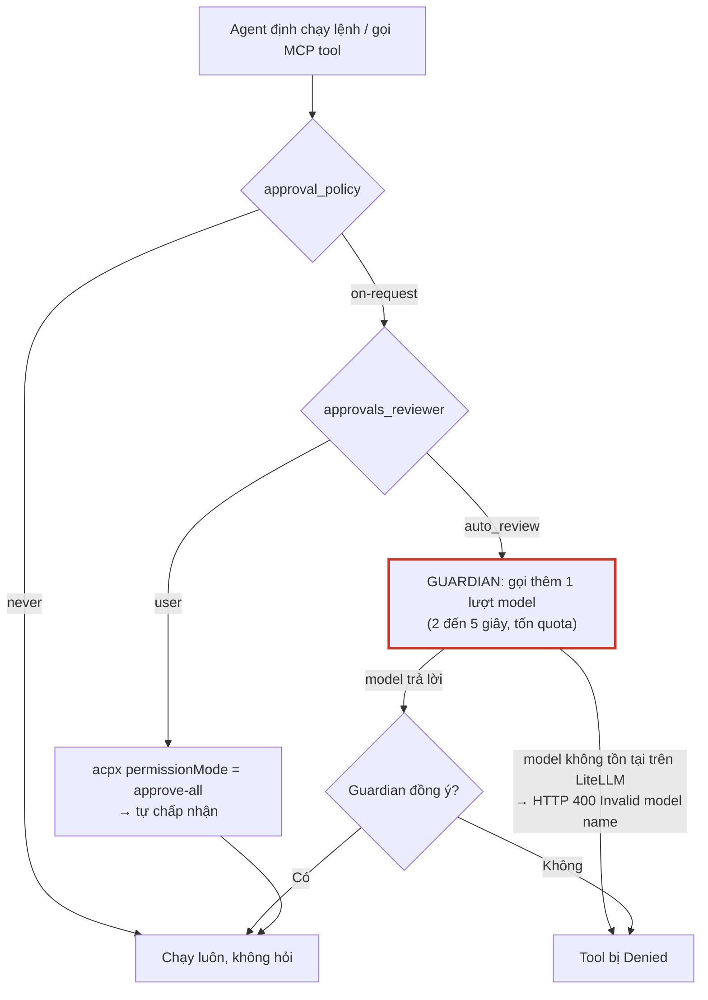
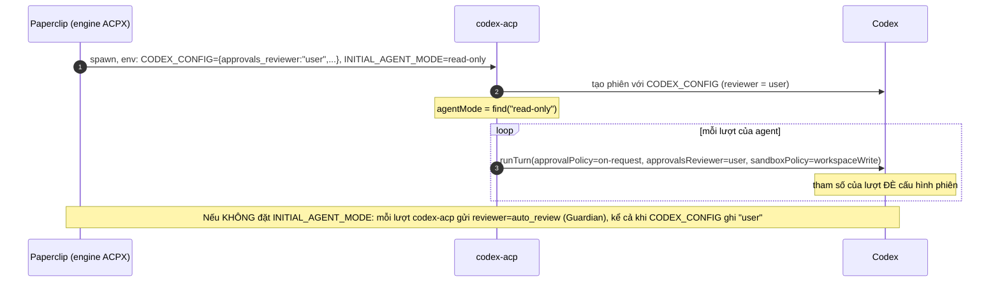
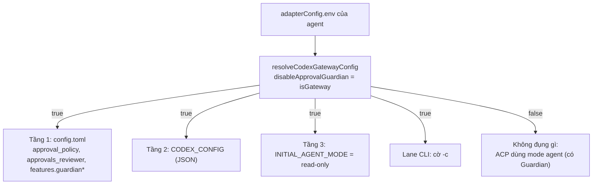

# Phần 4. Bỏ lượt LLM "Guardian" khi Codex duyệt lệnh: 3 tầng cấu hình, công tắc và đánh đổi an toàn

- Ngày: 29/10/2026
- Nhánh: `test_adapter`. Các link code trỏ tới commit [`f6c9d6bfc`](https://github.com/trung2710/ppclip/tree/f6c9d6bfc1225895047151d99f8d4002dacee482), nên số dòng không bị lệch khi code thay đổi sau này.
- Commit chính của phần này:
  - [`bbaf367c4`](https://github.com/trung2710/ppclip/commit/bbaf367c4) (20/10): `codex-toml.ts`, hàm tắt approval và Guardian trong `config.toml`;
  - [`852ccdac9`](https://github.com/trung2710/ppclip/commit/852ccdac9) (20/10): cờ `-c` cho lane CLI (`codex-args.ts`) và seed home;
  - [`3ea8f0477`](https://github.com/trung2710/ppclip/commit/3ea8f0477) (20/10): `INITIAL_AGENT_MODE` và `CODEX_CONFIG` cho lane ACP.
- Liên quan: Phần 1 (agent nào được coi là gateway), Phần 2 (nguồn gốc lỗi `Invalid model name`).

---

## Tóm tắt phần này

**Đã thực hiện:** đọc code của cả 2 engine; **đọc mã nguồn của `codex-acp` 1.11.0 đã cài trong repo** để kiểm tra các chế độ duyệt; đối chiếu 2 tài liệu nguồn; kiểm tra cấu hình duyệt của 18 agent Codex trong database (chỉ đọc); đọc log run thật; chạy test.

| Nội dung trong plan | Trạng thái | Xem ở mục |
|---|---|---|
| Guardian là gì, vì sao tốn thêm một lượt LLM | Xong | 1 |
| 3 tầng cấu hình duyệt (approval policy, sandbox, reviewer) | Xong | 2, 3 |
| Trước đây tốn một lượt LLM cho mỗi lần duyệt, giờ đã tắt thế nào | Xong | 3, 4 |
| Agent nào được tắt, agent nào không | Xong | 4, 5 |
| Đánh đổi về độ an toàn | Xong | 7 |

**Nguồn đã dùng:**
- Code: `adapter-utils/src/codex-toml.ts`, `adapter-utils/src/acpx-engine/execute.ts`, `codex-local/src/server/codex-args.ts`, `codex-home.ts`, `server/src/routes/agents.ts`.
- Mã nguồn của bên thứ ba: `@agentclientprotocol/codex-acp@1.11.0` (`node_modules`).
- Tài liệu: [co_che_3_tang_cau_hinh_duyet_guardian_codex.md](../instructions/co_che_3_tang_cau_hinh_duyet_guardian_codex.md), [thay_doi_litellm_guardian_cost_token_theo_run.md](../instructions/thay_doi_litellm_guardian_cost_token_theo_run.md).

**Kết quả kiểm tra:**
- Bảng 3 chế độ trong tài liệu **khớp với mã nguồn `codex-acp` 1.11.0** đã cài, và `codex-acp` gửi `approvalPolicy`, `approvalsReviewer`, `sandboxPolicy` **kèm mỗi lượt** (xem mục 2.2).
- 34 test pass (`codex-args.test.ts` và `codex-toml.test.ts`).
- Database: trong 18 agent Codex đang hoạt động, **3 agent** được tắt Guardian tự động (nhận diện là gateway), **1 agent** tắt bằng tay, **14 agent còn lại** vẫn để Guardian bật ở lane ACP (mục 5).
- Log run thật của `DW VT` xác nhận engine ACPX và `approve-all`.

**Kết luận chính:**
1. Guardian là một lượt model riêng chạy **trước mỗi hành động cần duyệt**. Qua LiteLLM, model đó không có nên lượt này lỗi và tool MCP bị `Denied`. Paperclip tắt nó bằng một công tắc duy nhất, `disableApprovalGuardian`, đặt `true` khi agent được nhận diện là gateway LiteLLM.
2. Với lane ACP, **chỉ chỉnh `config.toml` không đủ**: `codex-acp` gửi kèm chế độ duyệt ở **mỗi lượt** và đè lên cấu hình. Phải đặt thêm `INITIAL_AGENT_MODE=read-only` (tầng 3), mới tắt hẳn.
3. Tắt Guardian nghĩa là **mọi yêu cầu duyệt được tự chấp nhận** (`approve-all`), chỉ còn sandbox làm hàng rào. Đây là đánh đổi cần chấp nhận có ý thức, nhất là với agent nhận nội dung từ bên ngoài như Telegram.
4. Cờ `dangerouslyBypassApprovalsAndSandbox` (đang bật cho 17 trên 18 agent) **chỉ có tác dụng ở lane CLI**, không ảnh hưởng lane ACP, nhưng giao diện hiển thị cho cả hai (mục 7.2).

---

## 1. Guardian là gì

Khi agent Codex định làm việc có rủi ro (chạy lệnh, ghi file ngoài vùng cho phép, gọi MCP tool), Codex có thể **hỏi duyệt** trước. Người duyệt (`approvals_reviewer`) là một trong hai:

| Người duyệt | Cách hoạt động | Chi phí |
|---|---|---|
| `auto_review` (**Guardian**) | Một **lượt model riêng** tự đánh giá rủi ro rồi đồng ý hoặc từ chối | Thêm 2 đến 5 giây mỗi lần và tốn thêm token hoặc quota (số đo theo tài liệu nguồn; tôi không tự đo) |
| `user` | Chuyển cho client. Trong Paperclip, client là `acpx` chạy `approve-all`, nên **tự đồng ý ngay** | Không đáng kể |



**Vì sao với LiteLLM thì Guardian hỏng, không chỉ chậm:** theo [tài liệu nguồn](../instructions/co_che_va_cau_hinh_codex_home_multi_level_paperclip.md), Guardian gọi ngầm model `gpt-5.6-luna`. Gateway LiteLLM không có model tên đó, nên lượt Guardian trả `HTTP 400 Invalid model name` và tool MCP hiện `Status: Denied`. Đó là lý do ban đầu agent LiteLLM không gọi được tool của Paperclip.

**Hai khóa khác nhau, cần tắt cả hai.** Comment trong code nói rõ ([codex-toml.ts:258-263](https://github.com/trung2710/ppclip/blob/f6c9d6bfc1225895047151d99f8d4002dacee482/packages/adapter-utils/src/codex-toml.ts#L258-L263)):

> `approval_policy = "never"` chỉ tắt việc duyệt lệnh terminal. Lệnh gọi tool MCP còn phải qua Guardian (`features.guardian_approval`), và Guardian gọi một model riêng mà gateway thường không phục vụ.

```ts
// codex-toml.ts:264-273
export function ensureCodexApprovalsDisabled(toml: string): string {
  const withRoot = setTomlRootKeys(toml, {
    approval_policy: "never",        // lệnh terminal: không hỏi
    approvals_reviewer: "user",      // nếu có hỏi thì người duyệt là client, không phải Guardian
  });
  return setTomlTableKeys(withRoot, "features", {
    guardian_approval: false,        // MCP tool: tắt Guardian
    guardian: false,
  });
}
```

---

## 2. Ba tầng cấu hình chồng lên nhau

### 2.1. Bảng tổng hợp

Cấu hình duyệt đến từ **3 tầng**; tầng sau đè tầng trước. Đường CLI không có tầng 2 và 3 mà dùng cờ `-c`.

| | Tầng 1: `config.toml` | Tầng 2: `CODEX_CONFIG` | Tầng 3: `INITIAL_AGENT_MODE` | Lane CLI: cờ `-c` |
|---|---|---|---|---|
| Hình thức | File trong `CODEX_HOME` | Biến môi trường JSON | Biến môi trường chứa **tên** một bộ cài đặt | Đối số dòng lệnh `codex exec` |
| Ai tạo | Paperclip vá khi seed (Phần 1) | Engine tính lại **mỗi run** từ DB | Engine đặt mỗi run, hoặc giữ giá trị agent tự đặt | `buildCodexExecArgs` |
| Ai đọc | Codex lúc khởi động | `codex-acp` chuyển cho Codex lúc **tạo phiên** | `codex-acp`, đọc **một lần** lúc khởi động | Codex |
| Áp dụng | Khởi động | Tạo phiên | **Gửi kèm mỗi lượt** | Cả lần chạy |
| Phạm vi | Mọi khóa | Mọi khóa | Chỉ 3 giá trị: `approvalPolicy`, `approvalsReviewer`, sandbox | Từng khóa |
| Thắng khi mâu thuẫn | Thấp nhất | Giữa | **Cao nhất** (ở lane ACP) | Cao nhất (ở lane CLI) |

### 2.2. Vì sao tầng 3 thắng: kiểm tra trong mã `codex-acp`

Tôi đọc `dist/index.js` của `@agentclientprotocol/codex-acp@1.11.0` trong `node_modules`. Mỗi lượt, `sendPrompt` truyền các giá trị của chế độ hiện tại tới Codex (`index.js` dòng 28693-28709):

```js
// codex-acp 1.11.0, dist/index.js
return await this.codexClient.runTurn({
  threadId: request.sessionId,
  input,
  approvalPolicy: agentMode.approvalPolicy,
  approvalsReviewer: agentMode.approvalsReviewer,
  sandboxPolicy: addAdditionalDirectoriesToSandboxPolicy(agentMode.sandboxPolicy, additionalDirectories),
  ...
});
```

Và chế độ ban đầu đọc từ biến môi trường, **không đặt thì dùng `agent`** (dòng 27338-27345):

```js
static getInitialAgentMode() {
  const predefinedAgentMode = process.env["INITIAL_AGENT_MODE"];
  if (predefinedAgentMode) return _AgentMode.find(predefinedAgentMode) ?? _AgentMode.DEFAULT_AGENT_MODE;
  else return _AgentMode.DEFAULT_AGENT_MODE;   // = Agent  (có Guardian)
}
```



Đây chính là lỗi gặp lúc đầu: chỉ sửa tầng 1 và 2 mà Guardian vẫn chạy, vì tầng 3 đè lên.

### 2.3. Ba chế độ có sẵn của `codex-acp` (đối chiếu mã nguồn)

| `INITIAL_AGENT_MODE` | Tên hiển thị | `approvalPolicy` | `approvalsReviewer` | Sandbox | Khớp tài liệu? |
|---|---|---|---|---|---|
| `read-only` | Ask for approval | `on-request` | `user` | `workspace-write`, `networkAccess: false` | Khớp |
| `agent` (**mặc định**) | Approve for me | `on-request` | **`auto_review` (Guardian)** | `workspace-write`, `networkAccess: false` | Khớp |
| `agent-full-access` | Full access | `never` | `user` | `danger-full-access` (mọi file, có mạng) | Khớp |

Hai điểm dễ hiểu nhầm:
- Tên `read-only` **không** có nghĩa là chỉ đọc: nó dùng **cùng sandbox ghi được** như `agent`, chỉ khác người duyệt.
- Không đặt riêng từng giá trị được; chỉ chọn một trong ba bộ.

---

## 3. Code của Paperclip: một công tắc điều khiển bốn chỗ

Công tắc duy nhất là `disableApprovalGuardian`, được tính trong `resolveCodexGatewayConfig` ([codex-toml.ts:460-485](https://github.com/trung2710/ppclip/blob/f6c9d6bfc1225895047151d99f8d4002dacee482/packages/adapter-utils/src/codex-toml.ts#L460-L485)):

```ts
const isGateway = liteLlmBaseUrl !== null;      // có LITELLM_BASE_URL / OPENAI_BASE_URL / LITELLM_API_KEY (Phần 1)
return { ..., isGateway, disableApprovalGuardian: isGateway };   // dòng 483
```

Agent không phải gateway **không bao giờ** được tắt Guardian bằng công tắc này. Test [codex-toml.test.ts:156-159](https://github.com/trung2710/ppclip/blob/f6c9d6bfc1225895047151d99f8d4002dacee482/packages/adapter-utils/src/codex-toml.test.ts#L156-L159) kiểm tra điều đó: một khóa `disableApprovalGuardian: true` tự ghi trong cấu hình bị bỏ qua, `resolved.disableApprovalGuardian` vẫn là `false`.



| Chỗ | Việc làm | Code |
|---|---|---|
| **Tầng 1** (file) | Ghi 4 khóa tắt duyệt vào `config.toml` | `ensureCodexApprovalsDisabled` [codex-toml.ts:264-273](https://github.com/trung2710/ppclip/blob/f6c9d6bfc1225895047151d99f8d4002dacee482/packages/adapter-utils/src/codex-toml.ts#L264-L273); được gọi từ `applyLiteLlmGatewayToml` ([dòng 305](https://github.com/trung2710/ppclip/blob/f6c9d6bfc1225895047151d99f8d4002dacee482/packages/adapter-utils/src/codex-toml.ts#L305)) và `disableCodexApprovalsInHome` ([321-326](https://github.com/trung2710/ppclip/blob/f6c9d6bfc1225895047151d99f8d4002dacee482/packages/adapter-utils/src/codex-toml.ts#L321-L326)) |
| Lúc seed home | Gọi vá khi tạo hoặc nạp lại home | CLI: [codex-home.ts:659-662](https://github.com/trung2710/ppclip/blob/f6c9d6bfc1225895047151d99f8d4002dacee482/packages/adapters/codex-local/src/server/codex-home.ts#L659-L662); ACP: [acpx-engine/execute.ts:676-679](https://github.com/trung2710/ppclip/blob/f6c9d6bfc1225895047151d99f8d4002dacee482/packages/adapter-utils/src/acpx-engine/execute.ts#L676-L679) |
| **Tầng 2** (JSON) | Trộn `approval_policy`, `approvals_reviewer`, `features` vào `CODEX_CONFIG` mỗi run | `buildCodexStartupConfig` [acpx-engine/execute.ts:1124-1174](https://github.com/trung2710/ppclip/blob/f6c9d6bfc1225895047151d99f8d4002dacee482/packages/adapter-utils/src/acpx-engine/execute.ts#L1124-L1174); gọi ở [dòng 1551-1558](https://github.com/trung2710/ppclip/blob/f6c9d6bfc1225895047151d99f8d4002dacee482/packages/adapter-utils/src/acpx-engine/execute.ts#L1551-L1558) |
| **Tầng 3** (chế độ) | Đặt `INITIAL_AGENT_MODE=read-only` nếu là gateway và agent chưa tự đặt | `resolveCodexAcpInitialMode` [codex-toml.ts:424-431](https://github.com/trung2710/ppclip/blob/f6c9d6bfc1225895047151d99f8d4002dacee482/packages/adapter-utils/src/codex-toml.ts#L424-L431); gọi ở [acpx-engine/execute.ts:1568-1572](https://github.com/trung2710/ppclip/blob/f6c9d6bfc1225895047151d99f8d4002dacee482/packages/adapter-utils/src/acpx-engine/execute.ts#L1568-L1572) |
| **Lane CLI** | Thêm 4 cờ `-c` | [codex-args.ts:58-65](https://github.com/trung2710/ppclip/blob/f6c9d6bfc1225895047151d99f8d4002dacee482/packages/adapters/codex-local/src/server/codex-args.ts#L58-L65) |

```ts
// codex-args.ts:58-65
if (resolveCodexGatewayConfig(record).disableApprovalGuardian) {
  args.push(
    "-c", 'approval_policy="never"',
    "-c", 'approvals_reviewer="user"',
    "-c", "features.guardian_approval=false",
    "-c", "features.guardian=false",
  );
}
```

```ts
// codex-toml.ts:421-431: tầng 3
export const CODEX_ACP_NO_GUARDIAN_MODE = "read-only";
export function resolveCodexAcpInitialMode(input: { isGateway: boolean; existingMode?: string | null }): string | null {
  if (!input.isGateway) return null;                                         // agent thường: không đụng
  if (input.existingMode && input.existingMode.trim().length > 0) return null;   // agent đã tự đặt: tôn trọng
  return CODEX_ACP_NO_GUARDIAN_MODE;
}
```

Điểm thiết kế đáng chú ý: **trước thay đổi này, cờ `-c` tắt duyệt áp cho mọi agent**; nhánh đã thu hẹp lại để chỉ áp cho agent gateway ([thay_doi…, mục 3](../instructions/thay_doi_litellm_guardian_cost_token_theo_run.md): *"Cờ `approval_policy="never"` và tắt Guardian chỉ khi agent dùng gateway (trước đây áp cho mọi agent)"*). Nhờ đó agent Codex dùng tài khoản ChatGPT giữ nguyên hành vi mặc định của Codex.

---

## 4. Agent nào được gì

| Loại agent | Lane ACP (mặc định) | Lane CLI |
|---|---|---|
| **Gateway LiteLLM** (có `LITELLM_*` hoặc `OPENAI_BASE_URL`) | Guardian **tắt** ở cả 3 tầng; sandbox `workspace-write`, không mạng | Guardian **tắt** (config.toml và cờ `-c`) |
| **Không phải gateway**, không đặt gì | Chế độ `agent`: Guardian **bật**, sandbox `workspace-write`, không mạng | Mặc định của Codex; nếu cờ bypass bật thì **không sandbox, không duyệt** |
| **Không phải gateway**, tự đặt `INITIAL_AGENT_MODE=read-only` | Guardian **tắt**, vì tầng 3 thắng | Không có tác dụng (CLI không qua `codex-acp`) |
| Bất kỳ, `engine: "cli"` | Không áp dụng | Như cột bên phải |

Lane ACP là mặc định (`normalizeEngine` trả `acp` khi agent không đặt `engine`, [acp.ts:70-75](https://github.com/trung2710/ppclip/blob/f6c9d6bfc1225895047151d99f8d4002dacee482/packages/adapters/codex-local/src/server/acp.ts#L70-L75)); chỉ rơi về CLI khi không đủ điều kiện (thiếu `codex-acp`, Node cũ, môi trường remote không hỗ trợ…, [acp.ts:461-482](https://github.com/trung2710/ppclip/blob/f6c9d6bfc1225895047151d99f8d4002dacee482/packages/adapters/codex-local/src/server/acp.ts#L461-L482)).

---

## 5. Cấu hình thực tế trên máy bạn

Tôi đọc `adapter_config` của các agent `codex_local` chưa bị xóa (chỉ đọc; không in giá trị biến môi trường nhạy cảm). Tất cả đều để `engine` mặc định, tức chạy ACP, `permissionMode` mặc định `approve-all`.

| Nhóm | Agent | Guardian ở lane ACP |
|---|---|---|
| **Gateway (tắt tự động)**, 3 agent | `DW VT` (`LITELLM_API_KEY`), `DW LiteLLM` (`LITELLM_API_KEY` dạng secret), `Codex` (đang `error`, có `LITELLM_API_KEY`) | **Tắt** |
| **Tắt bằng tay**, 1 agent | `Codex` dùng `~/.codex`, tự đặt `INITIAL_AGENT_MODE=read-only` | **Tắt** |
| **Chưa được nhận diện là gateway**, 1 agent | `Nvidia` (model `nemotron-free`, chỉ có `OPENAI_API_KEY` dạng secret) | **Bật** |
| **Còn lại**, 13 agent | `CEO`, `CFO`, `CMO`, `CTO`, `Contract`, `CyberSercirity`, `DW Tran Van Thu`, `Founding Engineer`, `HR`, `Ops`, `Reflection Coach`, `Router`, `UX/UI` | **Bật** |

Ghi chú:
- Ba agent gateway có `config.toml` đúng như thiết kế. Ví dụ `DW VT` (`agents/87c740d4…/codex-home/config.toml`) có `approval_policy = "never"`, `approvals_reviewer = "user"` và `guardian_approval = false`.
- `Nvidia`: tên model là model free của LiteLLM nhưng env **không có** `LITELLM_API_KEY`, `LITELLM_BASE_URL` hay `OPENAI_BASE_URL`, nên `resolveCodexGatewayConfig` không coi nó là gateway (xem Phần 1, mục 5). Theo code, nó **không** được định tuyến qua provider `mygw` (home của nó không có `model_provider`) và giữ Guardian. Tôi chưa chạy thử agent này để xem nó gọi model ở đâu.
- **17 trên 18 agent có `dangerouslyBypassApprovalsAndSandbox = true`** (chỉ `Reflection Coach` chưa đặt). Cờ này chỉ có tác dụng ở lane CLI (mục 7.2).
- Với 14 agent bật Guardian, mỗi lần duyệt ở lane ACP tốn thêm một lượt model. Các agent này dùng tài khoản ChatGPT (Phần 3: 185 cost event `subscription_included`), nên lượt đó **ăn quota thuê bao** thay vì tiền.

---

## 6. Bằng chứng từ run thật

### 6.1. Log run của `DW VT` (27/10)

Log run `0dc97c51…` có sự kiện `acpx.session` và `approve-all`, xác nhận engine ACPX với `permissionMode = approve-all` đúng như mục 4. (Tôi dùng mã run này vì là run mới nhất của `DW VT`.)

### 6.2. Số request lỗi giảm sau khi tắt Guardian (suy luận, không phải chứng minh)

Dòng `[paperclip] LiteLLM usage for …: N request(s) (M failed)` trong log run (Phần 2) cho biết số request lỗi trên LiteLLM. Với agent `DW VT`:

| Giai đoạn | Số request lỗi / tổng số request của từng run |
|---|---|
| 13/10 (lúc đang gỡ lỗi) | 2/2, 1/1, 2/2, **6/8, 9/15**, 2/2 |
| 15/10 | 1/7 |
| 22/10 | 1/5, 0/3, 0/4, 0/6, 1/6, 1/6, 1/6, 1/9 |
| 27/10 | 1/8, 0/5, 1/11 |

Từ 15/10 trở đi mỗi run chỉ có **0 đến 1** request lỗi; trước đó phần lớn request lỗi. Điều này **phù hợp** với lập luận rằng lượt Guardian (gọi model không tồn tại) từng làm lỗi hàng loạt và nay không còn, còn 1 lỗi còn lại là request tạo tiêu đề dùng `gpt-5.6-luna` (Phần 2, R7). Tuy vậy tôi **không đọc được tên model của từng request** (cần key LiteLLM), nên đây là dấu hiệu gián tiếp, không phải bằng chứng trực tiếp. Các run ngày 13/10 cũng chạy trong lúc đang thử nghiệm nhiều thay đổi khác.

### 6.3. Độ trễ 2 đến 5 giây mỗi lần duyệt

Con số này lấy từ [tài liệu nguồn](../instructions/co_che_3_tang_cau_hinh_duyet_guardian_codex.md) ("một run đo được mất 6 giây cho 2 lần duyệt"). Tôi **không tự đo** được vì với agent đã tắt Guardian thì không còn lượt nào để đo, và log run không ghi riêng thời gian của lượt Guardian.

---

## 7. Đánh đổi về an toàn

### 7.1. Những lớp bảo vệ có và không có

| Lớp | Khi Guardian **bật** (agent ACP thường) | Khi Guardian **tắt** (agent gateway) |
|---|---|---|
| Sandbox của Codex (`workspace-write`, không mạng) | Có | Có (cùng sandbox) |
| Một model xem xét hành động trước khi chạy | **Có (Guardian)** | **Không** |
| Người duyệt cuối | Guardian | `acpx approve-all`: **tự chấp nhận mọi yêu cầu** |
| Chính sách của tool gateway Paperclip (Phần 7) | Có | Có |
| Ngân sách hard-stop (Phần 3) | Có (xem lỗi số lẻ) | Có |

Điều cần hiểu đúng: sandbox mặc định chặn mạng, nhưng khi model **xin leo thang** (ví dụ cần gọi mạng), yêu cầu đó đi tới người duyệt. Khi người duyệt là `acpx approve-all` thì **luôn được chấp nhận**. Vì vậy, khi tắt Guardian, hàng rào thực tế chỉ còn là việc model có chủ động xin vượt sandbox hay không, cùng các chính sách ở tầng Paperclip. Đây là suy luận từ cấu hình `on-request` cộng `approve-all`; tôi chưa chạy thử một yêu cầu leo thang cụ thể.

Rủi ro chính, như tài liệu nguồn nêu: **agent nhận nội dung từ bên ngoài (ví dụ Telegram) dễ bị prompt injection**; nếu Guardian tắt thì không có model nào chặn một yêu cầu bất thường. Tài liệu đề xuất giữ các giới hạn khác (đã gỡ tool `api_request`, chỉ còn tool cụ thể; nên giới hạn `file_path` trong workspace của run).

### 7.2. Cờ `dangerouslyBypassApprovalsAndSandbox` chỉ có tác dụng ở lane CLI

Tôi tìm toàn bộ nơi dùng cờ này:
- Chỉ một nơi **thực thi** nó: [codex-args.ts:49-57](https://github.com/trung2710/ppclip/blob/f6c9d6bfc1225895047151d99f8d4002dacee482/packages/adapters/codex-local/src/server/codex-args.ts#L49-L57), thêm `--dangerously-bypass-approvals-and-sandbox` cho `codex exec` (tắt cả duyệt lẫn sandbox).
- Engine ACP **không đọc** cờ này; sandbox và duyệt của lane ACP do `INITIAL_AGENT_MODE` quyết định (mục 2.3).
- Mặc định là `true` cho agent mới: [agents.ts:1374-1381](https://github.com/trung2710/ppclip/blob/f6c9d6bfc1225895047151d99f8d4002dacee482/server/src/routes/agents.ts#L1374-L1381) (`DEFAULT_CODEX_LOCAL_BYPASS_APPROVALS_AND_SANDBOX = true`, [index.ts:9](https://github.com/trung2710/ppclip/blob/f6c9d6bfc1225895047151d99f8d4002dacee482/packages/adapters/codex-local/src/index.ts#L9)).
- Giao diện mô tả cờ là *"Run Codex without sandbox restrictions"* ([agent-config-primitives.tsx:35](https://github.com/trung2710/ppclip/blob/f6c9d6bfc1225895047151d99f8d4002dacee482/ui/src/components/agent-config-primitives.tsx#L35)).

Hệ quả: một agent hiển thị "bỏ sandbox" đang bật nhưng chạy ACP thực tế **vẫn nằm trong sandbox `workspace-write`**. Ngược lại, nếu agent ấy bị rơi về CLI (thiếu `codex-acp`…), nó sẽ chạy **không sandbox, không duyệt**. Hai lane vì thế có mức an toàn rất khác nhau với cùng một cấu hình, và người dùng khó nhận ra điều đó.

---

## 8. Rủi ro và điểm cần lưu ý

**R1. Agent không phải gateway giữ Guardian bật ở lane ACP. Mức trung bình (hiệu năng và quota).** 14 trên 18 agent trên máy bạn mỗi lần duyệt tốn thêm một lượt model và 2 đến 5 giây. Có 2 cách tắt: đặt `INITIAL_AGENT_MODE=read-only` trong `env` của agent (chỉ có tác dụng ở ACP, đã dùng cho 1 agent), hoặc thêm một tùy chọn `disableApprovalGuardian` riêng (đề xuất trong [tài liệu nguồn, mục 7](../instructions/co_che_3_tang_cau_hinh_duyet_guardian_codex.md), **chưa làm**). Cách đầu chưa được kiểm chứng với agent không dùng LiteLLM.

**R2. Cờ bypass gây hiểu nhầm (mục 7.2). Mức trung bình (an toàn).** Mặc định `true`, chỉ có tác dụng ở CLI, nhưng được hiển thị cho cả hai lane.

**R3. Công tắc gắn với "là gateway".** Agent như `Nvidia` (dùng model free nhưng thiếu URL hoặc key LiteLLM) không được tắt Guardian. Ngược lại, một agent trỏ `OPENAI_BASE_URL` sang provider khác (OpenRouter, Azure…) cũng bị coi là gateway nên bị tắt Guardian, và nhận provider `mygw` (Phần 1, R2).

**R4. Tên chế độ `read-only` dễ hiểu sai.** Nó không chỉ-đọc mà là `workspace-write` kèm `approve-all` (mục 2.3, 7.1).

**R5. Đổi `INITIAL_AGENT_MODE` có hiệu lực với phiên cũ không thì chưa kiểm chứng.** Biến được `codex-acp` đọc một lần lúc khởi động; mỗi run Paperclip tạo tiến trình mới nên thường áp dụng ngay, nhưng với agent `persistent` nạp lại phiên cũ thì [tài liệu nguồn](../instructions/co_che_3_tang_cau_hinh_duyet_guardian_codex.md) nói rõ là chưa kiểm chứng.

**R6. Các điểm còn mở trong [thay_doi…, mục 7](../instructions/thay_doi_litellm_guardian_cost_token_theo_run.md):**
- Codex 0.160.1 báo `features.guardian` "is ignored" (chỉ `guardian_approval` hợp lệ). Vô hại, chưa bỏ khóa thừa.
- Chế độ `read-only` có sandbox `read-only` ở luồng phụ (tạo tiêu đề); cần xác nhận lượt chính vẫn ghi được workspace.

**R7. Độ trễ và quota chưa được đo trên hệ thống này (mục 6.3).** Các con số 2 đến 5 giây là của tài liệu nguồn.

**R8. Tài liệu cũ lệch.** [co_che_va_cau_hinh_codex_home_multi_level_paperclip.md](../instructions/co_che_va_cau_hinh_codex_home_multi_level_paperclip.md) mục 8.6 nói `guardian_approval = false` là đủ; [thay_doi…, mục 8](../instructions/thay_doi_litellm_guardian_cost_token_theo_run.md) đính chính rằng **không đủ ở lane ACP**, cần thêm `INITIAL_AGENT_MODE`. Hàm trong tài liệu cũ tên `ensureGuardianApprovalDisabled` nay là `ensureCodexApprovalsDisabled`.

---

## 9. Kết luận

1. **Vấn đề:** Guardian là một lượt model riêng trước mỗi hành động cần duyệt. Với agent chạy qua LiteLLM, lượt đó gọi một model không có trên gateway, nên lỗi và làm tool MCP bị `Denied`; ngay cả khi chạy được, nó cũng tốn 2 đến 5 giây và quota.
2. **Cách giải quyết:** một công tắc duy nhất (`disableApprovalGuardian = isGateway`) điều khiển bốn chỗ: `config.toml` (tầng 1), `CODEX_CONFIG` (tầng 2), `INITIAL_AGENT_MODE=read-only` (tầng 3, quyết định ở lane ACP) và cờ `-c` (lane CLI). Tôi đã đối chiếu và xác nhận với mã `codex-acp` 1.11.0 rằng tầng 3 được gửi kèm mỗi lượt và đè lên các tầng còn lại.
3. **Đánh đổi:** tắt Guardian đồng nghĩa với việc mọi yêu cầu duyệt được tự chấp nhận (`approve-all`); hàng rào còn lại là sandbox và chính sách ở tầng Paperclip. Nên cân nhắc kỹ với agent nhận nội dung từ bên ngoài.
4. **Trên máy bạn:** 4 trong 18 agent đã tắt Guardian, 14 agent còn lại để Guardian bật ở lane ACP. Cờ bypass đang bật cho 17 agent nhưng chỉ có nghĩa ở lane CLI.
5. **Nên làm tiếp:**
   - làm rõ trên giao diện rằng cờ bypass chỉ áp dụng cho lane CLI, hoặc đổi mặc định (R2);
   - quyết định có thêm tùy chọn `disableApprovalGuardian` theo từng agent để agent không dùng LiteLLM cũng tắt được (R1);
   - rà lại `Nvidia` (R3).

---

## Phụ lục A. Danh sách file đã trích dẫn

| File | Nội dung chính |
|---|---|
| [adapter-utils/src/codex-toml.ts](https://github.com/trung2710/ppclip/blob/f6c9d6bfc1225895047151d99f8d4002dacee482/packages/adapter-utils/src/codex-toml.ts) | `ensureCodexApprovalsDisabled`, `resolveCodexAcpInitialMode`, `resolveCodexGatewayConfig` |
| [adapter-utils/src/acpx-engine/execute.ts](https://github.com/trung2710/ppclip/blob/f6c9d6bfc1225895047151d99f8d4002dacee482/packages/adapter-utils/src/acpx-engine/execute.ts) | `buildCodexStartupConfig` (tầng 2), đặt `INITIAL_AGENT_MODE` (tầng 3), seed home ACP |
| [codex-local/src/server/codex-args.ts](https://github.com/trung2710/ppclip/blob/f6c9d6bfc1225895047151d99f8d4002dacee482/packages/adapters/codex-local/src/server/codex-args.ts) | Cờ `-c` và cờ bypass của lane CLI |
| [codex-local/src/server/codex-home.ts](https://github.com/trung2710/ppclip/blob/f6c9d6bfc1225895047151d99f8d4002dacee482/packages/adapters/codex-local/src/server/codex-home.ts) | Gọi vá `config.toml` khi seed home CLI |
| [codex-local/src/server/acp.ts](https://github.com/trung2710/ppclip/blob/f6c9d6bfc1225895047151d99f8d4002dacee482/packages/adapters/codex-local/src/server/acp.ts) | Chọn engine, điều kiện rơi về CLI |
| [server/src/routes/agents.ts](https://github.com/trung2710/ppclip/blob/f6c9d6bfc1225895047151d99f8d4002dacee482/server/src/routes/agents.ts) | Mặc định cờ bypass cho agent mới |
| `node_modules/.pnpm/@agentclientprotocol+codex-acp@1.11.0/.../dist/index.js` | Ba chế độ, `getInitialAgentMode`, `sendPrompt` (không nằm trong repo) |

## Phụ lục B. Cách tự kiểm tra trên máy

```sh
# 1. Agent nào đang tắt Guardian trong config.toml của home riêng
grep -l "guardian_approval = false" "$HOME/.paperclip/instances/default/companies/"*/agents/*/codex-home/config.toml

# 2. Xem 3 chế độ trong codex-acp đã cài (kiểm tra bảng ở mục 2.3)
sed -n 27258,27300p "node_modules/.pnpm/@agentclientprotocol+codex-acp@1.11.0/node_modules/@agentclientprotocol/codex-acp/dist/index.js"

# 3. Chạy test của phần này
npx vitest run packages/adapters/codex-local/src/server/codex-args.test.ts packages/adapter-utils/src/codex-toml.test.ts
```

```text
4. Thử tắt Guardian cho một agent không dùng LiteLLM (cách 1 của tài liệu nguồn):
   thêm vào env của agent trên giao diện:   INITIAL_AGENT_MODE = read-only
   rồi chạy một task mới (không dùng lại phiên cũ) và so sánh thời gian từng lần gọi tool.
```
