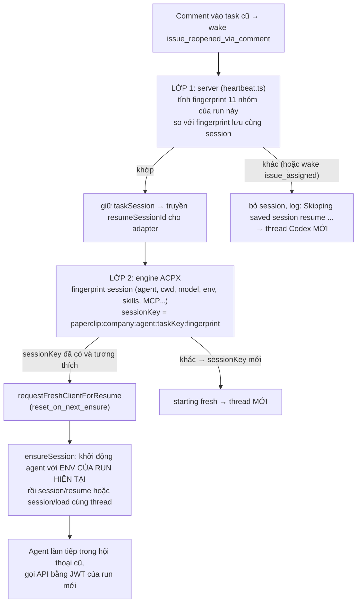

# Phần 5. Giữ lại session Codex cũ khi chạy tiếp trên cùng task: fingerprint và làm mới env khi resume

- Ngày: 29/10/2026
- Nhánh: `test_adapter`. Các link code trỏ tới commit [`f6c9d6bfc`](https://github.com/trung2710/ppclip/tree/f6c9d6bfc1225895047151d99f8d4002dacee482), nên số dòng không bị lệch khi code thay đổi sau này.
- Commit chính của phần này (cả 4 ngày 22/10):
  - [`9484bc8d8`](https://github.com/trung2710/ppclip/commit/9484bc8d8): bỏ `issues.updated_at` khỏi fingerprint của nhóm `workspaceConfig`;
  - [`ce5f44f62`](https://github.com/trung2710/ppclip/commit/ce5f44f62): chỉ băm `modelProfile` khi profile thật sự được áp dụng;
  - [`cdc715f16`](https://github.com/trung2710/ppclip/commit/cdc715f16): loại thư mục scratch của từng run khỏi `adapterEnvHash`;
  - [`612535f46`](https://github.com/trung2710/ppclip/commit/612535f46): khi resume, khởi động agent bằng env của run hiện tại.
- Liên quan: Phần 4 (nguồn gốc cờ và env của agent), Phần 7 (JWT gắn theo run, cùng ý tưởng "danh tính theo run").

---

## Tóm tắt phần này

**Đã thực hiện:** đọc tài liệu nguồn và code của cả hai lớp fingerprint (server và engine ACPX); chạy test; **đo tỷ lệ dùng lại session trên database thật** (chỉ đọc) và đếm các triệu chứng trong log run theo ngày.

| Nội dung trong plan | Trạng thái | Xem ở mục |
|---|---|---|
| Fingerprint của session gồm những gì | Xong | 2 |
| Vì sao trước đây session cứ bị tạo mới | Xong (4 nguyên nhân) | 3 |
| Đã sửa thế nào | Xong | 3 |
| Khi resume thì dùng env của run hiện tại | Xong | 3.4 |
| Tỷ lệ session được dùng lại (tài liệu nguồn ghi "chưa đo") | **Xong, có số liệu thật** | 4 |
| Phát hiện mới: còn một trường hợp vẫn bị nhiễu | Xong, **nguyên nhân chưa xác định** | 5 |

**Nguồn đã dùng:**
- Code: `server/src/services/heartbeat.ts`, `adapter-utils/src/acpx-engine/{execute,fingerprint-env,session-refresh}.ts`.
- Commit: `9484bc8d8`, `ce5f44f62`, `cdc715f16`, `612535f46`.
- Tài liệu: [2026-10-22-dung-lai-session-khi-comment-task-cu.md](../doc/reports/2026-10-22-dung-lai-session-khi-comment-task-cu.md).
- Dữ liệu thật: bảng `heartbeat_runs`, `agent_task_sessions`, `issues` và thư mục `run-logs` của máy bạn.

**Kết quả kiểm tra:**
- 3 file test pass, **132 test** (`heartbeat-workspace-session`, `fingerprint-env`, `session-refresh`).
- **Trước khi sửa (01 đến 13/10): 0 trên 67 run** có session lưu sẵn được dùng lại. **Sau khi sửa (27/10): 6 trên 6** được dùng lại. Cả 4 triệu chứng trong tài liệu đều xuất hiện trong log và biến mất sau 22/10.
- Còn một trường hợp chưa sửa hết: task có workspace lấy từ `agent_home` vẫn bị bỏ session ở mọi run (mục 5).

**Kết luận chính:**
1. Session được lưu theo `(agent, adapter, taskKey)`, với `taskKey` là id của issue. Trước mỗi run, server so **dấu vân tay cấu hình** (11 nhóm); khác thì bỏ session và mở thread Codex mới. Engine ACPX có thêm một fingerprint riêng và một khóa session chứa fingerprint đó.
2. Vấn đề không phải là cấu hình đổi thật mà là **các giá trị đổi ở mọi run lọt vào fingerprint**: mốc thời gian của issue, metadata của profile, thư mục scratch. Cả 3 đã được loại ra.
3. Giữ session lại còn lộ ra lỗi thứ tư: agent chạy tiếp với **env của run đầu tiên** (JWT gắn với run cũ), nên mọi thao tác ghi đều bị từ chối. Đã sửa bằng cờ `reset_on_next_ensure` có sẵn của acpx.
4. Kết quả đo được là rõ rệt, nhưng với task có workspace từ `agent_home` thì **fingerprint vẫn đổi ở mọi run**, chưa tìm ra giá trị nào đổi.

---

## 1. Vì sao cần giữ session

Khi người dùng comment vào một task đã làm xong, server đánh thức agent bằng một run mới (wake `issue_reopened_via_comment`). Có hai cách để run này bắt đầu:
- **Thread Codex mới:** agent phải đọc lại toàn bộ task từ đầu, mất hội thoại cũ.
- **Nối lại thread cũ (resume):** agent còn nhớ những gì đã làm ở lượt trước, trả lời đúng ngữ cảnh.

Mục tiêu của 4 commit là để cách thứ hai thực sự xảy ra.

Dữ liệu session nằm trong bảng `agent_task_sessions` (cột `task_key`, `session_params_json`, `last_run_id`). Trên máy bạn có 72 session của agent `Codex`, 16 của `CTO`, 12 của `DW VT`… Mỗi session lưu kèm 4 khóa metadata của Paperclip (xem mục 2.1), nên đủ thông tin để so sánh ở lần chạy sau.

---

## 2. Cơ chế: hai lớp fingerprint



### 2.1. Lớp 1: server, 11 nhóm

Danh sách nhóm ([heartbeat.ts:3178-3190](https://github.com/trung2710/ppclip/blob/f6c9d6bfc1225895047151d99f8d4002dacee482/server/src/services/heartbeat.ts#L3178-L3190)):

```ts
const EFFECTIVE_RUN_SESSION_CONFIG_CATEGORIES = [
  "adapter", "adapterConfig", "agentRuntimeConfig", "modelProfile", "instructions",
  "issueOverrides", "workspaceConfig", "environment", "envBindings", "secrets", "runtimeSkills",
] as const;
```

- Cuối mỗi run, server ghi fingerprint tổng và fingerprint từng nhóm vào `session_params_json` qua 4 khóa `__paperclipConfigFingerprint`, `…Version`, `…Categories`, `…CategoryFingerprints` ([heartbeat.ts:3166-3169](https://github.com/trung2710/ppclip/blob/f6c9d6bfc1225895047151d99f8d4002dacee482/server/src/services/heartbeat.ts#L3166-L3169)). Database của bạn xác nhận: session mới nhất đều có đủ 11 nhóm, phiên bản fingerprint 1.
- Lần chạy sau, `resolveTaskSessionConfigFreshness` so sánh ([heartbeat.ts:4142-4201](https://github.com/trung2710/ppclip/blob/f6c9d6bfc1225895047151d99f8d4002dacee482/server/src/services/heartbeat.ts#L4142-L4201)). Session bị bỏ khi: đổi model đã cấu hình; thiếu metadata fingerprint; đổi phiên bản fingerprint; fingerprint tổng khác (kèm danh sách nhóm đổi); hoặc wake có lý do reset (ví dụ `issue_assigned`).
- Kết quả được ghi vào `result_json.configFreshness.session` của run (`taskSessionAvailable`, `taskSessionReused`, `changedCategories`, `resetReasons`) và vào log: [heartbeat.ts:13082](https://github.com/trung2710/ppclip/blob/f6c9d6bfc1225895047151d99f8d4002dacee482/server/src/services/heartbeat.ts#L13082) `Skipping saved session resume for task "…" because effective run configuration changed: <nhóm>`.
- Các đầu vào của fingerprint được gom tại [heartbeat.ts:12503-12545](https://github.com/trung2710/ppclip/blob/f6c9d6bfc1225895047151d99f8d4002dacee482/server/src/services/heartbeat.ts#L12503-L12545).

### 2.2. Lớp 2: engine ACPX

Engine tính một `fingerprint` riêng ([acpx-engine/execute.ts:1686-1718](https://github.com/trung2710/ppclip/blob/f6c9d6bfc1225895047151d99f8d4002dacee482/packages/adapter-utils/src/acpx-engine/execute.ts#L1686-L1718)) từ: agent, lệnh, thư mục làm việc, chế độ, quyền, model, effort, skill, MCP server, `secretManifestHash` và **`adapterEnvHash`** (băm toàn bộ env đã giải của adapter). Fingerprint này nằm trong khóa session ([dòng 1720](https://github.com/trung2710/ppclip/blob/f6c9d6bfc1225895047151d99f8d4002dacee482/packages/adapter-utils/src/acpx-engine/execute.ts#L1720)):

```ts
const sessionKey = `paperclip:${agent.companyId}:${agent.id}:${taskKey}:${fingerprint}`;
```

Fingerprint đổi thì `sessionKey` đổi, tức là không tìm thấy session đã lưu và engine "starting fresh". Hàm `isCompatibleSession` ([dòng 1176-1189](https://github.com/trung2710/ppclip/blob/f6c9d6bfc1225895047151d99f8d4002dacee482/packages/adapter-utils/src/acpx-engine/execute.ts#L1176-L1189)) kiểm tra thêm: fingerprint, `sessionKey`, agent, chế độ, thư mục làm việc và môi trường remote phải trùng.

Nguyên tắc chung của cả hai lớp (nêu trong tài liệu nguồn): **fingerprint chỉ được đổi khi cấu hình thật sự đổi**. Giá trị đổi ở mọi run sẽ làm session bị bỏ ở mỗi lần.

---

## 3. Bốn nguyên nhân và cách sửa

### 3.1. `issues.updated_at` làm nhóm `workspaceConfig` đổi liên tục: `9484bc8d8`

| | |
|---|---|
| Triệu chứng | Task mở lại bằng comment; mọi run ghi `changed: workspace config`, mỗi comment sinh một thread mới |
| Nguyên nhân | `workspaceConfig` chứa `issueConfigRevisionAt` lấy từ `issues.updated_at`. Cột này đổi ở mọi comment, đổi trạng thái, checkout, kể cả comment do **chính agent đăng trong run**. Fingerprint lưu cuối run vì thế không bao giờ khớp lần sau |
| Sửa | Hàm mới `buildSessionWorkspaceConfigFingerprintInput` không còn mốc thời gian của issue. Giữ `projectConfigRevisionAt` (chỉ đổi khi project bị sửa). Cấu hình workspace thật của issue vẫn được tính qua `issueSettings` |
| Code | [heartbeat.ts:3807-3847](https://github.com/trung2710/ppclip/blob/f6c9d6bfc1225895047151d99f8d4002dacee482/server/src/services/heartbeat.ts#L3807-L3847), dùng ở [12509-12517](https://github.com/trung2710/ppclip/blob/f6c9d6bfc1225895047151d99f8d4002dacee482/server/src/services/heartbeat.ts#L12509-L12517) |

```ts
// heartbeat.ts:3807-3847 (rút gọn): không có issue.updated_at trong đầu vào
export function buildSessionWorkspaceConfigFingerprintInput(input: {
  requestedMode, effectiveMode, projectUpdatedAt, projectPolicy,
  issueSettings, reusableExecutionWorkspaceConfig, existingExecutionWorkspace,
}) { return { requestedMode, effectiveMode, projectConfigRevisionAt: ..., projectPolicy, issueSettings, ... }; }
```

### 3.2. Model profile được yêu cầu nhưng không áp dụng: `ce5f44f62`

| | |
|---|---|
| Triệu chứng | Log `changed: model profile`; fingerprint nhảy `null → cheap → null` giữa các run |
| Nguyên nhân | Nhóm `modelProfile` băm cả metadata (`requested`, `requestedBy`, `applied`, `configSource`, `fallbackReason`). Wake `source_scoped_recovery_action` yêu cầu profile `cheap` nhưng agent đã tắt nó (`applied: null`), run vẫn dùng model thường; metadata vẫn khác các run không yêu cầu gì |
| Sửa | Chỉ băm khi profile **được áp dụng**; profile chỉ được yêu cầu thì coi như không có |
| Code | [heartbeat.ts:3858-3867](https://github.com/trung2710/ppclip/blob/f6c9d6bfc1225895047151d99f8d4002dacee482/server/src/services/heartbeat.ts#L3858-L3867), dùng ở [12507](https://github.com/trung2710/ppclip/blob/f6c9d6bfc1225895047151d99f8d4002dacee482/server/src/services/heartbeat.ts#L12507) |

```ts
export function buildSessionModelProfileFingerprintInput(metadata) {
  const applied = readNonEmptyString(metadata?.applied);
  if (!applied) return null;                                   // chỉ yêu cầu → không có profile
  return { applied, configSource: readNonEmptyString(metadata?.configSource) };
}
```

### 3.3. Thư mục scratch riêng của từng run nằm trong `adapterEnvHash`: `cdc715f16`

| | |
|---|---|
| Triệu chứng | Log `config fingerprint changed: adapterEnvHash` rồi `starting fresh` ở mọi run |
| Nguyên nhân | Server ghi thư mục scratch (tạo bằng `mkdtemp`, khác nhau mỗi run) vào env adapter qua `PAPERCLIP_RUN_SCRATCH_DIR`, `PAPERCLIP_TASK_SCRATCH_DIR`, `PAPERCLIP_SCRATCH_DIR`, `PAPERCLIP_TMPDIR`, và `TMPDIR`/`TEMP`/`TMP` khi người dùng để trống. Engine băm cả các giá trị này |
| Sửa | File mới `fingerprint-env.ts`: hàm `stripRunScopedEnvForFingerprint` bỏ các khóa này (và mọi khóa có giá trị đúng bằng thư mục scratch) trước khi băm. Giá trị **vẫn được truyền cho agent**, chỉ bị loại khỏi mã băm |
| Code | [fingerprint-env.ts](https://github.com/trung2710/ppclip/blob/f6c9d6bfc1225895047151d99f8d4002dacee482/packages/adapter-utils/src/acpx-engine/fingerprint-env.ts), dùng ở [acpx-engine/execute.ts:1717](https://github.com/trung2710/ppclip/blob/f6c9d6bfc1225895047151d99f8d4002dacee482/packages/adapter-utils/src/acpx-engine/execute.ts#L1717) |

```ts
// fingerprint-env.ts (rút gọn)
export function stripRunScopedEnvForFingerprint(env: Record<string, string>) {
  const scratchDir = env.PAPERCLIP_RUN_SCRATCH_DIR ?? env.PAPERCLIP_SCRATCH_DIR ?? null;
  return Object.fromEntries(Object.entries(env).filter(([key, value]) => {
    if (RUN_SCRATCH_ENV_KEYS.has(key)) return false;
    return !(scratchDir && value === scratchDir);     // TMPDIR do người dùng tự đặt thì giá trị khác → vẫn được băm
  }));
}
```

### 3.4. Resume nhưng agent chạy với env của run đầu tiên: `612535f46`

Ba lỗi trên chỉ làm session **bị bỏ oan**. Khi sửa xong, lỗi thứ tư mới lộ ra: session được giữ, nhưng agent không ghi được gì.

| | |
|---|---|
| Triệu chứng | Mọi thao tác ghi bị từ chối với `Issue run ownership conflict` hoặc `agent_jwt_run_id_mismatch`; agent không comment hay đóng task được |
| Nguyên nhân | acpx lưu `sessionOptions.env` của run **tạo** session trong bản ghi trên đĩa, và trả lại nguyên vẹn ở các lần `ensureSession` sau. Env của Paperclip gắn theo run: `PAPERCLIP_API_KEY` là JWT ràng buộc mã run, `PAPERCLIP_RUN_ID` là mã run. Lượt resume vì thế gọi API với danh nghĩa **run cũ** |
| Sửa | Trước `ensureSession`, đặt cờ `reset_on_next_ensure` (cờ có sẵn của acpx) lên bản ghi. acpx bỏ bản ghi cũ, khởi động agent với **env của run hiện tại**, rồi nối lại cùng thread bằng `session/resume` hoặc `session/load` |
| Code | [session-refresh.ts](https://github.com/trung2710/ppclip/blob/f6c9d6bfc1225895047151d99f8d4002dacee482/packages/adapter-utils/src/acpx-engine/session-refresh.ts), gọi ở [acpx-engine/execute.ts:2961-2966](https://github.com/trung2710/ppclip/blob/f6c9d6bfc1225895047151d99f8d4002dacee482/packages/adapter-utils/src/acpx-engine/execute.ts#L2961-L2966) |

```ts
// session-refresh.ts (rút gọn)
export async function requestFreshClientForResume(store, sessionKey): Promise<boolean> {
  const record = await store.load(sessionKey).catch(() => undefined);
  if (!record || record.acpx?.reset_on_next_ensure === true) return false;
  record.acpx = { ...record.acpx, reset_on_next_ensure: true };
  await store.save(record);
  return true;
}

// acpx-engine/execute.ts:2964-2966: chỉ khi resume nguội (không có handle ấm) và mode persistent
if (!handle && resumeSessionId && prepared.mode === "persistent") {
  await requestFreshClientForResume(runtimeOptions.sessionStore, prepared.sessionKey).catch(() => false);
}
```

Commit này là bắt buộc đi kèm ba commit đầu: nếu chỉ giữ session mà không làm mới env thì lỗi ownership xuất hiện ngay. Ý tưởng "danh tính gắn theo run" cũng chính là cơ chế bảo vệ ở Phần 7 (run token).

---

## 4. Kết quả đo trên máy bạn

### 4.1. Tỷ lệ dùng lại session theo ngày

Tôi đếm các run `codex_local` có ghi `configFreshness` trong `result_json` (chỉ đọc). "Có session lưu sẵn" nghĩa là `taskSessionAvailable = true`, tức đã có session của task đó để cân nhắc dùng lại.

| Ngày | Tổng run | Có session lưu sẵn | **Được dùng lại** | Bị bỏ |
|---|---|---|---|---|
| 01/10 | 27 | 7 | **0** | 7 |
| 05/10 | 9 | 4 | **0** | 4 |
| 06/10 | 22 | 6 | **0** | 6 |
| 08/10 | 38 | 14 | **0** | 14 |
| 12/10 | 33 | 27 | **0** | 27 |
| 13/10 | 13 | 9 | **0** | 9 |
| 15, 19, 20/10 | 25 | 0 | 0 | 0 |
| 22/10 (ngày sửa) | 45 | 30 | 17 | 13 |
| **27/10** | 16 | 6 | **6** | **0** |

- **01 đến 13/10: 67 run có session lưu sẵn, 0 run dùng lại.** Mọi comment vào task cũ đều mở thread mới.
- **27/10: 6 trên 6** được dùng lại, không run nào bị bỏ.
- Các ngày 15, 19, 20/10 không có run nào có session lưu sẵn, nên không có số liệu cho các ngày này.
- Lưu ý mẫu nhỏ: sau ngày sửa chỉ có 6 run có session lưu sẵn (27/10), cùng nguồn workspace `task_session`; con số 6/6 cho thấy hướng đúng nhưng chưa đủ để kết luận về mọi trường hợp (xem mục 5).

### 4.2. Ngày 22/10 theo giờ

| Khoảng giờ | Kết quả |
|---|---|
| 09:55 đến 10:19 | 9 run, **tất cả bị bỏ** (nhóm đổi: `workspaceConfig`, có lúc kèm `modelProfile`) |
| 11:08 đến 16:28 | 17 run của `Codex` (14 run) và `DW VT` (3 run), **tất cả được dùng lại** |
| 15:30 | 1 run bị bỏ vì wake `issue_assigned` (**chủ đích thiết kế**: giao việc mới thì bắt đầu session mới) |
| 16:45 đến 16:48 | 3 run `DW VT` bị bỏ vì `workspaceConfig`, xem mục 5 |

Các commit có giờ 16:27 đến 16:36, nhưng hiệu quả xuất hiện từ **11:08**. Giờ của commit chỉ là lúc bạn đóng gói công việc; các sửa đổi đã chạy trong working tree từ trước. Vì vậy không nên dùng giờ commit để suy ra "từ lúc nào chạy đúng".

### 4.3. Triệu chứng trong log run

Tôi đếm số file log run có chứa từng dòng triệu chứng, theo ngày sửa đổi file:

| Dòng trong log | Số file log | Ngày xuất hiện |
|---|---|---|
| `adapterEnvHash` (`config fingerprint changed: adapterEnvHash`) | 2 | chỉ 22/10 |
| `starting fresh` | 4 | chỉ 22/10 |
| `Issue run ownership conflict` | 2 | chỉ 22/10 |
| `agent_jwt_run_id_mismatch` | 1 | chỉ 22/10 |
| `Skipping saved session resume` | 184 dòng, rải từ 28/07 đến 22/10 | **không có dòng nào sau 22/10** |

- Ba triệu chứng đầu chỉ xuất hiện đúng ngày 22/10, khi vừa sửa xong một lỗi thì lộ ra lỗi kế tiếp, khớp với diễn biến mô tả trong tài liệu nguồn.
- Trong 163 dòng `Skipping saved session resume` thuộc loại "cấu hình thay đổi", **mọi dòng đều nêu `workspace config`**: 98 dòng chỉ có `workspace config`, 59 dòng là `model profile, workspace config`, còn lại kèm `adapter config`/`runtime skills`. Nghĩa là `workspaceConfig` là thủ phạm chính, phù hợp với 3.1.
- Dòng `agent_jwt_run_id_mismatch` có trong log run ngày 22/10 13:44 (agent `Codex`), ghi nhận claim `run_id` lệch; đây chính là lỗi mô tả ở 3.4.

---

## 5. Phát hiện mới: task có workspace `agent_home` vẫn bị nhiễu

### 5.1. Hiện tượng

Ngày 22/10, hai task của `DW VT` đều được mở lại bằng comment, nhưng cho kết quả khác nhau:

| Task | Các run | Mã vân tay tổng (phần cuối) | Dùng lại session? |
|---|---|---|---|
| `KHT-114` (`2e841161`) | 16:10, 16:14, 16:14, 16:28 | `…c9223b550a4b` **giống nhau ở cả 4 run** | Có (từ run thứ 2) |
| `KHT-115` (`2e03ea09`) | 16:44, 16:45, 16:47, 16:48 | **4 giá trị khác nhau** | **Không**, bị bỏ vì `workspaceConfig` |

(Cột này lấy từ `result_json.configFreshness.session.nextFingerprint`. `KHT-115` lần lượt có `…d71d1970bb7f`, `…94cc2b24b492`, `…6ea826f8ed66`, `…54ef8da7d98a`.)

Cả hai issue đều không thuộc project nào, không có execution workspace và không có workspace settings, nên các đầu vào mà hàm `buildSessionWorkspaceConfigFingerprintInput` nhận (project, settings, execution workspace) là như nhau. Vậy thứ đổi ở `KHT-115` nằm ở chỗ khác.

### 5.2. Điểm khác biệt tìm được: nguồn workspace

Tôi so `context_snapshot` của một run được dùng lại (16:28) với một run bị bỏ (16:45). Ngoài nội dung task, comment và mã issue, chỉ có một khác biệt:

| Trường | Run được dùng lại | Run bị bỏ |
|---|---|---|
| `paperclipWorkspace.source` | `task_session` | **`agent_home`** |

Kiểm tra tương quan trên mọi run có session lưu sẵn từ 22/10 11:00:

| Nguồn workspace | Số run | Được dùng lại | Bị bỏ |
|---|---|---|---|
| `task_session` | 23 | **23** | 0 |
| `agent_home` | 4 | 0 | 4 (3 vì `workspaceConfig`, 1 vì wake `issue_assigned`) |

Và trước khi sửa (01 đến 13/10) **cả 67 run** đều có nguồn `agent_home`, không run nào dùng lại. Như vậy ba commit đầu chữa được trường hợp `task_session`, còn trường hợp `agent_home` vẫn bị bỏ, dù tài liệu nguồn không nhắc tới điều này.

### 5.3. Điều chưa biết

- **Tôi chưa xác định được giá trị nào của nhóm `workspaceConfig` đổi ở mỗi run** khi nguồn là `agent_home`. Database chỉ lưu hash của từng nhóm, không lưu đầu vào, và tôi không tái hiện được hàm tính ở môi trường này.
- Chưa rõ vì sao `KHT-115` lấy workspace từ `agent_home` trong khi `KHT-114` lấy từ `task_session`.
- Giả thuyết (chưa kiểm chứng): khi workspace rơi về thư mục dự phòng của agent, một giá trị suy ra từ workspace (chế độ hiệu lực hoặc `reusableExecutionWorkspaceConfig`) mang dữ liệu đổi theo từng run.
- Cách làm tiếp để tìm ra: ghi log **đầu vào** (không chỉ hash) của nhóm `workspaceConfig` trong hai run liên tiếp của một task `agent_home`; hoặc viết một test tái hiện với issue không có project; hoặc chạy thêm 2 comment liên tiếp vào một task mới của `DW VT` và xem `changedCategories`.

---

## 6. Rủi ro và điểm cần lưu ý

**R1. Task có workspace `agent_home` không giữ được session. Mức trung bình.** Mục 5. Task của `KHT-115` không thuộc project nào; có thể trường hợp "agent không gắn project" (như agent Telegram `DW VT`) dễ rơi vào tình huống này, nhưng tôi chưa đếm tần suất.

**R2. Lỗi ở phần ngân sách (Phần 3) có thể làm mất session đã giữ. Mức trung bình.** Việc lưu session sau run (`upsertTaskSession`, [heartbeat.ts:14147-14171](https://github.com/trung2710/ppclip/blob/f6c9d6bfc1225895047151d99f8d4002dacee482/server/src/services/heartbeat.ts#L14147-L14171)) nằm **sau** `updateRuntimeState` trong cùng khối. Nếu `evaluateCostEvent` ném lỗi (số cent lẻ vượt ngưỡng, Phần 3 mục 6), bước lưu session bị bỏ qua, và lần comment tiếp theo sẽ bắt đầu thread mới. Đây là suy luận từ thứ tự lệnh, chưa tái hiện cụ thể.

**R3. Phụ thuộc vào cờ nội bộ của acpx.** `reset_on_next_ensure` là trường trong bản ghi lưu của acpx. Nếu phiên bản acpx sau đổi cấu trúc bản ghi, hàm `requestFreshClientForResume` có thể ngừng hoạt động. Lỗi bị nuốt (`.catch(() => false)`), nên run không hỏng, nhưng triệu chứng `Issue run ownership conflict` sẽ quay lại.

**R4. Chưa kiểm thử các trường hợp khác (theo tài liệu nguồn).** Luồng Telegram và n8n đầu cuối; agent không ở chế độ `persistent`; tiến trình giữ ấm (`warmHandleIdleMs > 0`). Mặc định `warmHandleIdleMs = 0`, nên trường hợp giữ ấm không xảy ra trên máy bạn.

**R5. Ngữ cảnh dài hơn khi giữ session.** Số token cached tăng theo độ dài hội thoại. Ảnh hưởng tới thời gian run và chi phí **chưa được đo** (tài liệu nguồn cũng ghi chưa đo); một lượt resume dài còn kéo theo nhiều request hơn trong log LiteLLM (Phần 2).

**R6. `stripRunScopedEnvForFingerprint` dựa trên tên khóa và giá trị.** Nếu server thêm một biến env mới chứa đường dẫn thư mục riêng của run mà không đưa vào danh sách `RUN_SCRATCH_ENV_KEYS` (và không trùng giá trị thư mục scratch), nó sẽ lại làm fingerprint đổi mỗi run. Nên có test chung kiểm tra "hai run liên tiếp của cùng cấu hình cho cùng fingerprint".

**R7. Session cũ không có metadata sẽ bị bỏ.** Khi `preserveLegacySessionWithoutConfigMetadata` không bật, session lưu trước khi có cơ chế fingerprint (hoặc đổi phiên bản fingerprint) luôn bị bỏ một lần.

**R8. Các lý do bỏ session chủ đích vẫn còn.** Wake `issue_assigned` luôn bắt đầu thread mới; đổi model, đổi workspace settings, sửa project, đổi profile được áp dụng, đổi env cấu hình đều làm mất session. Đó là hành vi mong muốn, không phải lỗi.

---

## 7. Kết luận

1. **Cơ chế:** session được lưu theo task và so sánh bằng fingerprint ở hai lớp (11 nhóm ở server, và một khóa session chứa fingerprint ở engine ACPX). Khác thì mở thread mới.
2. **Nguyên nhân session bị bỏ oan:** ba giá trị đổi ở mọi run lọt vào fingerprint (mốc `updated_at` của issue, metadata profile chưa áp dụng, thư mục scratch riêng của run). Đã loại cả ba.
3. **Lỗi thứ tư là điều kiện đi kèm:** giữ session mà không làm mới env thì agent gọi API bằng JWT của run cũ và bị từ chối. Đã sửa bằng `reset_on_next_ensure`.
4. **Hiệu quả đo được:** từ 0 trên 67 run (đầu tháng 10) lên 6 trên 6 (27/10), các triệu chứng đặc thù biến mất sau 22/10. Với task có workspace lấy từ `task_session`, tỷ lệ dùng lại là 23 trên 23.
5. **Còn dang dở:** task có workspace lấy từ `agent_home` (3 trên 3 run của `KHT-115`) vẫn mất session ở mọi run, nguyên nhân chưa xác định. Ngoài ra lỗi ngân sách ở Phần 3 có thể gián tiếp làm mất session.
6. **Nên làm tiếp:** điều tra mục 5.3; sửa lỗi ngân sách số lẻ (Phần 3); thêm test "hai run liên tiếp cùng cấu hình thì cùng fingerprint" cho trường hợp không có project (R1, R6).

---

## Phụ lục A. Danh sách file đã trích dẫn

| File | Nội dung chính |
|---|---|
| [server/src/services/heartbeat.ts](https://github.com/trung2710/ppclip/blob/f6c9d6bfc1225895047151d99f8d4002dacee482/server/src/services/heartbeat.ts) | 11 nhóm fingerprint, hai hàm dựng đầu vào, `resolveTaskSessionConfigFreshness`, log "Skipping saved session resume", lưu session sau run |
| [adapter-utils/src/acpx-engine/execute.ts](https://github.com/trung2710/ppclip/blob/f6c9d6bfc1225895047151d99f8d4002dacee482/packages/adapter-utils/src/acpx-engine/execute.ts) | Fingerprint session ACPX, `sessionKey`, `isCompatibleSession`, gọi `requestFreshClientForResume` |
| [adapter-utils/src/acpx-engine/fingerprint-env.ts](https://github.com/trung2710/ppclip/blob/f6c9d6bfc1225895047151d99f8d4002dacee482/packages/adapter-utils/src/acpx-engine/fingerprint-env.ts) | Loại biến scratch khỏi `adapterEnvHash` |
| [adapter-utils/src/acpx-engine/session-refresh.ts](https://github.com/trung2710/ppclip/blob/f6c9d6bfc1225895047151d99f8d4002dacee482/packages/adapter-utils/src/acpx-engine/session-refresh.ts) | Đặt cờ `reset_on_next_ensure` |

## Phụ lục B. Cách tự kiểm tra trên máy

```sql
-- 1. Tỷ lệ dùng lại session theo ngày (chạy trên database Paperclip, cổng 54329 nếu dùng Postgres nhúng)
select to_char(r.started_at,'MM-DD') as day,
       count(*) as runs,
       count(*) filter (where r.result_json->'configFreshness'->'session'->>'taskSessionAvailable'='true') as had_saved_session,
       count(*) filter (where r.result_json->'configFreshness'->'session'->>'taskSessionReused'='true')    as reused
from heartbeat_runs r join agents a on a.id = r.agent_id
where a.adapter_type = 'codex_local' and r.result_json ? 'configFreshness'
group by 1 order by 1;

-- 2. Run bị bỏ session: nhóm nào đổi và nguồn workspace là gì
select to_char(r.started_at,'MM-DD HH24:MI') as at,
       r.context_snapshot->'paperclipWorkspace'->>'source' as workspace_source,
       r.result_json->'configFreshness'->'session'->'changedCategories' as changed
from heartbeat_runs r
where r.result_json->'configFreshness'->'session'->>'taskSessionAvailable'='true'
  and r.result_json->'configFreshness'->'session'->>'taskSessionReused'<>'true'
order by r.started_at;
```

```sh
# 3. Trong log run, đếm dòng bỏ session và xem lý do
grep -rh -o -E "Skipping saved session resume for task [^ ]+ because [^\"]{0,120}" \
  "$HOME/.paperclip/instances/default/data/run-logs" | sort | uniq -c | sort -rn | head

# 4. Chạy test của phần này
npx vitest run server/src/__tests__/heartbeat-workspace-session.test.ts \
  packages/adapter-utils/src/acpx-engine/fingerprint-env.test.ts \
  packages/adapter-utils/src/acpx-engine/session-refresh.test.ts
```

```text
5. Thử trực tiếp: tạo một task cho agent Codex, để agent trả lời xong, rồi comment vào task đó 2 lần liên tiếp.
   - Xem result_json.configFreshness.session: taskSessionReused phải là true ở lần comment thứ hai trở đi.
   - Nếu là false, xem changedCategories và paperclipWorkspace.source (nghi ngờ mục 5 nếu source là agent_home).
```
