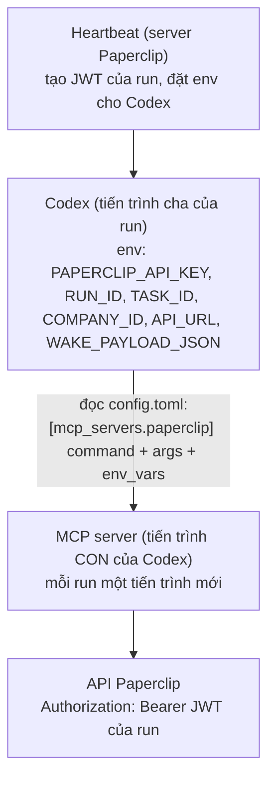
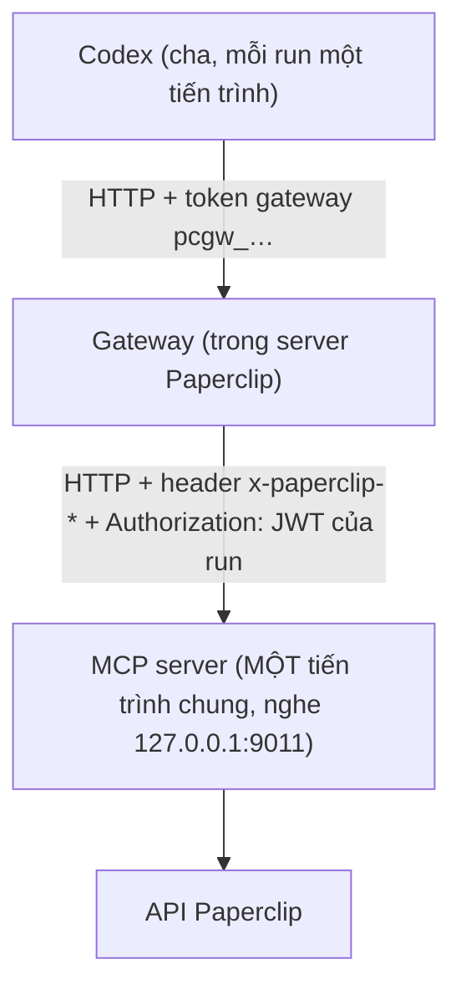
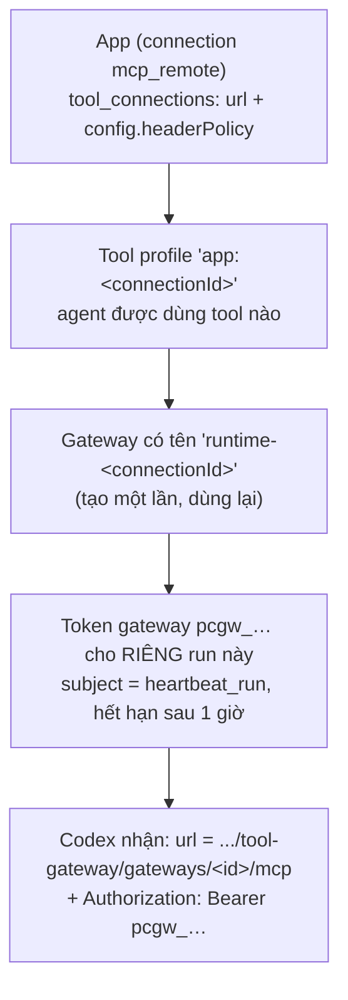

# Phần 7. MCP server, app và gateway: danh tính run đi từ Paperclip tới MCP server

- Ngày: 13/11/2026
- Nhánh: `test_adapter`. Các link code trỏ tới commit [`f6c9d6bfc`](https://github.com/trung2710/ppclip/tree/f6c9d6bfc1225895047151d99f8d4002dacee482), nên số dòng không bị lệch khi code thay đổi sau này.
- Commit chính của phần này (đều ngày 27/10):
  - [`d26534915`](https://github.com/trung2710/ppclip/commit/d26534915): đưa MCP server Python `paperclip-mcp` vào repo;
  - [`6b4311e59`](https://github.com/trung2710/ppclip/commit/6b4311e59): MCP server đọc danh tính run từ header của gateway;
  - [`8a9e6048b`](https://github.com/trung2710/ppclip/commit/8a9e6048b): gateway gửi JWT của run cho MCP server chạy trên máy này;
  - [`6ab6078f8`](https://github.com/trung2710/ppclip/commit/6ab6078f8): hai công tắc trong tab Advanced của app;
  - [`5108822ea`](https://github.com/trung2710/ppclip/commit/5108822ea): `finish_task` không báo thành công giả khi đóng task lỗi;
  - [`19378f7ca`](https://github.com/trung2710/ppclip/commit/19378f7ca), [`8bad749a7`](https://github.com/trung2710/ppclip/commit/8bad749a7), [`a7e6a5ca4`](https://github.com/trung2710/ppclip/commit/a7e6a5ca4), [`4b3875f2b`](https://github.com/trung2710/ppclip/commit/4b3875f2b): tài liệu, kế hoạch, sửa script build và test trên Windows.
- Đã có sẵn một báo cáo chi tiết về luồng này: [doc/reports/2026-10-27-luong-danh-tinh-va-api-key-qua-gateway.md](../doc/reports/2026-10-27-luong-danh-tinh-va-api-key-qua-gateway.md). Báo cáo này **không lặp lại toàn bộ**: nó kiểm chứng báo cáo đó bằng code, test và dữ liệu thật, và bổ sung phần "tiến trình cha, tiến trình con".
- Liên quan: Phần 1 và 4 (`env_vars` của MCP server trong `config.toml`), Phần 6 (lỗi MCP hiện trong transcript), Phần 5 (danh tính gắn theo run).

---

## Tóm tắt phần này

**Đã thực hiện:** đọc code ba lớp (MCP server Python, gateway trong Paperclip, adapter/heartbeat), 5 tài liệu nguồn; chạy test; kiểm tra `config.toml` thật của các `CODEX_HOME`; đối chiếu số tool và việc phủ test.

| Nội dung trong plan | Trạng thái | Xem ở mục |
|---|---|---|
| Tiến trình cha và tiến trình con của MCP server | Xong | 1 |
| Ứng dụng (app) kết nối tới một MCP server | Xong | 2 |
| Gateway gửi metadata sang MCP server | Xong | 3 |
| MCP server đọc danh tính từ header | Xong | 4 |
| Công tắc giao diện, chốt chặn an toàn | Xong, **phát hiện khoảng trống test** | 5, 6 |
| `finish_task` báo lỗi đúng | Xong | 7 |
| Kiểm chứng bằng chạy thật | Một phần (xem mục 8) | 8 |

**Nguồn đã dùng:**
- Code: `paperclip-mcp/src/paperclip_mcp/server.py`; `server/src/services/tool-gateway.ts`, `heartbeat.ts`, `remote-http-endpoint-guard.ts`; `packages/adapter-utils/src/acpx-engine/execute.ts`; `ui/src/pages/apps/`.
- Tài liệu: báo cáo luồng danh tính (ở trên), [doc/plans/2026-10-27-truyen-danh-tinh-run-cho-mcp-server.md](../doc/plans/2026-10-27-truyen-danh-tinh-run-cho-mcp-server.md), [loi_lech_pha_token_runtime_giua_codex_va_mcp_server.md](../instructions/loi_lech_pha_token_runtime_giua_codex_va_mcp_server.md), [so_sanh_va_kien_truc_mcp_server_external_vs_internal.md](../instructions/so_sanh_va_kien_truc_mcp_server_external_vs_internal.md), [tong_quan_paperclip_mcp.md](../instructions/tong_quan_paperclip_mcp.md).

**Kết quả kiểm tra:**
- 10 test pass: nhóm `headerPolicy.runCredential` của gateway (6), cộng test bộ kiểm tra địa chỉ trên máy và `run-identity.test.ts`.
- **3 trong 6 chốt chặn của đường "gửi token của run" không có test nào** (`run_credential_requires_run`, `run_credential_run_mismatch`, `run_credential_run_inactive`), và lớp kiểm tra run ở bước dựng session chỉ được test một phần (mục 6).
- Test Python của `paperclip-mcp` (9 file) **chưa chạy được** trên máy này: thiếu `pytest` và `fastmcp`. Tôi không cài thêm gói vào môi trường Python của bạn.
- Máy chủ Paperclip, MCP server (cổng 9011) và LiteLLM **đều không chạy** lúc tôi kiểm tra, nên tôi **không** chạy lại được lần thử thật. Kết quả "KHT-121 thành công" là từ báo cáo nguồn.

**Kết luận chính:**
1. Có hai cách chạy MCP server: **stdio** (Codex khởi động một tiến trình con riêng cho mỗi run, danh tính đi qua biến môi trường) và **HTTP qua gateway** (một tiến trình chung, danh tính đi qua header của từng request). Hai cách này đúng khác nhau ở chỗ danh tính nằm ở đâu.
2. Cách HTTP cần hai thứ mới: gateway **gắn header** `x-paperclip-*` từ session (đáng tin vì lấy từ DB), và gateway **tự tạo JWT của run** cho từng lần gọi. Server MCP phải đọc chúng **theo từng request**, không lưu vào biến toàn cục.
3. Hai tính năng này **tắt mặc định**, gateway từ chối gửi JWT trừ khi đích là máy này, và bỏ mọi header `authorization` hay `x-paperclip-*` do model gửi lên.
4. Còn các điểm cần xử lý: khoảng trống test (3 chốt chặn), token gateway chỉ sống 1 giờ trong khi run mặc định không giới hạn thời gian, và server HTTP phụ thuộc vào việc không có khóa tĩnh trong môi trường của nó.

---

## 1. Tiến trình cha và tiến trình con

Một "MCP server" là một chương trình mà Codex gọi để dùng thêm công cụ. Cách nó được chạy quyết định **danh tính của run đi qua đâu**.

### 1.1. Cách 1: stdio, một tiến trình con cho mỗi run



Cơ chế nằm ở `config.toml` của `CODEX_HOME`. Codex khởi động MCP server làm tiến trình con và **chỉ chuyển cho nó các biến môi trường có tên liệt kê trong `env_vars`** (danh sách tên; giá trị lấy từ môi trường của chính Codex lúc chạy). Paperclip tự đảm bảo danh sách này đủ ([codex-toml.ts:339-406](https://github.com/trung2710/ppclip/blob/f6c9d6bfc1225895047151d99f8d4002dacee482/packages/adapter-utils/src/codex-toml.ts#L339-L406)):

```ts
export const PAPERCLIP_MCP_ENV_VARS = [
  "PAPERCLIP_API_KEY", "PAPERCLIP_COMPANY_ID", "PAPERCLIP_RUN_ID",
  "PAPERCLIP_TASK_ID", "PAPERCLIP_API_URL", "PAPERCLIP_WAKE_PAYLOAD_JSON",
] as const;
```

Trên máy bạn, home của company `b0964fd7…` có đúng cấu hình này, trỏ tới **MCP server nội bộ** viết bằng Node (khác với `paperclip-mcp` bằng Python):

```toml
[mcp_servers.paperclip]
command = "node"
args = ["C:/paperclip/packages/mcp-server/dist/stdio.js"]
env_vars = ["PAPERCLIP_API_KEY", "PAPERCLIP_COMPANY_ID", "PAPERCLIP_RUN_ID", "PAPERCLIP_TASK_ID", "PAPERCLIP_API_URL", "PAPERCLIP_WAKE_PAYLOAD_JSON"]
```

| Ưu điểm | Nhược điểm |
|---|---|
| Danh tính **đúng tự nhiên**: mỗi run có tiến trình riêng với env riêng | Paperclip **không thấy** lời gọi tool: không có phân quyền theo agent, policy, duyệt hay audit |
| Đơn giản, không cần cấu hình gateway | Mỗi run phải khởi động lại tiến trình (theo báo cáo nguồn, nạp `server.py` mất khoảng 2,4 đến 3 giây, làm chậm lúc khởi động run khoảng 0,9 giây) |
| | Agent thấy đủ mọi tool, tốn khoảng 6.200 token schema mỗi lượt (số trong báo cáo nguồn, tôi không tự đo) |

### 1.2. Cách 2: HTTP qua gateway, một tiến trình dùng chung



Tiến trình MCP không còn là con của Codex; nó chạy riêng và phục vụ mọi run. Do đó `os.environ` của nó **không thể** mang danh tính của một run cụ thể, và danh tính phải đi theo từng request. Đây chính là lý do đợt thay đổi ngày 27/10 tồn tại. Lần thử đầu qua gateway (sáng 27/10, chưa sửa code) thất bại với lỗi thiếu `PAPERCLIP_TASK_ID`, `PAPERCLIP_COMPANY_ID` và `401 Missing PAPERCLIP_API_KEY`, vì không có gì chuyển danh tính sang tiến trình chung.

Tài liệu [loi_lech_pha_token_runtime…](../instructions/loi_lech_pha_token_runtime_giua_codex_va_mcp_server.md) mô tả cùng gốc rễ ("hai tiến trình sống ở hai thế giới độc lập") và các cách chữa tạm đã thử (tham số `api_key` trong tool, giải mã JWT, khóa tĩnh trong `.env`, quét file `.paperclip-run-env.json`). Cách làm hiện tại thay thế các cách chữa tạm đó bằng header do gateway cấp, an toàn hơn vì model không còn phải tự truyền khóa.

---

## 2. Ứng dụng (app) kết nối tới một MCP server

Trong giao diện Paperclip, mục **Apps** quản lý các **connection** (bảng `tool_connections`). Một connection kiểu `mcp_remote` trỏ tới địa chỉ HTTP của một MCP server. Từ connection, Paperclip dựng ba thứ cho mỗi run, trong `buildPaperclipRuntimeMcpServers` ([heartbeat.ts:2171-2299](https://github.com/trung2710/ppclip/blob/f6c9d6bfc1225895047151d99f8d4002dacee482/server/src/services/heartbeat.ts#L2171-L2299)):



Các điểm đáng lưu ý:
- **Chỉ connection thỏa cả 4 điều kiện** mới được giao cho run: nằm trong quyền (profile) của agent; đã cài đặt; `status = active` và `enabled`; `transport = mcp_remote`. Thiếu một điều kiện thì không có MCP server nào, và Paperclip ghi một chẩn đoán (`recordRuntimeMcpDeliveryDiagnostic`).
- Token gateway là một **chiếc vé tạm** cho từng run: `subjectType: "heartbeat_run"`, `allowedActions: ["tools/list", "tools/call"]`, hạn **1 giờ** ([heartbeat.ts:2270-2282](https://github.com/trung2710/ppclip/blob/f6c9d6bfc1225895047151d99f8d4002dacee482/server/src/services/heartbeat.ts#L2270-L2282)). Nó **không** gọi được API Paperclip, chỉ để vào gateway.
- Adapter ACPX biến danh sách đó thành cấu hình MCP gửi cho Codex ([acpx-engine/execute.ts:1441-1452](https://github.com/trung2710/ppclip/blob/f6c9d6bfc1225895047151d99f8d4002dacee482/packages/adapter-utils/src/acpx-engine/execute.ts#L1441-L1452)): `type: "http"`, `url`, và header `Authorization: Bearer <token gateway>`.
- Khi run kết thúc (khối `finally`), mọi token gateway của run bị thu hồi: [`revokeHeartbeatRunGatewayTokens`](https://github.com/trung2710/ppclip/blob/f6c9d6bfc1225895047151d99f8d4002dacee482/server/src/services/heartbeat.ts#L2154-L2169), gọi ở [heartbeat.ts:13809](https://github.com/trung2710/ppclip/blob/f6c9d6bfc1225895047151d99f8d4002dacee482/server/src/services/heartbeat.ts#L13809).

**Ba khái niệm hay nhầm** (theo báo cáo nguồn, đã đối chiếu với code):

| Khái niệm | Ý nghĩa | Sống bao lâu |
|---|---|---|
| **JWT của run** (`PAPERCLIP_API_KEY`) | API key thật để gọi API Paperclip dưới tên agent và run | 1 giờ (`PAPERCLIP_AGENT_JWT_TTL_SECONDS`, mặc định `60 * 60`, [agent-auth-jwt.ts:45](https://github.com/trung2710/ppclip/blob/f6c9d6bfc1225895047151d99f8d4002dacee482/server/src/agent-auth-jwt.ts#L45)) |
| **Token gateway** (`pcgw_…`) | "Vé" để Codex vào gateway; không gọi được API | 1 giờ, thu hồi khi run kết thúc |
| **Session gateway** | Đối tượng tạm trong bộ nhớ, dựng từ vé ở mỗi lần gọi tool; chứa run, agent, công ty, task | Một lần gọi tool |

---

## 3. Gateway gửi metadata sang MCP server

Gateway đứng giữa Codex và MCP server. Mỗi lần Codex gọi tool, gateway: dựng session từ token, kiểm tra quyền, rồi **ghép lại header** gửi tới server thật. Hai chính sách điều khiển phần header, nằm trong `config.headerPolicy` của connection, đọc bởi `readHeaderPolicy` ([tool-gateway.ts:2135-2194](https://github.com/trung2710/ppclip/blob/f6c9d6bfc1225895047151d99f8d4002dacee482/server/src/services/tool-gateway.ts#L2135-L2194)):

| Chính sách | Cấu hình | Tác dụng |
|---|---|---|
| **Gửi danh tính run** | `headerPolicy.metadata.forward = [run_id, issue_id, company_id, agent_id]` | Gắn header `x-paperclip-run-id`, `-issue-id`, `-company-id`, `-agent-id` |
| **Gửi token của run** | `headerPolicy.runCredential = true` | Tạo JWT của run và gắn vào `Authorization: Bearer …` |

### 3.1. Header danh tính lấy từ session, không từ model

`metadataHeadersForSession` ([tool-gateway.ts:2283-2299](https://github.com/trung2710/ppclip/blob/f6c9d6bfc1225895047151d99f8d4002dacee482/server/src/services/tool-gateway.ts#L2283-L2299)) lấy giá trị từ **session** (dựng từ bảng token trong DB), rồi đặt tên `x-paperclip-<khóa>`:

```ts
const values = { company_id: session.companyId, agent_id: session.agentId,
                 issue_id: session.issueId, project_id: session.projectId,
                 run_id: session.runId, gateway_session_id: session.id,
                 correlation_id: randomUUID() };
for (const key of policy.metadataHeaders)
  headers[`x-paperclip-${key.replace(/_/g, "-")}`] = values[key];
```

Ngoài 4 khóa danh tính, còn có `project_id`, `gateway_session_id` (mã session) và `correlation_id` (một UUID mới mỗi lần gọi, để truy vết).

### 3.2. Chống giả mạo

Trong `buildRemoteHeaders` ([tool-gateway.ts:2301-](https://github.com/trung2710/ppclip/blob/f6c9d6bfc1225895047151d99f8d4002dacee482/server/src/services/tool-gateway.ts#L2301)), mọi header Codex gửi lên bị lọc: header dành riêng (`host`, `content-type`…), header trùng với credential do gateway quản lý, và header nhạy cảm (`authorization`, `x-paperclip-*`) đều bị bỏ, mỗi lần bỏ có ghi `collisionRules` vào bản tóm tắt. Nhờ đó **model không tự chèn được danh tính hay khóa** nào đi qua gateway.

### 3.3. Tạo JWT của run

`resolveRunCredentialHeaders` ([tool-gateway.ts:2201-2268](https://github.com/trung2710/ppclip/blob/f6c9d6bfc1225895047151d99f8d4002dacee482/server/src/services/tool-gateway.ts#L2201-L2268)) gọi `createLocalAgentJwt(agentId, companyId, adapterType, runId, responsibleUserId, scope)`, với `scope` tính bằng `localAgentJwtScopeForIssue` (giống hệt cách heartbeat tạo key cho run), rồi trả `{ authorization: "Bearer <JWT>" }`. Đoạn này **tạo mới ở mỗi lần gọi tool**, không lưu JWT vào DB hay log (có test kiểm tra).

---

## 4. MCP server đọc danh tính từ header

`paperclip-mcp/src/paperclip_mcp/server.py` ([dòng 85-130](https://github.com/trung2710/ppclip/blob/f6c9d6bfc1225895047151d99f8d4002dacee482/paperclip-mcp/src/paperclip_mcp/server.py#L85-L130)) có các hàm lấy danh tính, **đọc tại lúc gọi**, không lưu vào biến toàn cục:

| Hàm | Thứ tự ưu tiên |
|---|---|
| `_api_key()` | header `Authorization: Bearer …` → biến `PAPERCLIP_API_KEY` của tiến trình → hằng tĩnh `API_KEY` |
| `_run_id()` | header `x-paperclip-run-id` → `PAPERCLIP_RUN_ID` → claim `run_id` giải mã từ JWT |
| `_task_id()` | header `x-paperclip-issue-id` → `PAPERCLIP_TASK_ID` |
| `_get_company_id()` | header `x-paperclip-company-id` → `PAPERCLIP_COMPANY_ID` → claim `company_id` trong JWT → hằng tĩnh |

```python
def _header(name: str) -> str:
    """Giá trị header của request HTTP đang xử lý; rỗng khi chạy stdio."""
    try:
        return get_http_headers(include_all=True).get(name, "").strip()
    except Exception:
        return ""
```

Hai hệ quả:
- **Chạy stdio thì hành vi không đổi**: `get_http_headers` không có request HTTP nên trả rỗng, và code rơi về biến môi trường như trước.
- **Chạy HTTP**: nhiều run gọi cùng lúc không lẫn nhau, vì không có biến toàn cục nào giữ danh tính.

Điểm cần lưu ý: thứ tự ưu tiên là *header trước, env sau*. Nếu MCP server HTTP được khởi động với một `PAPERCLIP_API_KEY` tĩnh trong môi trường (ví dụ từ file `.env` ở `load_dotenv()`), thì mọi request **thiếu** header danh tính sẽ dùng khóa tĩnh đó, tức mọi agent bị coi là cùng một người. Server tự cảnh báo điều này khi khởi động ở chế độ HTTP ([dòng 2432-2438](https://github.com/trung2710/ppclip/blob/f6c9d6bfc1225895047151d99f8d4002dacee482/paperclip-mcp/src/paperclip_mcp/server.py#L2432-L2438)).

Server chạy bằng `--transport streamable-http --port 9011` (mặc định nghe `127.0.0.1`) với `stateless_http=True`, tức mỗi request độc lập, hợp với việc danh tính đi theo request.

---

## 5. Công tắc trên giao diện

Tab **Advanced** của một app có hai công tắc, mặc định **tắt** (commit `6ab6078f8`):
- **Send run identity**: ghi `headerPolicy.metadata.forward` với 4 khóa danh tính.
- **Send run token**: ghi `headerPolicy.runCredential = true`.

Code: [AdvancedPanel.tsx](https://github.com/trung2710/ppclip/blob/f6c9d6bfc1225895047151d99f8d4002dacee482/ui/src/pages/apps/app-detail/AdvancedPanel.tsx) (`RunIdentitySection`, dòng 230) và [run-identity.ts](https://github.com/trung2710/ppclip/blob/f6c9d6bfc1225895047151d99f8d4002dacee482/ui/src/pages/apps/run-identity.ts). Vì API cập nhật connection thay **toàn bộ** `config`, hàm `configWithRunIdentityForwarding` gộp thay đổi vào `config` hiện có (giữ nguyên `url` và các tùy chọn khác). Nếu chỉ bật một phần khóa danh tính, `partialRunIdentityKeys` giúp giao diện nói rõ là "một phần". Có test [run-identity.test.ts](https://github.com/trung2710/ppclip/blob/f6c9d6bfc1225895047151d99f8d4002dacee482/ui/src/pages/apps/run-identity.test.ts).

Tôi **chưa xem giao diện bằng mắt** (không có trình duyệt, server không chạy).

---

## 6. Chốt chặn an toàn của "Send run token"

Gateway **từ chối** (HTTP 422) thay vì âm thầm gửi thiếu hoặc gửi sai chỗ. Sáu điều kiện, theo thứ tự kiểm tra trong `resolveRunCredentialHeaders`:

| # | Điều kiện | Mã lý do | Số test của mã này |
|---|---|---|---|
| 1 | Địa chỉ server phải trên máy này (`localhost`, `127.0.0.0/8`, `::1`, xét theo **tên**, không tra DNS) | `run_credential_requires_loopback` | 1 |
| 2 | Không đồng thời có khóa `Authorization` lưu trong `credentialRefs` | `run_credential_conflict` | 2 |
| 3 | Phải có run đang gọi tool | `run_credential_requires_run` | **0** |
| 4 | Run phải khớp agent và công ty của session | `run_credential_run_mismatch` | **0** |
| 5 | Run phải đang chạy (`ACTIVE_GATEWAY_RUN_STATUSES = {"running"}`) | `run_credential_run_inactive` | **0** |
| 6 | Phải có JWT secret (`PAPERCLIP_AGENT_JWT_SECRET` hoặc `BETTER_AUTH_SECRET`) | `run_credential_unavailable` | 1 |

Hàm kiểm tra địa chỉ ([remote-http-endpoint-guard.ts:80-85](https://github.com/trung2710/ppclip/blob/f6c9d6bfc1225895047151d99f8d4002dacee482/server/src/services/remote-http-endpoint-guard.ts#L80-L85)):

```ts
export function isLoopbackHttpEndpoint(endpoint: URL): boolean {
  const hostname = endpoint.hostname.replace(/^\[|\]$/g, "").toLowerCase();
  if (hostname === "localhost" || hostname.endsWith(".localhost") || hostname === "::1") return true;
  const ipv4 = isIP(hostname) === 4 ? parseIpv4Address(hostname) : null;
  return ipv4 !== null && ipv4[0] === 127;
}
```

**Khoảng trống test:** nhóm `headerPolicy.runCredential` có 6 test ([tool-gateway.test.ts:1615-1810](https://github.com/trung2710/ppclip/blob/f6c9d6bfc1225895047151d99f8d4002dacee482/server/src/__tests__/tool-gateway.test.ts#L1615-L1810)): gửi JWT và không lưu; scope theo task thử kỹ năng; không gửi khi tắt; từ chối đích ngoài máy; từ chối khi có khóa `Authorization` lưu sẵn; từ chối khi thiếu JWT secret. **Ba chốt chặn còn lại** (#3, #4, #5), chính là những chốt bảo vệ "chỉ cấp khóa cho đúng run đang chạy của đúng agent", **không có test nào**. Đây là phần quan trọng nhất về an toàn của tính năng. Có một lớp kiểm tra run gần giống ở **bước dựng session**, chạy trước đường tạo JWT ([tool-gateway.ts:1058-1066](https://github.com/trung2710/ppclip/blob/f6c9d6bfc1225895047151d99f8d4002dacee482/server/src/services/tool-gateway.ts#L1058-L1066) và [1236-1244](https://github.com/trung2710/ppclip/blob/f6c9d6bfc1225895047151d99f8d4002dacee482/server/src/services/tool-gateway.ts#L1236-L1244)): `run_company_mismatch`, `run_agent_mismatch`, `run_inactive`, `session_run_inactive`. Đếm test: `run_inactive` có 1, `session_run_inactive` có 2, còn **`run_company_mismatch` và `run_agent_mismatch` đều 0**. Vậy `run_inactive` được phủ ở lớp trước, nhưng việc "run phải thuộc đúng agent và công ty" **không có test ở cả hai lớp**.

Các điều kiện khác (theo báo cáo nguồn, đã đối chiếu code): JWT **không** được ghi vào activity, audit hay `headerSummary` (chỉ ghi tên header, credential bị che); hai công tắc mặc định tắt nên MCP server của bên thứ ba không nhận gì trừ khi board bật cho riêng connection đó.

---

## 7. `finish_task` không còn báo thành công giả

Tool `finish_task_and_reply_telegram` làm 5 bước: đọc task, gửi webhook n8n để nhắn Telegram, (bước 3), đổi trạng thái task (bước 4), ghi comment (bước 5). Bước 4 và 5 chạy **sau khi Telegram đã gửi** nên cố ý không ném lỗi (nếu ném, agent gọi lại và gửi trùng tin).

Trước commit `5108822ea`, nếu bước 4 hoặc 5 thất bại, tool chỉ ghi cảnh báo nhưng vẫn trả `ok: true` và log "HOÀN TẤT THÀNH CÔNG". Giờ tool trả:

```python
"ok": completed,                                   # completed = task_status_updated and comment_saved
"status": "success" if completed else "partial_failure",
"task_status_updated": ..., "comment_saved": ...,
"warning": "... KHÔNG gọi lại tool này vì sẽ gửi trùng tin; báo lỗi này trong câu trả lời cuối."
```

Test: [test_finish_steps.py](https://github.com/trung2710/ppclip/blob/f6c9d6bfc1225895047151d99f8d4002dacee482/paperclip-mcp/tests/test_finish_steps.py). Phần log của lỗi `[LỖI MCP] [finish_task] [Step 3/5 FAILED] Webhook n8n báo lỗi HTTP 500` nhìn thấy được trong transcript nhờ Phần 6.

---

## 8. Kiểm chứng

| Hạng mục | Kết quả |
|---|---|
| Test gateway nhóm `headerPolicy.runCredential` | **6 pass** |
| Test bộ kiểm tra địa chỉ trên máy và `run-identity.test.ts` | Pass (tổng 10 test pass cùng nhóm trên) |
| Test Python của `paperclip-mcp` (9 file test) | **Chưa chạy được**: máy thiếu `pytest` và `fastmcp`; tôi không cài thêm |
| Lần thử đầu cuối qua gateway (KHT-121, run `ef5f6e96`, 27/10) | Từ báo cáo nguồn: mọi lời gọi 200 hoặc 201, `finish_task` đủ 5 bước, task `done`, comment do agent Codex viết đúng run, không sinh run bàn giao. **Tôi không chạy lại**: lúc kiểm tra, server Paperclip (3100), MCP server (9011) đều không chạy |
| `config.toml` thật | Home company `b0964fd7…` dùng stdio tới MCP server nội bộ Node (mục 1.1). Home của agent `DW VT` hiện không có khối `mcp_servers` trong `config.toml`. Điều này **không** cho biết agent có dùng MCP qua gateway hay không: lane ACP truyền MCP server qua tùy chọn `mcpServers` của acpx chứ không ghi vào `config.toml`; chỉ lane CLI ghi khối `PAPERCLIP MANAGED MCP` |
| Số tool | `server.py` có 42 hàm gắn `@mcp.tool`; báo cáo nguồn ghi "38 tool". Tôi chưa xác định chênh lệch này (có thể một số tool bị ẩn hoặc thêm sau) |

---

## 9. Rủi ro và điểm cần lưu ý

**R1. Các chốt chặn "run phải đúng agent và công ty" và "phải có run" không có test (mục 6). Mức trung bình (an toàn).** Nên thêm test: không có run; run thuộc agent khác; run thuộc công ty khác (ở cả bước dựng session và bước tạo JWT). Trường hợp run đã kết thúc đã có test ở lớp session.

**R2. Token gateway và JWT chỉ sống 1 giờ, nhưng run mặc định không giới hạn thời gian. Mức trung bình.** `expiresAt` của token gateway là cố định 1 giờ khi bắt đầu run ([heartbeat.ts:2280](https://github.com/trung2710/ppclip/blob/f6c9d6bfc1225895047151d99f8d4002dacee482/server/src/services/heartbeat.ts#L2280)), và JWT của run có TTL 1 giờ. Timeout mặc định của adapter ACPX là 0 (không giới hạn). Suy luận từ code: một run kéo dài hơn 1 giờ sẽ mất quyền gọi tool qua gateway và gọi API giữa chừng; tôi chưa tái hiện.

**R3. Server MCP HTTP phụ thuộc vào việc không có khóa tĩnh trong môi trường của nó.** Nếu có `PAPERCLIP_API_KEY` tĩnh, mọi request thiếu header sẽ dùng khóa đó (mục 4). Cần chạy server HTTP mà **không** có `.env` chứa khóa.

**R4. Server HTTP nghe `127.0.0.1`: mọi tiến trình trên máy đều gọi được và tự khai header.** Chấp nhận cho máy cá nhân, không mở ra mạng (theo báo cáo nguồn). Chốt "chỉ gửi JWT tới loopback" giữ cho khóa không rời khỏi máy.

**R5. Token gateway "Managed" thứ hai không được dùng.** Mỗi run còn được cấp một token tên `Managed <agent> <run>` ([heartbeat.ts:2371](https://github.com/trung2710/ppclip/blob/f6c9d6bfc1225895047151d99f8d4002dacee482/server/src/services/heartbeat.ts#L2371)), ghi vào khối `PAPERCLIP MANAGED MCP` của `config.toml`, nhưng theo báo cáo nguồn không được dùng. Cần xem riêng vì mỗi token là một bề mặt tấn công thừa.

**R6. "Send run token" làm hỏng tab Test của app và lời gọi duyệt sau khi run kết thúc**, vì không còn run đang chạy (`run_credential_requires_run`/`run_inactive`). Đây là hành vi mong muốn nhưng dễ gây hiểu nhầm khi thử trong giao diện.

**R7. Chưa thử đường Telegram và webhook n8n qua gateway** (theo báo cáo nguồn).

**R8. Hai MCP server cùng tên `paperclip`.** Home company dùng server Node nội bộ (`packages/mcp-server`), còn `paperclip-mcp` (Python) là server ngoài đi qua gateway. Tài liệu [so sánh](../instructions/so_sanh_va_kien_truc_mcp_server_external_vs_internal.md) giải thích lý do chọn server ngoài, nhưng việc hai cái cùng tên dễ dẫn tới cấu hình nhầm (khối `[mcp_servers.paperclip]` stdio có thể che hoặc chồng với gateway).

**R9. Chưa kiểm tra bằng mắt trên giao diện, và chưa chạy lại lần thử thật.** Kết luận về chạy thật dựa vào báo cáo nguồn.

---

## 10. Kết luận

1. **Hai cách chạy MCP server, hai cách mang danh tính:** stdio dùng tiến trình con riêng và biến môi trường (`env_vars`); HTTP qua gateway dùng một tiến trình chung nên danh tính phải đi theo header từng request.
2. **Gateway là nơi "đáng tin":** header `x-paperclip-*` lấy từ session trong DB, model không giả được; JWT của run được tạo mới ở mỗi lần gọi, chỉ gửi tới địa chỉ trên máy này, và từ chối thay vì gửi thiếu.
3. **Phía MCP server** đọc danh tính theo từng request (header trước, env sau), nên nhiều run dùng chung một tiến trình mà không lẫn nhau.
4. **Trước khi dùng rộng:** thêm các test còn thiếu cho kiểm tra đúng agent và công ty (R1), cân nhắc gia hạn token cho run dài (R2), chạy server HTTP không kèm khóa tĩnh (R3).
5. **Nên làm tiếp:** chạy lại lần thử đầu cuối khi bật server (và thử đường Telegram), chạy test Python bằng môi trường có `pytest` và `fastmcp`, và xem xét token "Managed" thứ hai (R5).

---

## Phụ lục A. Danh sách file đã trích dẫn

| File | Nội dung chính |
|---|---|
| [paperclip-mcp/src/paperclip_mcp/server.py](https://github.com/trung2710/ppclip/blob/f6c9d6bfc1225895047151d99f8d4002dacee482/paperclip-mcp/src/paperclip_mcp/server.py) | MCP server Python: đọc danh tính theo request, `finish_task`, transport |
| [server/src/services/tool-gateway.ts](https://github.com/trung2710/ppclip/blob/f6c9d6bfc1225895047151d99f8d4002dacee482/server/src/services/tool-gateway.ts) | `readHeaderPolicy`, `resolveRunCredentialHeaders`, `metadataHeadersForSession`, `buildRemoteHeaders` |
| [server/src/services/heartbeat.ts](https://github.com/trung2710/ppclip/blob/f6c9d6bfc1225895047151d99f8d4002dacee482/server/src/services/heartbeat.ts) | `buildPaperclipRuntimeMcpServers`, `revokeHeartbeatRunGatewayTokens` |
| [server/src/services/remote-http-endpoint-guard.ts](https://github.com/trung2710/ppclip/blob/f6c9d6bfc1225895047151d99f8d4002dacee482/server/src/services/remote-http-endpoint-guard.ts) | `isLoopbackHttpEndpoint` |
| [adapter-utils/src/acpx-engine/execute.ts](https://github.com/trung2710/ppclip/blob/f6c9d6bfc1225895047151d99f8d4002dacee482/packages/adapter-utils/src/acpx-engine/execute.ts) | Truyền MCP server và token gateway cho Codex |
| [adapter-utils/src/codex-toml.ts](https://github.com/trung2710/ppclip/blob/f6c9d6bfc1225895047151d99f8d4002dacee482/packages/adapter-utils/src/codex-toml.ts) | `PAPERCLIP_MCP_ENV_VARS`, `ensurePaperclipMcpEnvVars` (stdio) |
| [ui/src/pages/apps/](https://github.com/trung2710/ppclip/tree/f6c9d6bfc1225895047151d99f8d4002dacee482/ui/src/pages/apps) | Công tắc "Send run identity" và "Send run token" |

## Phụ lục B. Cách tự kiểm tra trên máy

```sh
# 1. Chạy test của gateway (nhóm run credential) và của giao diện
npx vitest run server/src/__tests__/tool-gateway.test.ts -t "headerPolicy.runCredential"
npx vitest run server/src/__tests__/remote-http-endpoint-guard.test.ts ui/src/pages/apps/run-identity.test.ts

# 2. Chạy test Python của MCP server (cần môi trường có pytest và fastmcp, ví dụ dùng uv)
cd paperclip-mcp && uv run pytest tests -q

# 3. Xem config MCP của một CODEX_HOME (che token trước khi dán ra ngoài)
grep -n -A4 "mcp_servers" "$HOME/.paperclip/instances/default/companies/<companyId>/codex-home/config.toml"
```

```text
4. Thử đầu cuối qua gateway (cần bật server Paperclip và MCP server):
   a. Chạy MCP server: python server.py --transport streamable-http --port 9011   (không có PAPERCLIP_API_KEY trong env)
   b. Apps: thêm connection mcp_remote trỏ http://127.0.0.1:9011/mcp, bật "Send run identity" và "Send run token"
   c. Giao task cho agent Codex dùng tool finish_task_and_reply_telegram
   d. Kiểm tra: tool trả ok=true; comment trên task có created_by_run_id đúng run; không sinh run bàn giao
```
