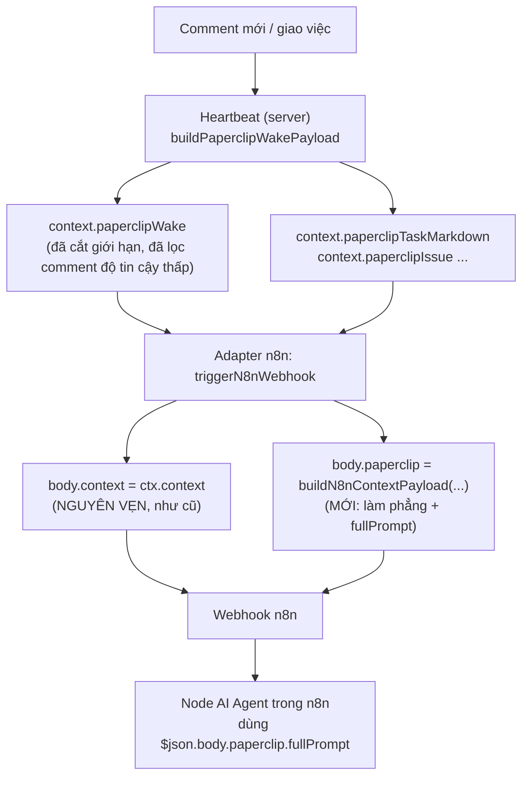

# Phần 8. Context và prompt khi đánh thức agent n8n

- Ngày: 13/11/2026
- Nhánh: `test_adapter`. Các link code trỏ tới commit [`f6c9d6bfc`](https://github.com/trung2710/ppclip/tree/f6c9d6bfc1225895047151d99f8d4002dacee482), nên số dòng không bị lệch khi code thay đổi sau này.
- Commit chính của phần này:
  - [`f5a6dcec5`](https://github.com/trung2710/ppclip/commit/f5a6dcec5) (27/08): adapter n8n gửi thêm trường `paperclip` (context và prompt hoàn chỉnh) sang webhook n8n;
  - [`0d0881853`](https://github.com/trung2710/ppclip/commit/0d0881853) (27/10): lưu lại các mẫu prompt thật của một lượt run (chỉ tài liệu).
- Liên quan: Phần 5 (resume session, nguồn của biến thể "Resume Delta"), Phần 6 (log n8n), Phần 7 (danh tính theo run).
- **Đính chính so với kế hoạch ban đầu:** tôi từng viết rằng các mẫu prompt của `0d0881853` sẽ được "đối chiếu với prompt mà adapter n8n dựng ra". Đọc tận nơi thì các file này **không phải prompt của n8n**: chúng là prompt của agent **Codex** (Front-Desk) và request LiteLLM của `DW VT`. Báo cáo dùng chúng làm mốc so sánh (mục 6).

---

## Tóm tắt phần này

**Đã thực hiện:** đọc diff của commit, code hiện tại của cả hai bản adapter n8n, các hàm dựng prompt trong `adapter-utils`, phía server dựng payload đánh thức, 3 tài liệu nguồn và 7 file mẫu prompt; chạy test và typecheck; viết 3 test thăm dò tạm (đã xóa) để **đo trên dữ liệu thật** và kiểm chứng hành vi.

| Nội dung trong plan | Trạng thái | Xem ở mục |
|---|---|---|
| Trường `paperclip` trong body webhook | Xong | 2 |
| Dùng lại `adapter-utils` để có cùng prompt với adapter khác | Xong, **kèm một lỗi nhỏ** | 3 |
| Hai tùy chọn `includeFullContext`, `includeFullPrompt` và đọc phản hồi webhook | Xong, **mặc định lệch kế hoạch** | 4 |
| `fullPrompt` thực tế gồm gì, so với adapter local | Xong, có số đo | 5 |
| Các mẫu prompt (`0d0881853`) | Xong | 6 |
| Đối chiếu dữ liệu thật | Một phần (xem mục 7) | 7 |

**Nguồn đã dùng:**
- Code: `packages/adapters/n8n-runtime/src/server/execute.ts` (bản built-in đang chạy) và `n8n-runtime-adapter/src/server/execute.ts` (bản plugin cũ); `packages/adapter-utils/src/server-utils.ts`; `server/src/services/heartbeat.ts`.
- Tài liệu: [ke_hoach_nang_cap_n8n_context.md](../instructions/ke_hoach_nang_cap_n8n_context.md), [kien_truc_comment_paperclip.md](../instructions/kien_truc_comment_paperclip.md), [bao_cao_xay_dung_n8n_runtime_adapter.md](../instructions/bao_cao_xay_dung_n8n_runtime_adapter.md).
- Dữ liệu thật: [instructions/execution.json](../instructions/execution.json) (bản dump một lần chạy n8n ngày 26/08, chứa đúng body mà n8n đã nhận) và [instructions/prompts/](../instructions/prompts/).

**Kết quả kiểm tra:**
- 41 test pass cho các hàm dùng chung (`renderPaperclipWakePrompt`, `normalizePaperclipWakePayload`, `stringifyPaperclipWakePayload`). Typecheck của cả hai bản adapter n8n đều sạch.
- **Adapter n8n không có test nào** (không có file `*.test.*` trong cả hai thư mục).
- Database không chạy hôm nay, nên tôi **không** xem được body thật mà n8n nhận *sau* thay đổi. Chỉ có một mẫu thật, và nó được chụp **trước** thay đổi (26/08).

**Kết luận chính:**
1. Thay đổi làm đúng điều nó định làm: body webhook giờ có thêm `paperclip` với các trường đã làm phẳng (lý do đánh thức, tiêu đề, trạng thái, các comment, tóm tắt run trước, thông tin phục hồi) và `fullPrompt` dựng bằng chính các hàm của adapter local.
2. Nhưng "n8n bị mù ngữ cảnh" trong kế hoạch là **nói quá**: bản dump 26/08 cho thấy body cũ **đã có** `context.paperclipWake` và `paperclipTaskMarkdown` (9,5 KB). Điều mới là dạng làm phẳng dễ dùng trong n8n và `fullPrompt`, không phải dữ liệu mới.
3. Có **một lỗi nhỏ có thật**: adapter truyền payload *đã chuẩn hóa* vào hàm dựng prompt, làm dòng `pending comments` ghi `2/2` thay vì `2/5` khi cửa sổ comment bị cắt (đã tái hiện).
4. Body gửi sang n8n **dư thừa và lộ thông tin cục bộ**: `context` thô vẫn được gửi nguyên (kèm đường dẫn `C:\Users\…`, thông tin môi trường), cộng thêm `paperclip` làm body lớn thêm khoảng 44% trên mẫu thật.

---

## 1. Bối cảnh: n8n nhận được gì trước thay đổi

Agent n8n không chạy model trong Paperclip. Khi được đánh thức (giao việc, có comment mới…), adapter gọi một **webhook** của n8n, và workflow n8n (thường có node AI Agent) tự quyết định phải làm gì. Vì vậy chất lượng câu trả lời phụ thuộc vào việc webhook nhận được **đủ ngữ cảnh**.

Kế hoạch nguồn ([ke_hoach_nang_cap_n8n_context.md](../instructions/ke_hoach_nang_cap_n8n_context.md), mục 1) mô tả trạng thái cũ: body chỉ có `agentId`, `runId`, `issueId`, và `context` với "chỉ có ID, không có text". Tôi kiểm tra bằng bản dump n8n ngày 26/08 (execution #893, node webhook `Nhận request từ Agent`):

| Hạng mục | Giá trị thật |
|---|---|
| Khóa của body | `agentId`, `runId`, `paperclipRunId`, `issueId`, `taskId`, `traceId`, `context`, `bridge` |
| Có trường `paperclip`? | **Không** (đúng, đây là trạng thái trước thay đổi) |
| Kích thước | body khoảng 10 KB, trong đó `context` khoảng 9,5 KB (đo bằng JSON có khoảng trắng; mục 5 dùng JSON gọn nên ra 9.152 ký tự) |
| Khóa của `context` | `source`, `taskId`, `issueId`, `taskKey`, `wakeReason`, `wakeSource`, `wakeTriggerDetail`, `paperclipHarnessCheckedOut`, `paperclipContinuationSummary`, **`paperclipWake`**, `paperclipIssue`, **`paperclipTaskMarkdown`**, `paperclipScratch`, `paperclipEnvironment`, `paperclipWorkspace`, `paperclipWorkspaces` |
| `paperclipWake` | 28 khóa, gồm `reason`, `issue`, `comments`, `commentWindow`, `continuationSummary`, `recovery`, `fallbackFetchNeeded`… |

Vậy `context.paperclipWake` (có cả mảng `comments`) **đã đến được n8n** từ trước. Mẫu này là một lần đánh thức `issue_assigned` với 0 comment, nên tôi chưa có mẫu comment thật để xác nhận từng chữ, nhưng cấu trúc `paperclipWake.comments` là cùng một chỗ mà code mới đọc, nên nội dung comment vốn nằm sẵn trong `context`. Cái khó cho người viết workflow n8n là **dữ liệu nằm sâu và không có dạng sẵn dùng**, chứ không phải là không có.

---

## 2. Giải pháp: thêm trường `paperclip` vào body webhook

### 2.1. Luồng dữ liệu



### 2.2. Phía server: dữ liệu đánh thức đã được kiểm soát

`context.paperclipWake` do `buildPaperclipWakePayload` ([heartbeat.ts:4477-](https://github.com/trung2710/ppclip/blob/f6c9d6bfc1225895047151d99f8d4002dacee482/server/src/services/heartbeat.ts#L4477)) dựng, với các giới hạn ([heartbeat.ts:325-328](https://github.com/trung2710/ppclip/blob/f6c9d6bfc1225895047151d99f8d4002dacee482/server/src/services/heartbeat.ts#L325-L328)):

| Giới hạn | Giá trị |
|---|---|
| Số comment nhúng tối đa | 8 |
| Độ dài mỗi comment | 4.000 ký tự |
| Tổng độ dài các comment | 12.000 ký tự |
| Độ dài mô tả issue | 12.000 ký tự |

Khi vượt giới hạn, payload đặt `truncated = true`, ghi `missingCount`, và `fallbackFetchNeeded = true` để báo cho người nhận biết cần lấy thêm qua API. Comment có độ tin cậy thấp (bị cách ly) bị **lọc bỏ nội dung** trước khi đưa vào (`sanitizeQuarantinedCommentForHigherTrust`), trừ khi cờ `exposeLowTrustRaw` bật. Đây là lớp bảo vệ có sẵn chống prompt injection qua comment.

### 2.3. Phía adapter: hàm `buildN8nContextPayload`

Code ([packages/adapters/n8n-runtime/src/server/execute.ts:696-729](https://github.com/trung2710/ppclip/blob/f6c9d6bfc1225895047151d99f8d4002dacee482/packages/adapters/n8n-runtime/src/server/execute.ts#L696-L729)):

```ts
function buildN8nContextPayload(ctx, opts: { includeFullPrompt: boolean }) {
  const wake = normalizePaperclipWakePayload(ctx.context.paperclipWake);
  let fullPrompt: string | null = null;
  if (opts.includeFullPrompt) {
    const taskMarkdown = selectPaperclipTaskMarkdown(ctx.context);
    const wakePromptText = wake ? renderPaperclipWakePrompt(wake) : null;   // ← truyền bản ĐÃ chuẩn hóa (xem R1)
    fullPrompt = joinPromptSections([wakePromptText, taskMarkdown]);
  }
  return { wakeReason, issueTitle, issueStatus, issueDescription, issueIdentifier,
           latestComments, continuationSummary, recovery, fallbackFetchNeeded, fullPrompt };
}
```

| Trường trong `paperclip` | Lấy từ | Ghi chú |
|---|---|---|
| `wakeReason` | `wake.reason` | Ví dụ `issue_reopened_via_comment`, `issue_assigned` |
| `issueTitle`, `issueStatus`, `issueDescription`, `issueIdentifier` | `wake.issue.*` | |
| `latestComments[]` | `wake.comments` | Chỉ giữ `id`, `body`, `authorType`, `createdAt` |
| `continuationSummary` | `wake.continuationSummary.body` | Tóm tắt các việc đã làm ở run trước |
| `recovery` | `wake.recovery` | `cause`, `failureSummary`, `attempt`, `maxAttempts` (khi run trước bị mất hoặc lỗi) |
| `fallbackFetchNeeded` | `wake.fallbackFetchNeeded` | `true` nghĩa là còn dữ liệu chưa nhúng đủ |
| `fullPrompt` | `joinPromptSections([wakePrompt, taskMarkdown])` | Chuỗi prompt hoàn chỉnh, xem mục 5 |

Nó được gắn vào body trong `triggerN8nWebhook` ([execute.ts:151-204](https://github.com/trung2710/ppclip/blob/f6c9d6bfc1225895047151d99f8d4002dacee482/packages/adapters/n8n-runtime/src/server/execute.ts#L151-L204)), **bên cạnh** `context` chứ không thay thế nó:

```ts
const body = { ...config.payloadTemplate, agentId, runId, paperclipRunId, issueId, taskId, traceId,
               context: ctx.context,                                   // như cũ
               ...(paperclipContext ? { paperclip: paperclipContext } : {}),   // mới
               bridge: { kind: "paperclip-n8n-runtime-adapter", startedAt } };
```

Ngoài body, URL còn có tham số truy vấn `Content` (tiêu đề task, lấy bởi `getTaskContent`, [dòng 655-665](https://github.com/trung2710/ppclip/blob/f6c9d6bfc1225895047151d99f8d4002dacee482/packages/adapters/n8n-runtime/src/server/execute.ts#L655-L665)), `traceId`, `paperclipRunId`, `issueId`, `agentId`, `companyId`.

---

## 3. Dùng lại thư viện có sẵn: phần "dependencies in repo"

Tên commit nói "utilize dependencies in repo": nghĩa là **dùng lại code có sẵn của repo** thay vì tự viết, cụ thể bốn hàm trong `@paperclipai/adapter-utils` (không liên quan tới "issue phụ thuộc nhau"):

| Hàm | Dòng | Việc làm |
|---|---|---|
| `normalizePaperclipWakePayload` | [server-utils.ts:1261-1340](https://github.com/trung2710/ppclip/blob/f6c9d6bfc1225895047151d99f8d4002dacee482/packages/adapter-utils/src/server-utils.ts#L1261-L1340) | Đọc an toàn `context.paperclipWake` thành kiểu có cấu trúc; trả `null` nếu trống |
| `renderPaperclipWakePrompt` | [server-utils.ts:1411-](https://github.com/trung2710/ppclip/blob/f6c9d6bfc1225895047151d99f8d4002dacee482/packages/adapter-utils/src/server-utils.ts#L1411) | Dựng đoạn Markdown "## Paperclip Wake Payload" cho model, gồm cả chỉ dẫn phục hồi và danh sách comment |
| `selectPaperclipTaskMarkdown` | [server-utils.ts:1395-](https://github.com/trung2710/ppclip/blob/f6c9d6bfc1225895047151d99f8d4002dacee482/packages/adapter-utils/src/server-utils.ts#L1395) | Chọn bản đầy đủ hoặc bản gọn của mô tả task |
| `joinPromptSections` | [server-utils.ts:428-436](https://github.com/trung2710/ppclip/blob/f6c9d6bfc1225895047151d99f8d4002dacee482/packages/adapter-utils/src/server-utils.ts#L428-L436) | Nối các đoạn, bỏ đoạn rỗng, cách nhau 2 dòng trống |

Điều kiện kỹ thuật để import được: commit `f5a6dcec5` đã thêm `n8n-runtime-adapter` vào `pnpm-workspace.yaml` và khai báo phụ thuộc `"@paperclipai/adapter-utils": "workspace:*"`. Hiện tại thư mục gốc `n8n-runtime-adapter/` **không còn** trong workspace (commit `9b26918b2` thay bằng `packages/adapters/*`), và bản đang chạy là `packages/adapters/n8n-runtime/`, cũng khai báo cùng phụ thuộc ([package.json:46](https://github.com/trung2710/ppclip/blob/f6c9d6bfc1225895047151d99f8d4002dacee482/packages/adapters/n8n-runtime/package.json#L46)). Hai bản `execute.ts` giờ gần như trùng nhau: chỉ khác 8 dòng sau khi bỏ khác biệt kiểu xuống dòng (import kiểu và vài comment).

Lợi ích của cách làm này là n8n nhận đúng định dạng "Wake Payload" mà các adapter Claude, Codex, Gemini nhận, nên không phải bảo trì hai bộ logic. Cái giá: lỗi nhỏ ở mục 3.1.

### 3.1. Lỗi nhỏ: truyền payload đã chuẩn hóa vào hàm dựng prompt

Tất cả adapter khác (Claude, Codex, Cursor, Gemini, Grok, Hermes) truyền **bản thô** `context.paperclipWake` vào `renderPaperclipWakePrompt`. Adapter n8n lại truyền `wake`, tức bản **đã chuẩn hóa**, và hàm này chuẩn hóa thêm một lần nữa. Hai lần chuẩn hóa không cho cùng kết quả, vì kết quả chuẩn hóa không còn khóa `commentWindow`. Tôi tái hiện bằng một payload có cửa sổ comment bị cắt (yêu cầu 5, nhúng được 2, thiếu 3):

| Cách gọi | Dòng trong prompt |
|---|---|
| `renderPaperclipWakePrompt(raw)` (cách đúng, như adapter khác) | `- pending comments: 2/5` |
| `renderPaperclipWakePrompt(normalize(raw))` (cách adapter n8n đang làm) | `- pending comments: 2/2` |

Cả hai vẫn ghi `fallback fetch needed: yes`, nên prompt tự mâu thuẫn (nói đã nhúng đủ 2/2 mà vẫn cần lấy thêm). Mức ảnh hưởng nhỏ, nhưng dễ sửa: truyền `ctx.context.paperclipWake` thay vì `wake` (một dòng). Chưa có test nào bắt được lỗi này vì adapter không có test.

---

## 4. Hai tùy chọn cấu hình và phản hồi của webhook

### 4.1. `includeFullContext` và `includeFullPrompt`

Khai báo ở [execute.ts:39-40](https://github.com/trung2710/ppclip/blob/f6c9d6bfc1225895047151d99f8d4002dacee482/packages/adapters/n8n-runtime/src/server/execute.ts#L39-L40) và đọc ở [146-147](https://github.com/trung2710/ppclip/blob/f6c9d6bfc1225895047151d99f8d4002dacee482/packages/adapters/n8n-runtime/src/server/execute.ts#L146-L147):

| Tùy chọn | Tác dụng | Mặc định trong **code** | Mặc định trong **kế hoạch** |
|---|---|---|---|
| `includeFullContext` | Bật hoặc tắt toàn bộ trường `paperclip` | `true` | `true` |
| `includeFullPrompt` | Bật hoặc tắt riêng `fullPrompt` | **`true`** | **`false`** ("vì rất dài") |

Có hai điều cần biết:
- **Mặc định lệch kế hoạch:** kế hoạch ([dòng 85-86 và 93](../instructions/ke_hoach_nang_cap_n8n_context.md)) đặt `includeFullPrompt` là `false`, code đặt `true`. Hậu quả: mọi agent n8n đều gửi `fullPrompt` trừ khi tự tắt.
- **Hai tùy chọn không được ghi ở đâu cả ngoài code và kế hoạch:** chúng không có trong `agentConfigurationDoc` ([metadata.ts](https://github.com/trung2710/ppclip/blob/f6c9d6bfc1225895047151d99f8d4002dacee482/packages/adapters/n8n-runtime/src/metadata.ts), danh sách "Core fields") và không có trong schema cấu hình hiển thị trên giao diện (các khóa trong `server/index.ts` chỉ gồm `webhookUrl`, `baseUrl`, `workflowId`, `n8nApiKey`, `method`, `pollIntervalMs`, `executionTimeoutMs`, `matchTraceId`). Người dùng chỉ đặt được bằng cách sửa JSON `adapterConfig`.

### 4.2. Đọc phản hồi của webhook

`triggerN8nWebhook` giờ **trả về nội dung phản hồi** (`return text`) thay vì bỏ đi, và `execute` ghi nó thành sự kiện `n8n.webhook.response_success`; nếu phần theo dõi execution không tìm được kết quả, nội dung phản hồi được dùng làm `result` của run. Điều này cho phép workflow n8n kết thúc bằng node "Respond to Webhook" và Paperclip lấy được câu trả lời.

---

## 5. `fullPrompt` thực tế gồm gì

Tôi chạy đúng các hàm của adapter trên `context` thật của bản dump 26/08 (một lần đánh thức `issue_assigned`):

| Số đo | Giá trị |
|---|---|
| `context` cũ (JSON gọn) | 9.152 ký tự |
| `fullPrompt` | 2.432 ký tự (phần wake 2.036 + phần task 394) |
| Trường `paperclip` mới (JSON) | **4.030 ký tự**, tức **+44%** so với `context` |
| Có đoạn "Execution contract"? | **Không** |

Cấu trúc của `fullPrompt` trong mẫu: `## Paperclip Wake Payload` → các dòng `reason/issue/status…` → `Issue continuation summary:` (kèm các mục `Objective`, `Acceptance Criteria`, `Recent Concrete Actions`, `Files / Routes Touched`, `Commands Run`, `Blockers / Decisions`, `Next Action`) → `Paperclip task context:`.

Đoạn mở đầu "Treat this wake payload as the highest-priority change… acknowledge the latest comment" là chỉ dẫn mà adapter local cũng dùng; đó là lý do `fullPrompt` làm n8n "ưu tiên comment mới".

### 5.1. So với prompt của adapter local

Tài liệu [kien_truc_comment_paperclip.md](../instructions/kien_truc_comment_paperclip.md) (mục 5) kết luận n8n nhận dữ liệu "đầy đủ y hệt Local Adapter". Đối chiếu với cách engine ACPX ghép prompt (8 phần, theo chính tài liệu đó):

| # | Phần trong prompt của adapter local | Có trong `fullPrompt` của n8n? |
|---|---|---|
| 1 | Luật của agent (`AGENTS.md`, `SKILL.md`) | **Không** |
| 2 | Bootstrap cơ bản | Không |
| 3 | **Wake prompt** (comment mới, trạng thái, phục hồi) | **Có** |
| 4 | Ghi chú bàn giao giữa các phiên | Không (n8n không có phiên) |
| 5 | **Mô tả task gốc** (task context) | **Có** |
| 6 | Môi trường và thư mục làm việc | Không |
| 7 | Hướng dẫn tool và API | Không |
| 8 | Template bổ sung và "Execution contract" | Không |

Vậy `fullPrompt` chỉ gồm **2 trong 8 phần**: đúng phần "việc cần làm ngay". Phần luật và công cụ của agent phải do workflow n8n tự cung cấp (system prompt của node AI Agent). Điều này hợp lý, nhưng cách nói "đầy đủ y hệt Local Adapter" trong tài liệu là chưa đúng.

### 5.2. Mô tả task bị lặp

`renderPaperclipWakePrompt` có sẵn tùy chọn `suppressIssueDescription`, dành cho adapter "đã mang task markdown trong prompt, để mô tả không bị gửi hai lần" (comment trong code). Adapter n8n ghép **cả hai** (`wakePrompt` + `taskMarkdown`) mà không bật tùy chọn này. Tôi đo trên một payload mẫu có mô tả: mô tả task xuất hiện **2 lần** trong `fullPrompt`; bật `suppressIssueDescription` thì còn 1 lần và prompt ngắn đi (1.350 xuống 1.141 ký tự trên mẫu nhỏ). Với mô tả dài (tối đa 12.000 ký tự) mức lãng phí lớn hơn nhiều.

---

## 6. Các mẫu prompt của commit `0d0881853`

Thư mục [instructions/prompts/](../instructions/prompts/) chứa hai nhóm, **cả hai đều thuộc agent Codex, không phải n8n**:

| Nhóm | File | Nội dung |
|---|---|---|
| `codex/` | `p1.txt` (19.931 byte), `p2_1.txt` (16.589 byte), `p2_2.txt` (8.290 byte) | Prompt đầy đủ mà adapter Codex (engine ACPX) gửi cho agent Front-Desk ở ba lượt |
| `litellm_gemini_3.6/` | `input.txt`, `input1.txt` (khoảng 14,5 KB), `output.txt`, `output1.txt` | Request và phản hồi thật ghi trong LiteLLM của agent `DW VT` (model `gemini/gemini-3.6-flash`) |

Cấu trúc của `p1.txt` (lượt đầu, lý do `issue_assigned`), tính theo byte:

| Phần | Byte | Tỷ lệ |
|---|---|---|
| Ghi chú kỹ năng (skills) | 269 | 1% |
| **`AGENTS.md` (luật của agent Front-Desk)** | **9.621** | **48%** |
| Wake payload và tóm tắt phục hồi | 3.929 | 20% |
| Task context | 3.199 | 16% |
| Execution contract | 2.913 | 15% |

`p2_2.txt` là biến thể **"## Paperclip Resume Delta"** (lý do `issue_reopened_via_comment`): khi **nối lại session** (Phần 5), prompt **bỏ hẳn `AGENTS.md`** vì session đã có sẵn, chỉ còn phần thay đổi. Kết quả: 8.290 byte, nhỏ hơn `p1.txt` khoảng 58%. Đây chính là giá trị cụ thể của việc giữ session mà Phần 5 đã làm.

Ví dụ nội dung của một `Resume Delta` thật (rút gọn):

```text
## Paperclip Resume Delta
You are resuming an existing Paperclip session.
This heartbeat is scoped to the issue below. Do not switch to another issue until you have handled this wake.
...
- reason: issue_reopened_via_comment
- issue: KHT-112 [Telegram] Xử lý: giới thiệu về bản thân bạn đi, bạn là agent nào?
- pending comments: 1/1
- fallback fetch needed: no
```

**Liên hệ với n8n:** adapter n8n gọi `renderPaperclipWakePrompt(wake)` **không** truyền `resumedSession`, nên luôn nhận biến thể "Paperclip Wake Payload" đầy đủ, không bao giờ nhận "Resume Delta". Điều đó đúng vì n8n không có phiên để nối lại, nhưng cũng có nghĩa là mỗi lần comment, n8n nhận lại toàn bộ tóm tắt và mô tả task.

Một điều đáng ghi nhận: file `input.txt` và `input1.txt` chứa nội dung request đầy đủ gửi tới LiteLLM, tức dữ liệu người dùng (tin nhắn Telegram, tên task). Chúng nằm trong repo và đã được push (Phần 2 R3 nói về việc LiteLLM đang lưu cả prompt). Tôi không in nội dung ra báo cáo.

---

## 7. Kiểm chứng

| Hạng mục | Kết quả |
|---|---|
| Test của hàm dùng chung (`server-utils.test.ts`, nhóm wake) | **41 pass** |
| Test riêng của adapter n8n | **Không có** (không có file `*.test.*` trong `packages/adapters/n8n-runtime/` và `n8n-runtime-adapter/`) |
| Typecheck (`tsc --noEmit`) của hai bản adapter | Sạch |
| Body n8n thật **trước** thay đổi (execution #893, 26/08) | Xác nhận: không có `paperclip`; có `context.paperclipWake` |
| Body n8n thật **sau** thay đổi | **Không có.** Database và server không chạy lúc kiểm tra; các log run n8n trên đĩa (từ 27/08) chỉ ghi log định dạng (Phần 6), không ghi body gửi đi |
| Hành vi `buildN8nContextPayload` | Kiểm chứng bằng test thăm dò tạm trên `context` thật của bản dump (đã xóa file test sau khi chạy) |
| Workflow n8n thật có dùng `paperclip.fullPrompt` không | Không biết. Bản dump 26/08 có node `AI Agent1` và `Groq Chat Model` nhưng được chụp trước thay đổi |

---

## 8. Rủi ro và điểm cần lưu ý

**R1. Dòng `pending comments` sai khi cửa sổ comment bị cắt (mục 3.1). Mức thấp.** Sửa một dòng: truyền `ctx.context.paperclipWake`.

**R2. Mô tả task bị lặp trong `fullPrompt` (mục 5.2). Mức thấp đến trung bình.** Tốn token ở node LLM của n8n. Cách sửa: truyền `{ suppressIssueDescription: true }`.

**R3. Body lớn thêm khoảng 44% và dư thừa. Mức thấp.** `context` thô vẫn gửi nguyên (9,2 KB trên mẫu) cộng `paperclip` (4,0 KB), trong đó tóm tắt run trước xuất hiện nhiều lần (trong `context.paperclipContinuationSummary`, `context.paperclipWake.continuationSummary`, `paperclip.continuationSummary` và trong `fullPrompt`). Có thể cho phép tắt `context` thô để chỉ gửi `paperclip`.

**R4. Gửi thông tin cục bộ và dữ liệu người dùng sang hệ thống ngoài. Mức trung bình (riêng tư và an toàn).** Trong mẫu thật, `context` gửi sang n8n gồm `paperclipWorkspace.cwd` với đường dẫn chứa tên người dùng Windows (`C:\Users\…`), `paperclipEnvironment`, `paperclipWorkspaces`, `paperclipScratch`. Ngoài ra, khi run có secret, server đặt `context.paperclipSecrets = { manifest }` ([heartbeat.ts:12482](https://github.com/trung2710/ppclip/blob/f6c9d6bfc1225895047151d99f8d4002dacee482/server/src/services/heartbeat.ts#L12482)); mỗi mục là tên khóa, `secretId`, phiên bản, nhà cung cấp (không phải giá trị bí mật). Mẫu 26/08 không có trường này, nên tôi chưa thấy nó đi sang n8n, nhưng code **không lọc** `context` trước khi gửi. Nội dung comment và tin nhắn người dùng cũng đi theo.

**R5. Mặc định `includeFullPrompt = true` lệch kế hoạch và hai tùy chọn không được tài liệu hóa (mục 4.1). Mức thấp.**

**R6. Adapter n8n không có test. Mức trung bình.** Đó là lý do lỗi R1 và R2 không bị phát hiện. Nên có test cho `buildN8nContextPayload` với payload comment bị cắt.

**R7. Hai bản adapter trùng nhau, bản gốc ngoài workspace.** `n8n-runtime-adapter/` không còn trong `pnpm-workspace.yaml`, nhưng vẫn tồn tại và vẫn chứa cùng logic (khác 8 dòng). Sửa một bản mà quên bản kia sẽ lệch (đã gặp ở Phần 6).

**R8. Tiêu đề task nằm trong URL.** Tham số `Content` đưa tiêu đề task vào chuỗi truy vấn, nên xuất hiện trong log truy cập của n8n và các proxy trung gian.

**R9. `fullPrompt` không có luật và công cụ của agent (mục 5.1).** Workflow n8n phải tự có system prompt. Tài liệu nên nói rõ điều này thay vì "y hệt Local Adapter".

**R10. Chưa kiểm tra đầu cuối với một lần comment thật.** Bản dump duy nhất là `issue_assigned` không có comment, và chụp trước thay đổi.

---

## 9. Kết luận

1. **Thay đổi hoạt động như thiết kế:** body webhook giờ có `paperclip` với dữ liệu làm phẳng và `fullPrompt` dựng bằng chính các hàm của adapter local, cộng việc đọc phản hồi của webhook.
2. **Giá trị thật nằm ở sự tiện dụng, không phải dữ liệu mới:** `context.paperclipWake` và `paperclipTaskMarkdown` vốn đã đến n8n (bản dump 26/08). Cái mới là dạng gọn dễ dùng trong n8n và chuỗi prompt sẵn.
3. **`fullPrompt` chỉ là 2 trong 8 phần của prompt local**, đúng phần "việc cần làm ngay". Nó không phải "y hệt" adapter local.
4. **Cần sửa nhỏ:** truyền payload thô thay vì payload đã chuẩn hóa (R1), bật `suppressIssueDescription` (R2), và thêm test (R6).
5. **Cần cân nhắc về dữ liệu gửi ra ngoài:** lọc `context` thô, hoặc cho phép chỉ gửi `paperclip` (R3, R4); ghi rõ hai tùy chọn mới và mặc định của chúng (R5).
6. **Các mẫu prompt của `0d0881853` thuộc agent Codex:** chúng cho thấy giá trị của giữ session (8,3 KB so với 19,9 KB) hơn là minh họa cho n8n.

---

## Phụ lục A. Danh sách file đã trích dẫn

| File | Nội dung chính |
|---|---|
| [packages/adapters/n8n-runtime/src/server/execute.ts](https://github.com/trung2710/ppclip/blob/f6c9d6bfc1225895047151d99f8d4002dacee482/packages/adapters/n8n-runtime/src/server/execute.ts) | `buildN8nContextPayload`, `triggerN8nWebhook`, đọc cấu hình (bản đang chạy) |
| [n8n-runtime-adapter/src/server/execute.ts](https://github.com/trung2710/ppclip/blob/f6c9d6bfc1225895047151d99f8d4002dacee482/n8n-runtime-adapter/src/server/execute.ts) | Bản plugin cũ, gần như trùng |
| [packages/adapter-utils/src/server-utils.ts](https://github.com/trung2710/ppclip/blob/f6c9d6bfc1225895047151d99f8d4002dacee482/packages/adapter-utils/src/server-utils.ts) | Bốn hàm dựng prompt dùng chung |
| [server/src/services/heartbeat.ts](https://github.com/trung2710/ppclip/blob/f6c9d6bfc1225895047151d99f8d4002dacee482/server/src/services/heartbeat.ts) | `buildPaperclipWakePayload`, giới hạn nhúng, `paperclipSecrets` |
| [packages/adapters/n8n-runtime/src/metadata.ts](https://github.com/trung2710/ppclip/blob/f6c9d6bfc1225895047151d99f8d4002dacee482/packages/adapters/n8n-runtime/src/metadata.ts) | Danh sách trường cấu hình được tài liệu hóa |
| [instructions/execution.json](https://github.com/trung2710/ppclip/blob/f6c9d6bfc1225895047151d99f8d4002dacee482/instructions/execution.json) | Bản dump n8n ngày 26/08 (body trước thay đổi) |
| [instructions/prompts/](https://github.com/trung2710/ppclip/tree/f6c9d6bfc1225895047151d99f8d4002dacee482/instructions/prompts) | Các mẫu prompt của agent Codex |

## Phụ lục B. Cách tự kiểm tra trên máy

```sh
# 1. Chạy test của các hàm dùng chung và typecheck adapter
npx vitest run packages/adapter-utils/src/server-utils.test.ts -t "renderPaperclipWakePrompt"
cd packages/adapters/n8n-runtime && npx tsc --noEmit

# 2. Xem body thật mà n8n nhận: trong n8n, mở một execution, node Webhook, tab Output.
#    Kiểm tra: có body.paperclip không? body.paperclip.fullPrompt bắt đầu bằng "## Paperclip Wake Payload"?
#    Kiểm tra: dòng "- pending comments: X/Y" có khớp số comment thật khi nhiều comment bị cắt không (lỗi R1)?

# 3. Đếm số lần mô tả task xuất hiện trong fullPrompt (lỗi R2)
#    Trong n8n Code node:  ($json.body.paperclip.fullPrompt.match(/Issue description:/g) || []).length
```

```text
4. Thử tắt phần dư: đặt trong adapterConfig của agent n8n
   { "includeFullPrompt": false }       -> không gửi fullPrompt
   { "includeFullContext": false }      -> không gửi cả trường paperclip
   (hai tùy chọn này chưa có trên giao diện, phải sửa JSON cấu hình)
```
