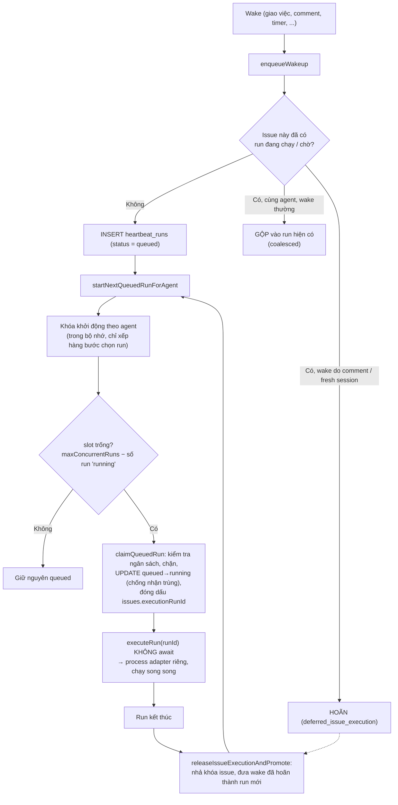

# Phần 9. Một agent chạy nhiều task cùng lúc

- Ngày: 13/11/2026
- Nhánh: `test_adapter`. Các link code trỏ tới commit [`f6c9d6bfc`](https://github.com/trung2710/ppclip/tree/f6c9d6bfc1225895047151d99f8d4002dacee482), nên số dòng không bị lệch khi code thay đổi sau này.
- Đây là phần **chỉ phân tích và chạy thử**, không có commit sửa code nào của nhánh `test_adapter` cho tính năng này. Cơ chế chạy song song có từ trước:
  - [`0131cf344`](https://github.com/trung2710/ppclip/commit/0131cf344) (20/02): thêm `maxConcurrentRuns` (giới hạn ban đầu 1 đến 10);
  - [`e8275318b`](https://github.com/trung2710/ppclip/commit/e8275318b) (01/05, PR #4954): nâng mặc định lên 20 và trần lên 50.
- Liên quan: Phần 2 (tag LiteLLM tách số liệu theo run), Phần 3 (ngân sách và cộng dồn cost), Phần 5 (session theo task), Phần 7 (token gateway theo run).

---

## Tóm tắt phần này

**Đã thực hiện:** đọc toàn bộ đường đi từ lúc nhận wake tới lúc chạy và kết thúc run; chạy test sẵn có; **viết và chạy 3 kịch bản thử tạm trên Postgres nhúng** (adapter giả, đã xóa file sau khi chạy); **đo tình trạng chạy chồng lên nhau trong 680 file log run thật** của máy bạn.

| Nội dung trong plan | Trạng thái | Xem ở mục |
|---|---|---|
| `maxConcurrentRuns` (mặc định, trần, nơi cấu hình) | Xong | 1 |
| Luồng insert → claim → chạy nền | Xong | 2 |
| Khóa theo issue: một task chỉ một run tại một thời điểm | Xong, có kiểm chứng thực nghiệm | 3 |
| Tài nguyên dùng chung giữa các run của một agent (workspace, `CODEX_HOME`, …) | Xong, **phát hiện rủi ro** | 5 |
| Kết quả chạy thử | **Phần của tôi xong; kết quả chạy thử của bạn chưa có** | 6, 7 |

**Nguồn đã dùng:**
- Code: `server/src/services/heartbeat.ts`, `agent-start-lock.ts`, `issues.ts`, `instance-settings.ts`, `run-scratch.ts`; `packages/shared/src/constants.ts`; `codex-local/src/server/runtime-config.ts`, `execute.ts`; `ui/src/components/AgentConfigForm.tsx`.
- Dữ liệu thật: các file `*.ndjson` trong `~/.paperclip/instances/default/data/run-logs`. Database không chạy hôm nay nên không dùng.

**Kết quả kiểm tra:**
- `heartbeat-dependency-scheduling.test.ts`: **6 test pass**, trong đó có test giới hạn bằng 1 (run thứ hai nằm ở `queued`) và test "cùng issue đang chạy thì wake mới bị hoãn".
- **Kịch bản tạm 1** (giới hạn 2, 3 issue khác nhau): 2 run chạy cùng lúc, run thứ 3 nằm chờ, đúng như thiết kế.
- **Kịch bản tạm 2** (một issue bị đánh thức 3 lần khi đang chạy): vẫn **chỉ 1 run** chạy; wake trùng được gộp, wake do comment được hoãn và chỉ chạy sau khi run đầu xong.
- **Log thật:** có agent từng chạy **6 run chồng lên nhau**, trong đó **4 run thuộc 4 task khác nhau** (TRU-2, TRU-3, TRU-4, TRU-5).

**Kết luận chính:**
1. Một agent chạy được nhiều task cùng lúc, tối đa `maxConcurrentRuns` run (mặc định 20, chỉnh được từ 1 đến 50). Mỗi task do một run chạy; run thừa nằm ở hàng đợi `queued`.
2. Một task (issue) chỉ có **một run tại một thời điểm**. Wake mới cho issue đang chạy được **gộp** vào run hiện có hoặc **hoãn** tới khi run đó kết thúc. Cơ chế dựa trên khóa dòng của issue trong database, nên bền vững.
3. Hàng đợi **không phải FIFO**: issue đang `in_progress` được ưu tiên hơn issue `todo`. Kịch bản thử cho thấy slot trống bị một run tiếp nối của issue vừa xong chiếm, thay vì run đang chờ (mục 4).
4. Rủi ro lớn nhất không nằm ở số run mà ở **tài nguyên dùng chung**: 73 run của một agent trong log đều dùng **cùng một thư mục làm việc**, và `enableIsolatedWorkspaces` mặc định là tắt.

---

## 1. Giới hạn số run chạy song song

| Hạng mục | Giá trị | Code |
|---|---|---|
| Mặc định | **20** | [constants.ts:79](https://github.com/trung2710/ppclip/blob/f6c9d6bfc1225895047151d99f8d4002dacee482/packages/shared/src/constants.ts#L79) |
| Trần và sàn | **50** và **1** | [heartbeat.ts:310-312](https://github.com/trung2710/ppclip/blob/f6c9d6bfc1225895047151d99f8d4002dacee482/server/src/services/heartbeat.ts#L310-L312), chuẩn hóa ở [dòng 2046-2048](https://github.com/trung2710/ppclip/blob/f6c9d6bfc1225895047151d99f8d4002dacee482/server/src/services/heartbeat.ts#L2046-L2048) |
| Nơi lưu | `agent.runtimeConfig.heartbeat.maxConcurrentRuns` | `parseHeartbeatPolicy` [heartbeat.ts:10572-10597](https://github.com/trung2710/ppclip/blob/f6c9d6bfc1225895047151d99f8d4002dacee482/server/src/services/heartbeat.ts#L10572-L10597) |
| Nơi chỉnh trên giao diện | Ô **"Max concurrent runs"** | [AgentConfigForm.tsx:1525](https://github.com/trung2710/ppclip/blob/f6c9d6bfc1225895047151d99f8d4002dacee482/ui/src/components/AgentConfigForm.tsx#L1525) |
| Phạm vi | **Theo từng agent**; không có giới hạn cho cả company hay cả hệ thống | |

- Giá trị được đọc **lại ở mỗi lần xếp lịch**, nên đổi cấu hình có hiệu lực với lần claim kế tiếp mà không cần khởi động lại.
- Con số 50 không xuất phát từ giới hạn kỹ thuật mà là "trần an toàn" do người viết chọn (PR #4954 nâng từ 10 lên 50, mặc định từ 5 lên 20). Thực tế RAM, CPU và giới hạn tốc độ API của nhà cung cấp thường chạm trước.
- Vì giới hạn tính theo từng agent, nhiều agent cộng lại có thể chạy hơn 50 run.

---

## 2. Vòng đời: từ wake tới run chạy xong



| Bước | Code |
|---|---|
| Insert run `queued` rồi gọi xếp lịch | [heartbeat.ts:16349-16372](https://github.com/trung2710/ppclip/blob/f6c9d6bfc1225895047151d99f8d4002dacee482/server/src/services/heartbeat.ts#L16349-L16372) |
| Đếm run đang `running` | `countRunningRunsForAgent` [10788-10794](https://github.com/trung2710/ppclip/blob/f6c9d6bfc1225895047151d99f8d4002dacee482/server/src/services/heartbeat.ts#L10788-L10794) |
| Tính slot trống, lấy các run `queued`, claim từng run | `startNextQueuedRunForAgent` [11841-11932](https://github.com/trung2710/ppclip/blob/f6c9d6bfc1225895047151d99f8d4002dacee482/server/src/services/heartbeat.ts#L11841-L11932) |
| `UPDATE … WHERE status='queued'` (nhận một lần duy nhất) | [10892-10903](https://github.com/trung2710/ppclip/blob/f6c9d6bfc1225895047151d99f8d4002dacee482/server/src/services/heartbeat.ts#L10892-L10903) |
| Chạy nền không chờ | [11917-11929](https://github.com/trung2710/ppclip/blob/f6c9d6bfc1225895047151d99f8d4002dacee482/server/src/services/heartbeat.ts#L11917-L11929) |
| Khóa khởi động theo agent (chỉ trong một tiến trình server, hết hạn sau 30 giây) | [agent-start-lock.ts](https://github.com/trung2710/ppclip/blob/f6c9d6bfc1225895047151d99f8d4002dacee482/server/src/services/agent-start-lock.ts) |

Điều quan trọng: **mọi run đều vào `queued` trước, kể cả khi còn chỗ**. Với slot trống, run chuyển sang `running` gần như ngay lập tức. Chỉ khi đã đủ số run đang chạy, run mới nằm lại hàng đợi.

```ts
// heartbeat.ts:11855-11858
const policy = parseHeartbeatPolicy(agent);
const runningCount = await countRunningRunsForAgent(agentId);
const availableSlots = Math.max(0, policy.maxConcurrentRuns - runningCount);
if (availableSlots <= 0) return [];
```

---

## 3. Một task chỉ có một run tại một thời điểm

Có **ba lớp** bảo vệ, từ trong ra ngoài:

1. **Khóa dòng khi xếp hàng.** Khi wake gắn với một issue, `enqueueWakeup` mở giao dịch và `select … for update` trên dòng issue ([heartbeat.ts:15593](https://github.com/trung2710/ppclip/blob/f6c9d6bfc1225895047151d99f8d4002dacee482/server/src/services/heartbeat.ts#L15593)). Hai wake đồng thời cho cùng issue bị xếp thành hàng ở bước này, nên không thể cùng tạo run.
2. **Dấu khóa thực thi khi nhận run.** `claimQueuedRun` ghi `issues.executionRunId = run.id`, chỉ khi cột này còn trống hoặc đã là chính run đó, và chỉ cho assignee hiện tại ([heartbeat.ts:10924-10949](https://github.com/trung2710/ppclip/blob/f6c9d6bfc1225895047151d99f8d4002dacee482/server/src/services/heartbeat.ts#L10924-L10949)).
3. **Checkout nguyên tử của issue** (một assignee, xung đột trả `409 Issue checkout conflict`, [issues.ts:7119](https://github.com/trung2710/ppclip/blob/f6c9d6bfc1225895047151d99f8d4002dacee482/server/src/services/issues.ts#L7119)).

Khi issue đã có run đang chạy mà có wake mới ([heartbeat.ts:16032-16140](https://github.com/trung2710/ppclip/blob/f6c9d6bfc1225895047151d99f8d4002dacee482/server/src/services/heartbeat.ts#L16032-L16140)):

| Wake mới | Xử lý | Trạng thái ghi lại |
|---|---|---|
| Wake thường (giao lại, timer…) cùng agent | **Gộp** ngữ cảnh vào run đang chạy, không tạo run | `coalesced` |
| Wake do **comment mới** hoặc `forceFreshSession` (`shouldDeferFollowupWakeForSameIssue`, [3151-3163](https://github.com/trung2710/ppclip/blob/f6c9d6bfc1225895047151d99f8d4002dacee482/server/src/services/heartbeat.ts#L3151-L3163)) | **Hoãn**; khi run kết thúc, `releaseIssueExecutionAndPromote` ([14528-](https://github.com/trung2710/ppclip/blob/f6c9d6bfc1225895047151d99f8d4002dacee482/server/src/services/heartbeat.ts#L14528)) đưa wake đã hoãn lâu nhất thành run mới | `deferred_issue_execution` |
| Wake của **agent khác** cho issue đó | Hoãn, hoặc hủy nếu run giữ khóa không còn hợp lệ (đã giao lại cho người khác) | |

Wake **không gắn issue** (timer, routine) không có khóa theo issue; chúng được gộp theo `taskKey` trong cùng agent ([heartbeat.ts:16375-16435](https://github.com/trung2710/ppclip/blob/f6c9d6bfc1225895047151d99f8d4002dacee482/server/src/services/heartbeat.ts#L16375-L16435)), và `enqueueWakeup` khóa dòng agent ([16438](https://github.com/trung2710/ppclip/blob/f6c9d6bfc1225895047151d99f8d4002dacee482/server/src/services/heartbeat.ts#L16438)) để xếp hàng việc tạo run.

---

## 4. Thứ tự lấy run khỏi hàng đợi: không phải FIFO

Khi có slot, các run `queued` được sắp theo ([heartbeat.ts:11891-11907](https://github.com/trung2710/ppclip/blob/f6c9d6bfc1225895047151d99f8d4002dacee482/server/src/services/heartbeat.ts#L11891-L11907)):

| Thứ hạng | Loại run |
|---|---|
| 0 | Issue sẵn sàng và đang **`in_progress`** |
| 1 | Issue sẵn sàng (không bị chặn bởi issue khác), trạng thái khác |
| 2 | Run không gắn issue |
| 3 | Issue còn bị chặn bởi issue khác |

Trong cùng hạng thì theo độ ưu tiên của issue, rồi theo thời gian tạo. Hệ quả: **một run tới sau nhưng thuộc issue `in_progress` có thể vượt mặt run đến trước của issue `todo`.**

---

## 5. Tài nguyên dùng chung giữa các run của cùng một agent

Chạy song song an toàn về mặt lịch (mục 2, 3), nhưng các run của **một agent** vẫn chia sẻ một số thứ.

### 5.1. Thư mục làm việc (workspace)

Khi issue **không thuộc project** nào, run dùng "workspace dự phòng" của agent: một thư mục duy nhất `<instance>/workspaces/<agentId>` ([home-paths.ts:50-56](https://github.com/trung2710/ppclip/blob/f6c9d6bfc1225895047151d99f8d4002dacee482/server/src/home-paths.ts#L50-L56)). Tôi đếm trong log thật dòng `Using fallback workspace "…" for this run`:

| Agent (8 ký tự đầu) | Số run dùng workspace dự phòng | Số thư mục khác nhau |
|---|---|---|
| `4919b15f` | 187 | **1** |
| `ee6a0ccc` | 73 | **1** |
| `87c740d4` | 71 | **1** |
| `e5f5c0b9` | 32 | **1** |

Mỗi agent có **đúng một** thư mục cho toàn bộ run của nó, kể cả các run chạy song song. Cách ly theo task (worktree riêng cho từng issue) chỉ có khi bật `enableIsolatedWorkspaces`, và tùy chọn thử nghiệm này **mặc định tắt** ([instance-settings.ts:246](https://github.com/trung2710/ppclip/blob/f6c9d6bfc1225895047151d99f8d4002dacee482/server/src/services/instance-settings.ts#L246), [validators/instance.ts:43](https://github.com/trung2710/ppclip/blob/f6c9d6bfc1225895047151d99f8d4002dacee482/packages/shared/src/validators/instance.ts#L43)). Hai run cùng ghi một file hoặc cùng `git checkout` trong thư mục đó có thể đè lên nhau. Thư mục tạm (`TMPDIR`) thì đã được tách theo run (`run-scratch.ts`, mỗi run một thư mục `mkdtemp`, xem Phần 5), nên chỉ riêng file tạm không va chạm.

### 5.2. `CODEX_HOME`

Mọi run của một agent dùng chung một `CODEX_HOME` (Phần 1). Hai điểm cần lưu ý (cả hai là **suy luận từ code**, tôi chưa tái hiện):
- **Khôi phục `config.toml` không đếm tham chiếu.** Khi agent có `PAPERCLIP_CODEX_PROVIDERS`, mỗi run sao lưu `config.toml`, ghi bản đã trộn, và khi xong thì ghi lại bản gốc ([runtime-config.ts:398-430](https://github.com/trung2710/ppclip/blob/f6c9d6bfc1225895047151d99f8d4002dacee482/packages/adapters/codex-local/src/server/runtime-config.ts#L398-L430)). Nếu run A xong trước run B, file bị trả về bản gốc trong lúc B còn chạy. Trên máy bạn, agent `Router` có biến này.
- **Token MCP theo run ghi vào file dùng chung (chỉ lane CLI).** `writeManagedCodexMcpConfig` ghi token gateway của run vào `config.toml` ([execute.ts:614-618](https://github.com/trung2710/ppclip/blob/f6c9d6bfc1225895047151d99f8d4002dacee482/packages/adapters/codex-local/src/server/execute.ts#L614-L618)); hai run CLI đồng thời của cùng agent ghi đè token của nhau. Lane ACP (mặc định) truyền MCP server qua `mcpServers` nên không ảnh hưởng.

### 5.3. Những thứ đã tách theo task hoặc theo run (nên an toàn)

| Thứ | Cách tách |
|---|---|
| Session hội thoại | Theo `taskKey` (issue); khóa session của ACPX chứa `taskKey` (Phần 5) |
| Danh tính và JWT | Theo run (Phần 7) |
| Tag và số liệu LiteLLM | Theo `paperclip_run:<runId>` (Phần 2), nên cost/token không lẫn khi chạy song song |
| Thư mục tạm | Theo run (`run-scratch.ts`) |

### 5.4. Những thứ chỉ có một bản cho mỗi agent

`agent_runtime_state` có một dòng cho mỗi agent. Tổng token và cost được cộng dồn nguyên tử (không mất khi nhiều run xong cùng lúc), nhưng `lastRunId`, `lastRunStatus`, `lastError`, `sessionId` chỉ giữ giá trị của run xong sau cùng (Phần 3). Đây là thông tin hiển thị, không ảnh hưởng kết quả công việc.

---

## 6. Kết quả thử trên Postgres nhúng (adapter giả)

Tôi dùng bộ khung của `heartbeat-dependency-scheduling.test.ts` (adapter giả bị khóa để kiểm soát lúc run kết thúc), thêm 3 kịch bản tạm rồi xóa file. Kịch bản giống test sẵn có `maxConcurrentRuns 1` nhưng đổi tham số.

**Kịch bản 1: giới hạn 2, ba issue khác nhau, giao liên tiếp**

| Thời điểm | Trạng thái 3 run | Số lần adapter chạy |
|---|---|---|
| Sau 3 wake | `running`, `running`, **`queued`** | 2 |

Đúng thiết kế: hai issue khác nhau chạy **cùng lúc**, run thứ ba chờ.

**Kịch bản 2: cùng một issue bị đánh thức 3 lần khi đang chạy (giới hạn 5)**

| Wake | Kết quả | Trạng thái wakeup |
|---|---|---|
| 1. `issue_assigned` | Tạo run `2cef315f`, chạy | `claimed` |
| 2. `issue_assigned` lần nữa (cùng issue) | **Trả về đúng run của wake 1**, không tạo run mới | `coalesced` (`issue_execution_same_name`) |
| 3. `issue_commented` kèm `commentId` | **Trả `null`**, không có run | `deferred_issue_execution` (`issue_execution_deferred`) |

Trong khi run đầu còn chạy: **1 run duy nhất**, adapter chạy 1 lần dù có 3 wake. Sau khi run đầu xong: có thêm 1 run (từ wake bị hoãn), adapter chạy lần thứ 2. Đây là hành vi "một task một run, comment không bị mất mà được xử lý ngay sau" đúng như bạn mô tả.

**Kịch bản 3: slot trống được ai chiếm?** (giới hạn 2, 3 issue; chẩn đoán)

| Thời điểm | Các run |
|---|---|
| Trước khi nhả slot | issue 1 `running`, issue 2 `running`, issue 3 `queued` |
| Sau khi run của issue 2 xong | issue 1 `running`, issue 2 `succeeded`, issue 3 **vẫn `queued`**, và xuất hiện **một run mới của issue 2** với lý do `finish_successful_run_handoff`, đang `running` |

Slot trống bị **run tiếp nối hệ thống của chính issue vừa xong** chiếm, vì issue đó đang `in_progress` (hạng 0) còn issue 3 là `todo` (hạng 1), khớp với mục 4. Run 3 phải chờ tiếp dù đến sớm hơn. Lưu ý đây là kết quả với adapter giả: trong thực tế, run tiếp nối này có thể không xuất hiện nếu run thật đã hoàn tất task đúng cách.

Các kịch bản tạm chỉ chạy trên máy này, không sửa file nào của repo (đã xóa). `git status` sau khi chạy chỉ còn thư mục `reports/`.

---

## 7. Bằng chứng từ log run thật

Dùng dấu thời gian của dòng log đầu và cuối làm khoảng thời gian của mỗi run (680 file có log), tôi tìm số run **chạy chồng lên nhau** nhiều nhất của từng agent:

| Agent (8 ký tự đầu) | Số run | Đỉnh số run chồng nhau | Thời điểm đỉnh (UTC) |
|---|---|---|---|
| `ee6a0ccc` | 96 | **6** | 28/07 09:16:45 |
| `e871d04c` | 13 | **3** | 28/07 09:25:17 |
| `e5f5c0b9` | 32 | 2 | 07/09 09:05:54 |
| `679c72d1` | 17 | 2 | 29/09 04:39:02 |
| `4919b15f` (agent `Codex`) | 206 | 2 | 08/09 06:12:35 |

Với 6 run chồng nhau của `ee6a0ccc` (09:14 đến 09:25), tôi tra mã issue xuất hiện đầu tiên trong từng log:

| Run | Khoảng thời gian | Issue chính |
|---|---|---|
| `7aee65ff` | 09:15:56 → 09:19:00 | **TRU-2** |
| `f5bfbe12` | 09:16:45 → 09:23:59 | **TRU-3** |
| `d3378768` | 09:16:45 → 09:21:29 | **TRU-4** |
| `0c3d0976` | 09:16:45 → 09:25:16 | **TRU-5** |
| `c073fa1b`, `6eee4e70` | 09:14 → 09:19, 09:16 → 09:20 | Không có một issue chính: các run này liệt kê nhiều issue (TRU-1 … TRU-5) |

Vậy trên máy bạn **một agent đã thật sự chạy 4 task khác nhau cùng lúc**. Tôi **không thấy** trường hợp hai run cùng một issue chồng nhau, nhưng log không đủ để chứng minh điều đó không xảy ra.

Hạn chế của phép đo: khoảng thời gian lấy từ dấu thời gian dòng log đầu và cuối, nên chỉ gần đúng; mã issue "chính" lấy từ lần xuất hiện đầu tiên trong log, cũng là ước lượng.

**Kết quả chạy thử của bạn:** tôi chưa có. Bạn đã nói sẽ tự chạy thử; nếu có, hãy gửi lại để tôi ghi vào mục này. Cách chạy thử gợi ý ở Phụ lục B.

---

## 8. Rủi ro và điểm cần lưu ý

**R1. Các run của một agent không có project dùng chung một thư mục làm việc. Mức trung bình đến cao (với agent sửa file).** Mục 5.1: 73 run của một agent đều dùng một thư mục; cách ly theo task mặc định tắt. Hai task cùng ghi một file hoặc cùng đổi nhánh git sẽ va chạm. Cách giảm: gắn task vào project có workspace riêng, hoặc bật `enableIsolatedWorkspaces`, hoặc hạ `maxConcurrentRuns` về 1 cho agent hay sửa file chung.

**R2. Hàng đợi không phải FIFO (mục 4, kịch bản 3). Mức thấp đến trung bình.** Issue `in_progress` luôn vượt `todo`; run tiếp nối của issue vừa xong có thể chiếm slot trước run đang chờ lâu, và nếu hai agent đều bận, task `todo` có thể chờ lâu.

**R3. Ngân sách có thể bị vượt khi chạy song song. Mức trung bình (suy luận).** Việc chặn theo ngân sách chạy **lúc nhận run** (`getInvocationBlock`, [heartbeat.ts:10812-10819](https://github.com/trung2710/ppclip/blob/f6c9d6bfc1225895047151d99f8d4002dacee482/server/src/services/heartbeat.ts#L10812-L10819)), còn cost chỉ được ghi khi run kết thúc. Nhiều run nhận cùng lúc khi ngân sách còn ít đều qua được kiểm tra; tổng chi có thể vượt hạn mức khoảng số run đang chạy nhân với cost mỗi run. Cùng với lỗi số cent lẻ (Phần 3) thì việc dừng cứng càng kém tin cậy. Tôi chưa tái hiện.

**R3b. Giới hạn ngày của heartbeat** (`maxDailyRuns`, `maxDailyCostCents`) cũng kiểm tra lúc nhận run, nên có cùng đặc điểm.

**R4. `CODEX_HOME` dùng chung (mục 5.2).** Khôi phục `config.toml` không đếm tham chiếu, và token MCP của lane CLI ghi vào file chung. Chưa tái hiện.

**R5. Khóa khởi động theo agent chỉ nằm trong bộ nhớ của một tiến trình server.** Nếu chạy nhiều bản server dùng chung database, khóa này không bảo vệ; các lớp bảo vệ dựa trên khóa dòng database (mục 3) vẫn đúng. Khóa này còn tự bỏ qua sau 30 giây (`AGENT_START_LOCK_STALE_MS`).

**R6. Tài nguyên máy và nhà cung cấp.** Mỗi run là một tiến trình CLI riêng (RAM, CPU), cộng giới hạn tốc độ của nhà cung cấp model. Với agent dùng tài khoản ChatGPT (subscription), mọi run chung một hạn mức (Phần 1). Mặc định 20 run song song có thể quá lớn cho máy cá nhân.

**R7. Run không gắn issue chỉ gộp theo `taskKey`.** Hai wake không issue với `taskKey` khác nhau có thể chạy song song, và các run timer không có khóa theo issue.

**R8. Chưa có test "dương" cho trường hợp nhiều issue chạy cùng lúc.** Test sẵn có chỉ kiểm tra giới hạn bằng 1 và việc hoãn wake cùng issue. Kịch bản 1 và 2 của tôi có thể làm cơ sở để thêm test vĩnh viễn vào `heartbeat-dependency-scheduling.test.ts`.

**R9. Chưa có kết quả chạy thử thủ công của bạn (mục 7).**

---

## 9. Kết luận

1. **Câu trả lời cho câu hỏi ban đầu:** có, một agent chạy nhiều task cùng lúc, tối đa `maxConcurrentRuns` (mặc định 20, chỉnh 1 đến 50, theo từng agent). Nhưng **mỗi task chỉ có một run tại một thời điểm**: wake mới cho issue đang chạy được gộp hoặc hoãn, không bao giờ tạo run chạy chồng.
2. **Cơ chế:** mọi run được insert ở `queued`, rồi `startNextQueuedRunForAgent` tính slot trống và nhận run, mỗi run chạy nền trong một process adapter riêng. Khi run xong, khóa issue được nhả và wake đã hoãn được đưa thành run mới.
3. **Độ tin cậy của khóa theo task** dựa trên khóa dòng database và dấu `executionRunId`, đã kiểm chứng bằng test sẵn có và bằng kịch bản tạm.
4. **Thực tế trên máy bạn:** đã có agent chạy 4 task khác nhau cùng lúc (6 run chồng nhau).
5. **Điều cần cẩn thận:** thư mục làm việc dùng chung (R1), ngân sách có thể vượt khi nhiều run cùng nhận (R3), hàng đợi ưu tiên `in_progress` (R2). Nên đặt `maxConcurrentRuns` thấp cho agent sửa file hoặc tốn cost.
6. **Nên làm tiếp:** gửi kết quả chạy thử của bạn để bổ sung; thêm test dương cho nhiều issue song song; cân nhắc bật cách ly workspace cho agent sửa file.

---

## Phụ lục A. Danh sách file đã trích dẫn

| File | Nội dung chính |
|---|---|
| [server/src/services/heartbeat.ts](https://github.com/trung2710/ppclip/blob/f6c9d6bfc1225895047151d99f8d4002dacee482/server/src/services/heartbeat.ts) | Giới hạn, xếp hàng, nhận run, chạy nền, khóa issue, hoãn và đưa wake lên |
| [server/src/services/agent-start-lock.ts](https://github.com/trung2710/ppclip/blob/f6c9d6bfc1225895047151d99f8d4002dacee482/server/src/services/agent-start-lock.ts) | Khóa khởi động theo agent |
| [server/src/services/issues.ts](https://github.com/trung2710/ppclip/blob/f6c9d6bfc1225895047151d99f8d4002dacee482/server/src/services/issues.ts) | Checkout nguyên tử của issue |
| [server/src/home-paths.ts](https://github.com/trung2710/ppclip/blob/f6c9d6bfc1225895047151d99f8d4002dacee482/server/src/home-paths.ts) | Thư mục workspace dự phòng của agent |
| [server/src/services/instance-settings.ts](https://github.com/trung2710/ppclip/blob/f6c9d6bfc1225895047151d99f8d4002dacee482/server/src/services/instance-settings.ts) | `enableIsolatedWorkspaces` mặc định tắt |
| [packages/shared/src/constants.ts](https://github.com/trung2710/ppclip/blob/f6c9d6bfc1225895047151d99f8d4002dacee482/packages/shared/src/constants.ts) | `AGENT_DEFAULT_MAX_CONCURRENT_RUNS = 20` |
| [codex-local/src/server/runtime-config.ts](https://github.com/trung2710/ppclip/blob/f6c9d6bfc1225895047151d99f8d4002dacee482/packages/adapters/codex-local/src/server/runtime-config.ts) | Sao lưu và khôi phục `config.toml` |
| [ui/src/components/AgentConfigForm.tsx](https://github.com/trung2710/ppclip/blob/f6c9d6bfc1225895047151d99f8d4002dacee482/ui/src/components/AgentConfigForm.tsx) | Ô "Max concurrent runs" |

## Phụ lục B. Cách tự chạy thử

```sh
# 1. Chạy test sẵn có về giới hạn song song
npx vitest run server/src/__tests__/heartbeat-dependency-scheduling.test.ts
```

```text
2. Thử thủ công trên giao diện (cần bật server Paperclip):
   a. Chọn một agent Codex; đặt "Max concurrent runs" = 2 (tab cấu hình agent).
   b. Tạo 3 task độc lập, giao cho agent đó trong vài giây.
   c. Kỳ vọng ở trang agent: 2 run "running", 1 run "queued"; khi một run xong thì run còn lại mới chạy
      (lưu ý: run tiếp nối của issue vừa xong có thể chiếm slot trước, xem mục 4).
   d. Với CÙNG một task đang chạy, comment thêm 2 lần liên tiếp: vẫn chỉ 1 run "running";
      sau khi run đó xong mới có thêm 1 run xử lý comment.
   e. Kiểm tra xung đột thư mục: cho 2 task cùng yêu cầu sửa một file trong workspace dự phòng của agent
      (không gắn project), rồi xem file kết quả.
```

```sql
-- 3. Xem các run đang chạy và hàng đợi của một agent (database Paperclip, cổng 54329 nếu dùng Postgres nhúng)
select r.status, left(r.id::text, 8) as run, r.context_snapshot->>'wakeReason' as wake,
       left(coalesce(r.context_snapshot->>'issueId',''), 8) as issue, r.created_at
from heartbeat_runs r
where r.agent_id = '<agentId>' and r.status in ('queued','running')
order by r.created_at;

-- 4. Wake bị gộp hoặc hoãn
select reason, status, count(*) from agent_wakeup_requests
where agent_id = '<agentId>' and status in ('coalesced','deferred_issue_execution') group by 1, 2;
```
